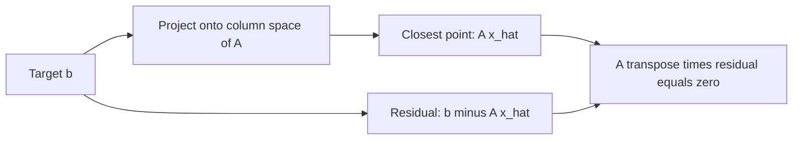
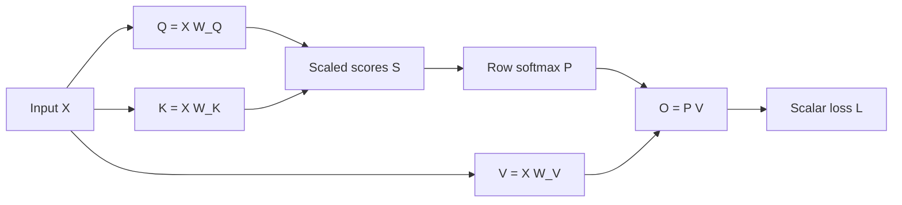
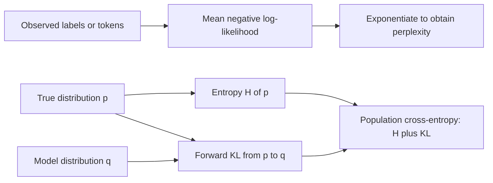
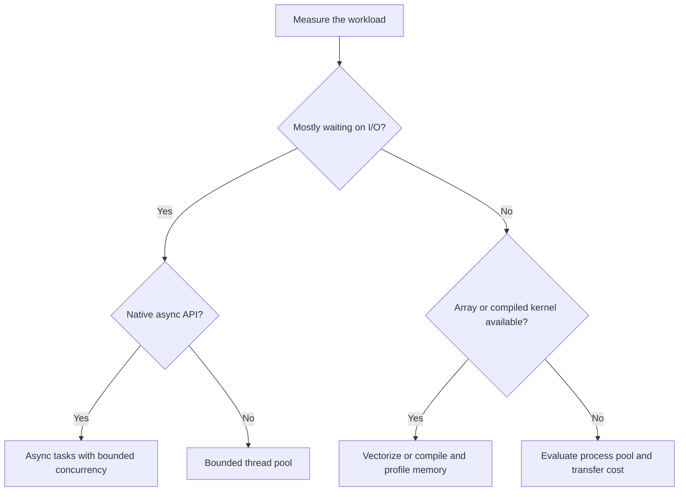

# Branch 1 teaching notes

Read the [overview](index.md) for the eight-hour schedule.
Keep the [problems](problems.md) open separately so you can attempt each derivation before revealing its solution.
These notes use real-valued arrays and natural logarithms unless stated otherwise.
Vectors in derivations are columns; data batches store one example per row.

## Working environment

Use Python 3.12 or 3.13 for the numerical examples.
The concurrency discussion also distinguishes optional free-threaded CPython builds.
Run the snippets as ordinary Python scripts, not inside an already-running notebook event loop.
The examples target NumPy 2.x, Polars 1.x, Numba 0.61 or later compatible with your interpreter, Pydantic 2.x, and pytest 8 or later.
Resolve compatible packages once and retain the generated lockfile for a real project.

```bash
uv init --python 3.12 --bare foundation-lab
cd foundation-lab
uv add 'numpy>=2,<3' 'polars>=1,<2' 'numba>=0.61,<1' 'pydantic>=2,<3'
uv add --dev 'pytest>=8,<10' 'mypy>=1,<2' 'ruff>=0.11,<1'
uv run python -c 'import numpy, polars, numba, pydantic; print(pydantic.__version__)'
```

Expected behavior: package resolution succeeds and the printed Pydantic version starts with `2.`.
This is an environment recipe, not permission to change dependencies in an existing repository without review.
The problems give file names and execution commands for the multi-file examples.

## 1.1 Vector calculus & linear algebra

Allocate three hours to this section and its exercises.
Primary references are [MML](https://mml-book.github.io/), chapters 2–5, and the [Stanford linear algebra review](https://cs229.stanford.edu/section/cs229-linalg.pdf).
The numerical conventions follow NumPy's [SVD reference](https://numpy.org/doc/stable/reference/generated/numpy.linalg.svd.html).

### Vector spaces, span, and rank

A real vector space is a set closed under vector addition and multiplication by real scalars, with the usual algebraic rules.
The space $\mathbb R^d$ is the example used here.
A linear combination of vectors $v_1,\ldots,v_k$ is $\sum_i a_i v_i$.
Their span contains all such combinations.
A basis is a linearly independent spanning set.
The number of basis vectors is the dimension.

For a matrix $A\in\mathbb R^{m\times n}$, the column space contains all vectors $Ax$.
Its dimension is the rank of $A$.
The null space contains all $x$ for which $Ax=0$.
Rank-nullity states that $\operatorname{rank}(A)+\dim\operatorname{null}(A)=n$.
This distinguishes output directions a transformation can express from input directions it discards.

For example, take

$$
A=\begin{bmatrix}1&2\\2&4\end{bmatrix}.
$$

The second column is twice the first.
The rank is one, not two.
The vector $(-2,1)^\top$ lies in the null space because $A(-2,1)^\top=0$.
Every output lies on the line spanned by $(1,2)^\top$.

A small singular value signals a direction that changes the output only weakly.
In floating-point arithmetic, numerical rank depends on a tolerance relative to scale and machine precision.
Do not compare singular values to exact zero in a noisy dataset.
Do not infer rank merely from a square shape.

### Orthogonal projections

The dot product $u^\top v$ measures alignment in Euclidean space.
Two vectors are orthogonal when their dot product is zero.
The Euclidean norm is $\|v\|_2=\sqrt{v^\top v}$.
An orthogonal projection finds the closest vector in a subspace under this norm.

Project $b$ onto the line spanned by nonzero $a$ by minimizing

$$
f(c)=\|b-ca\|_2^2.
$$

Differentiate and set the derivative to zero:

$$
f'(c)=-2a^\top(b-ca)=0,
\qquad
c=\frac{a^\top b}{a^\top a}.
$$

Thus $\hat b=Pb$ with $P=aa^\top/(a^\top a)$.
The residual $r=b-\hat b$ satisfies $a^\top r=0$.
This orthogonality condition is more informative than memorizing the projection formula.

For $a=(1,2)^\top$ and $b=(3,1)^\top$, $a^\top b=5$ and $a^\top a=5$.
The coefficient is one, the projection is $(1,2)^\top$, and the residual is $(2,-1)^\top$.
Check that $(1,2)\cdot(2,-1)=0$.

For a full-column-rank matrix $A$, the normal equations are $A^\top A\hat x=A^\top b$.
In exact arithmetic, the projector is $A(A^\top A)^{-1}A^\top$.
In code, use QR, SVD, or `lstsq` instead of explicitly forming this inverse.
The condition number of $A^\top A$ is the square of that of $A$ for full-column-rank $A$.
This can amplify numerical error.
For rank-deficient $A$, the projector is $AA^+$, where $A^+$ is the Moore–Penrose pseudoinverse.



This diagram represents a geometric decomposition, not two independent optimization runs.
The projected component and residual sum to the target.

### Eigen-decomposition and SVD

An eigenvector $v\ne0$ of a square matrix $A$ satisfies $Av=\lambda v$.
The eigenvalue $\lambda$ is its signed scale factor.
If $A$ has a full basis of eigenvectors, then $A=V\Lambda V^{-1}$.
Not every square matrix has such a basis over the reals.
A real symmetric matrix always has an orthonormal eigenbasis, so $A=Q\Lambda Q^\top$.

For

$$
C=\begin{bmatrix}2&1\\1&2\end{bmatrix},
$$

the normalized eigenvectors are $q_1=(1,1)^\top/\sqrt2$ and $q_2=(1,-1)^\top/\sqrt2$.
Their eigenvalues are 3 and 1.
Check $Cq_1=3q_1$ and $Cq_2=q_2$ directly.
Because both eigenvalues are positive, $C$ is positive definite.

Every real rectangular matrix has a singular value decomposition, or SVD:

$$
A=U\Sigma V^\top.
$$

For the reduced SVD with $k=\min(m,n)$, $U$ has shape $(m,k)$, $\Sigma$ has shape $(k,k)$, and $V^\top$ has shape $(k,n)$.
The columns of $U$ and $V$ are orthonormal.
The singular values are nonnegative and conventionally sorted in descending order.
The nonzero singular values equal the square roots of the nonzero eigenvalues of $A^\top A$.
For a symmetric positive semidefinite matrix such as $C$, its eigenvalues also serve as its singular values.
For a symmetric matrix with negative eigenvalues, singular values are their absolute values, not the signed eigenvalues.

The rank-$r$ truncated SVD keeps the largest $r$ singular values and their vectors.
It minimizes squared reconstruction error in the Frobenius norm among rank-at-most-$r$ matrices.
The squared Frobenius error is $\sum_{i>r}\sigma_i^2$.
This connects low-rank compression to a measurable loss of matrix energy.
Repeated singular values make the corresponding singular vectors nonunique.
Even an isolated singular vector has an arbitrary sign if the paired vector changes sign too.

```python
import numpy as np

a = np.array([[2.0, 1.0], [1.0, 2.0]])
u, s, vt = np.linalg.svd(a, full_matrices=False)
reconstructed = (u * s) @ vt  # Broadcasting scales columns of u.
rank_one = (u[:, :1] * s[:1]) @ vt[:1, :]
assert np.allclose(reconstructed, a)
assert np.allclose(u.T @ u, np.eye(2))
assert np.allclose(vt @ vt.T, np.eye(2))
print(np.round(s, 6))
print(round(float(np.linalg.norm(a - rank_one, ord="fro") ** 2), 6))
```

Expected output is `[3. 1.]` and `1.0`.
Do not compare raw singular vectors against a fixed sign convention.

### Gradients, Jacobians, and Hessians

For a scalar function $f:\mathbb R^n\to\mathbb R$, the gradient is the column vector of first partial derivatives.
It satisfies $df=(\nabla_x f)^\top dx$.
For $f:\mathbb R^n\to\mathbb R^m$, the Jacobian has entries $J_{ij}=\partial f_i/\partial x_j$ and shape $(m,n)$.
The Hessian of a twice-differentiable scalar function has entries $H_{ij}=\partial^2 f/(\partial x_i\partial x_j)$.
When the mixed partial derivatives are continuous, the Hessian is symmetric.

Consider

$$
f(x_1,x_2)=x_1^2+3x_1x_2+2x_2^2.
$$

Then

$$
\nabla f=\begin{bmatrix}2x_1+3x_2\\3x_1+4x_2\end{bmatrix},
\qquad
H=\begin{bmatrix}2&3\\3&4\end{bmatrix}.
$$

At $(1,2)$, the gradient is $(8,11)^\top$.
The Hessian determinant is $8-9=-1$, so the Hessian is indefinite.
Positive coefficients in a polynomial do not guarantee convexity.
The quadratic Taylor approximation is $f(x+\delta)\approx f(x)+\nabla f(x)^\top\delta+\tfrac12\delta^\top H(x)\delta$.
For this quadratic function, the approximation is exact.

### Chain rule in tensor notation

For $y=f(x)$ and $L=g(y)$, the chain rule gives $\nabla_x L=J_f(x)^\top\nabla_y L$.
Reverse-mode differentiation computes this vector-Jacobian product without constructing the whole Jacobian.
For tensors, write explicit indices before relying on compact notation:

$$
\frac{\partial L}{\partial X_{ab}}
=\sum_{i,j}\frac{\partial L}{\partial Y_{ij}}
\frac{\partial Y_{ij}}{\partial X_{ab}}.
$$

The indices $i,j$ are summed.
The free indices $a,b$ identify the output gradient shape.
Every input receives a gradient of the same shape as that input.
If an input affects several outputs, sum all those paths.
Broadcasted inputs also require a sum over the axes introduced by broadcasting.

Use the Frobenius inner product $\langle A,B\rangle_F=\operatorname{tr}(A^\top B)=\sum_{ij}A_{ij}B_{ij}$.
For a scalar loss, define $dL=\langle\nabla_XL,dX\rangle_F$.
This convention makes matrix gradients shape-compatible with the original parameters.
It avoids ambiguous conventions for a derivative of one matrix with respect to another matrix.

### Matrix-derivative identities

The table assumes real arrays, a scalar loss, and the Frobenius convention above.
Here $G$ denotes the upstream gradient with the same shape as the expression's output.
Constants do not depend on the differentiated variable.

| Expression or loss | Gradient or backward identity | Conditions and shapes |
|---|---|---|
| $a^\top x$ | $\nabla_x=a$ | $a,x\in\mathbb R^n$ |
| $x^\top A x$ | $\nabla_x=(A+A^\top)x$ | $A\in\mathbb R^{n\times n}$ |
| $\tfrac12\|X\|_F^2$ | $\nabla_X=X$ | Any matrix shape |
| $\operatorname{tr}(A^\top X)$ | $\nabla_X=A$ | $A$ and $X$ have equal shape |
| $Y=XW$ | $\nabla_WL=X^\top G$; $\nabla_XL=GW^\top$ | $X:(B,D)$, $W:(D,H)$, $G:(B,H)$ |
| $Y=XW+\mathbf1b^\top$ | $\nabla_bL=G^\top\mathbf1$ | $b:(H,)$; reduce the batch axis |
| $\tfrac12\|XW-T\|_F^2$ | $\nabla_W=X^\top(XW-T)$ | Sum loss; divide by $B$ only for a batch mean |
| $y=\operatorname{softmax}(z)$ | $J=\operatorname{diag}(y)-yy^\top$ | One probability vector |
| $L=-\sum_i t_i\log y_i$ | $\nabla_zL=y-t$ | $\sum_i t_i=1$; softmax probabilities |
| $Y=X\odot M$ | $\nabla_XL=G\odot M$ | Fixed equal-shaped mask; $\odot$ is elementwise product |

### Dense-layer backward pass

Let $X\in\mathbb R^{B\times D}$, $W\in\mathbb R^{D\times H}$, and $Y=XW$.
The elementwise definition is $Y_{ij}=\sum_k X_{ik}W_{kj}$.
For $G_{ij}=\partial L/\partial Y_{ij}$,

$$
\frac{\partial L}{\partial W_{ab}}
=\sum_i G_{ib}X_{ia}
=(X^\top G)_{ab}.
$$

Likewise, $\nabla_XL=GW^\top$.
Both formulas follow from summing every path to the loss, not from a rule that all backward passes transpose everything.
A bias vector broadcasts across rows and therefore sums its gradient across rows.
If $G$ already contains the factor $1/B$ from a mean loss, do not divide the parameter gradient by $B$ again.

For $X=[1,2]$, $W=(3,4)^\top$, $Y=11$.
If $L=Y^2/2$, then $G=11$.
The weight gradient is $(11,22)^\top$ and the input gradient is $[33,44]$.
These dimensions provide a quick check before numerical differentiation.

### Softmax and cross-entropy

For logits $z_i$, softmax gives $p_i=e^{z_i}/\sum_j e^{z_j}$.
Its Jacobian follows by the quotient rule:

$$
\frac{\partial p_i}{\partial z_j}=p_i(\delta_{ij}-p_j).
$$

For a target distribution $t$ with $\sum_i t_i=1$,

$$
L=-\sum_i t_i\log p_i
\quad\Longrightarrow\quad
\frac{\partial L}{\partial z_j}
=-\sum_i t_i(\delta_{ij}-p_j)
=p_j-t_j.
$$

The result also covers a one-hot target.
At logits $(0,0)$ and target $(1,0)$, the gradient is $(-1/2,1/2)$.
Increasing the correct class logit decreases the loss.
Adding the same constant to every logit changes neither the probabilities nor the loss.
Accordingly, the components of this gradient sum to zero.

Compute log probabilities as $z_i-\operatorname{logsumexp}(z)$.
Subtracting $\max_i z_i$ before exponentiation prevents overflow.
Computing `log(softmax(z))` directly can still underflow for unlikely classes.
For a batch mean, use $(P-T)/B$.
For masked token losses, divide by the count of included tokens, not by padded sequence length.

### Attention backward shapes

This matrix computation is the scaled dot-product attention you will meet again in Branch 4; here the goal is the gradient bookkeeping.

Use one attention head without batch dimensions:

$$
Q:(n_q,d_k),\quad K:(n_k,d_k),\quad V:(n_k,d_v),
$$

$$
S=QK^\top/\sqrt{d_k},\quad
P=\operatorname{softmax}_{\mathrm{row}}(S),\quad
O=PV.
$$

The scores $S$ and weights $P$ both have shape $(n_q,n_k)$.
The output $O$ has shape $(n_q,d_v)$.
Given upstream $G_O:(n_q,d_v)$, the backward equations are

$$
G_V=P^\top G_O:(n_k,d_v),\qquad
G_P=G_OV^\top:(n_q,n_k),
$$

$$
(G_S)_{ij}=P_{ij}\left((G_P)_{ij}-\sum_\ell P_{i\ell}(G_P)_{i\ell}\right),
$$

$$
G_Q=G_SK/\sqrt{d_k}:(n_q,d_k),\qquad
G_K=G_S^\top Q/\sqrt{d_k}:(n_k,d_k).
$$

The rowwise reduction in $G_S$ is the softmax vector-Jacobian product.
It does not require a four-dimensional Jacobian.
With batched multi-head arrays, preserve the batch and head axes and transpose only the last two axes for matrix products.
An additive fixed mask contributes no trainable gradient.
Masked entries receive zero score gradient in the ideal hard-mask limit.
Never softmax a fully masked row; define how your application handles an empty key set.

For self-attention with $Q=XW_Q$, $K=XW_K$, and $V=XW_V$, compute

$$
G_{W_Q}=X^\top G_Q,\quad
G_{W_K}=X^\top G_K,\quad
G_{W_V}=X^\top G_V,
$$

$$
G_X=G_QW_Q^\top+G_KW_K^\top+G_VW_V^\top.
$$

Sum the three paths because the same $X$ supplies all three projections.
Problem B1 checks the unmasked single-head formulas numerically.



Reverse-mode differentiation follows these arrows backward and sums gradients where paths meet.
The diagram omits positional encodings and output projections because this section studies the core matrix derivatives.

### Common pitfalls

- Treating rank as the number of columns rather than independent columns.
- Using an inverse in least squares when a factorization gives a safer solve.
- Confusing signed eigenvalues with nonnegative singular values.
- Dropping a transpose because a square example hides the shape mismatch.
- Dividing by batch size twice when the upstream gradient already includes a mean.
- Computing the gradient of softmax alone when the loss needs softmax plus cross-entropy.
- Omitting a path when a tensor contributes to several branches of a computation graph.

### Checklist

- [ ] State the column-space dimension and one null-space vector for the rank-one example.
- [ ] Derive projection from a scalar minimization.
- [ ] Explain when eigen-decomposition exists and why SVD is more general.
- [ ] Write gradient, Jacobian, and Hessian shapes without a library.
- [ ] Recover the dense-layer backward equations from indices.
- [ ] Derive $p-t$ and every attention gradient shape.

## 1.2 Probability, statistics & information theory

Allocate two hours to this section and A4–A6.
Use the [Stanford probability review](https://cs229.stanford.edu/section/cs229-prob.pdf), [Murphy's textbook portal](https://probml.github.io/pml-book/), and [Blitzstein and Hwang's book](https://probabilitybook.net/) as the source route.
[MML chapter 6](https://mml-book.github.io/) connects these ideas to the preceding matrix notation.

### Discrete and continuous distributions

A random variable maps an uncertain outcome to a value.
A discrete variable has a probability mass function, or PMF, $p(x)$ with $\sum_x p(x)=1$.
A continuous variable has a probability density function, or PDF, $f(x)$ with $\int f(x)\,dx=1$.
For a continuous variable, probability belongs to intervals: $P(a\le X\le b)=\int_a^b f(x)\,dx$.
A density value can exceed one; an event probability cannot.
The probability of any one point under a continuous density is zero.

A Bernoulli variable takes values zero and one:

$$
p(x\mid\theta)=\theta^x(1-\theta)^{1-x},\qquad0\le\theta\le1.
$$

A categorical variable chooses one of $K$ labels with probabilities $\pi_1,\ldots,\pi_K$ that sum to one.
A Gaussian variable has density

$$
f(x\mid\mu,\sigma^2)=\frac{1}{\sqrt{2\pi\sigma^2}}
\exp\left(-\frac{(x-\mu)^2}{2\sigma^2}\right),\qquad\sigma^2>0.
$$

These are models, not guarantees about real data.
Check whether a Gaussian approximation misses heavy tails or whether a Bernoulli model incorrectly treats correlated events as independent.
Independence means a joint distribution factors into marginal distributions.
Uncorrelated variables need not be independent.
For example, if $X$ is uniform on $[-1,1]$ and $Y=X^2$, then $\operatorname{Cov}(X,Y)=0$ by symmetry, but $Y$ depends completely on $X$.

### Expectation, variance, and covariance

Expectation is a probability-weighted average:

$$
\mathbb E[g(X)]=\sum_x g(x)p(x)
\quad\text{or}\quad
\int g(x)f(x)\,dx.
$$

When the required moments exist,

$$
\operatorname{Var}(X)=\mathbb E[(X-\mu)^2]
=\mathbb E[X^2]-\mu^2,
$$

$$
\operatorname{Cov}(X,Y)=\mathbb E[(X-\mathbb EX)(Y-\mathbb EY)].
$$

For a random column vector $X$, the covariance matrix is $\Sigma=\mathbb E[(X-\mu)(X-\mu)^\top]$.
It is symmetric positive semidefinite because $a^\top\Sigma a=\operatorname{Var}(a^\top X)\ge0$.
Its diagonal contains variances; off-diagonal entries contain covariances.
Covariance depends on measurement units.
Correlation divides by the product of standard deviations when both are nonzero.

For Bernoulli $X$, $X^2=X$.
Therefore $\mathbb EX=\theta$ and $\operatorname{Var}(X)=\theta(1-\theta)$.
At $\theta=0.25$, the variance is $0.1875$.
For independent variables, variances add.
In general, $\operatorname{Var}(X+Y)=\operatorname{Var}(X)+\operatorname{Var}(Y)+2\operatorname{Cov}(X,Y)$.
Ignoring the covariance term can substantially understate uncertainty.

### Likelihood and Bernoulli MLE

The likelihood treats observed data as fixed and parameters as variable.
For independent, identically distributed observations, multiply their probabilities or densities.
Maximum likelihood estimation, or MLE, chooses the parameter that maximizes this product.
Taking a logarithm gives the same maximizer and converts products into sums.

For Bernoulli observations $x_1,\ldots,x_n$, let $s=\sum_i x_i$.
The log-likelihood is

$$
\ell(\theta)=s\log\theta+(n-s)\log(1-\theta).
$$

For $0<s<n$, differentiate:

$$
\ell'(\theta)=\frac{s}{\theta}-\frac{n-s}{1-\theta}=0
\quad\Longrightarrow\quad
\hat\theta_{\mathrm{MLE}}=s/n.
$$

The second derivative is negative in the interior, so the stationary point is a maximum.
With three successes in five observations, the estimate is $3/5=0.6$.
All-zero or all-one data put the maximum at a boundary.
They do not make the general estimation problem undefined.
Use the limiting interpretation $0\log0=0$ in the log-likelihood.

### Bernoulli MAP

Maximum a posteriori estimation, or MAP, maximizes the posterior density.
Bayes' rule gives $p(\theta\mid x)\propto p(x\mid\theta)p(\theta)$.
The prior contributes an explicit assumption about plausible parameter values.
A Beta prior has density proportional to $\theta^{\alpha-1}(1-\theta)^{\beta-1}$.
The posterior is Beta$(s+\alpha,n-s+\beta)$.

For an interior mode,

$$
\hat\theta_{\mathrm{MAP}}
=\frac{s+\alpha-1}{n+\alpha+\beta-2}.
$$

This formula requires both posterior shape parameters to exceed one.
Boundary cases need separate analysis.
For $s=3,n=5,\alpha=\beta=2$, the MAP estimate is $4/7\approx0.571429$.
The posterior mean is instead $(s+\alpha)/(n+\alpha+\beta)=5/9$.
Do not call the posterior mean a MAP estimate.
MAP also depends on parameterization because it maximizes a density, not probability mass at a point.

### Gaussian MLE

For independent Gaussian observations with unknown mean and variance,

$$
\ell(\mu,\sigma^2)
=-\frac n2\log(2\pi\sigma^2)
-\frac{1}{2\sigma^2}\sum_i(x_i-\mu)^2.
$$

Differentiate with respect to $\mu$:

$$
\frac{\partial\ell}{\partial\mu}
=\frac{1}{\sigma^2}\sum_i(x_i-\mu)=0
\quad\Longrightarrow\quad
\hat\mu=\bar x.
$$

Let $v=\sigma^2$ and differentiate with respect to $v$:

$$
\frac{\partial\ell}{\partial v}
=-\frac{n}{2v}+\frac{\sum_i(x_i-\mu)^2}{2v^2}=0.
$$

Substituting $\hat\mu$ gives $\hat\sigma^2_{\mathrm{MLE}}=\sum_i(x_i-\bar x)^2/n$.
For data $(1,2,3)$, the mean is 2 and the variance MLE is $2/3$.
The unbiased sample variance uses $n-1$ instead and equals 1 for these data.
Unbiasedness and maximum likelihood are different criteria.
If all observations are identical, the Gaussian likelihood has no finite interior variance maximizer: it grows without bound as the variance approaches zero.

### Gaussian MAP with a known observation variance

Assume $x_i\mid\mu\sim\mathcal N(\mu,\sigma^2)$ with known $\sigma^2$.
Choose a Gaussian prior $\mu\sim\mathcal N(\mu_0,\tau^2)$ with $\tau^2>0$.
The log-posterior, up to constants, is

$$
-\frac{1}{2\sigma^2}\sum_i(x_i-\mu)^2
-\frac{1}{2\tau^2}(\mu-\mu_0)^2.
$$

Differentiate and collect the coefficients of $\mu$:

$$
\frac{n\bar x}{\sigma^2}+\frac{\mu_0}{\tau^2}
-\mu\left(\frac n{\sigma^2}+\frac1{\tau^2}\right)=0.
$$

Thus

$$
\hat\mu_{\mathrm{MAP}}
=\frac{n\bar x/\sigma^2+\mu_0/\tau^2}{n/\sigma^2+1/\tau^2}.
$$

The estimate is a precision-weighted average; precision means inverse variance.
For $(1,2,3)$, known $\sigma^2=1$, $\mu_0=0$, and $\tau^2=1$, it equals $6/4=1.5$.
The posterior is Gaussian with variance $1/(n/\sigma^2+1/\tau^2)=1/4$.
Here its mean and mode coincide.
This derivation does not estimate an unknown variance and does not silently substitute its MLE.

### Entropy, cross-entropy, and KL divergence

For a discrete distribution $p$, Shannon entropy measures average surprise under that distribution:

$$
H(p)=-\sum_x p(x)\log p(x).
$$

Natural logarithms measure entropy in nats.
Base-two logarithms measure entropy in bits.
The entropy of a fair binary outcome is $\log2\approx0.693147$ nats, or one bit.
The entropy of a deterministic outcome is zero.
For continuous variables, differential entropy uses a density integral and can be negative; do not transfer discrete entropy intuition without this qualification.

Cross-entropy evaluates a predictive distribution $q$ when outcomes follow $p$:

$$
H(p,q)=-\sum_x p(x)\log q(x).
$$

The Kullback–Leibler divergence, or KL divergence, is

$$
D_{\mathrm{KL}}(p\|q)=\sum_x p(x)\log\frac{p(x)}{q(x)}.
$$

It is nonnegative and generally asymmetric.
If $p(x)>0$ but $q(x)=0$, the divergence and cross-entropy are infinite.
For finite sums with compatible support, expand the logarithm:

$$
D_{\mathrm{KL}}(p\|q)
=\sum_xp(x)\log p(x)-\sum_xp(x)\log q(x)
=-H(p)+H(p,q).
$$

Therefore

$$
\boxed{H(p,q)=H(p)+D_{\mathrm{KL}}(p\|q)}.
$$

For fixed data distribution $p$, reducing cross-entropy also reduces this forward KL divergence.
The irreducible term $H(p)$ does not depend on the model parameters.
Finite-sample empirical cross-entropy estimates the population quantity; it is not automatically the population value.
In supervised classification, the target distribution for one labeled example is often one-hot.
Its cross-entropy is the negative log-probability of the correct label.

For $p=(0.5,0.5)$ and $q=(0.75,0.25)$,

$$
H(p)=0.693147,\qquad
H(p,q)=-\tfrac12\log(0.75)-\tfrac12\log(0.25)=0.836988,
$$

$$
D_{\mathrm{KL}}(p\|q)=0.143841.
$$

The two right-hand terms sum to $0.836988$ after rounding.
Reversing the distributions gives a different divergence.



The diagram distinguishes a finite-sample average from its population expectation.
Both use the same negative-log-probability quantity at different levels of averaging.

### Negative log-likelihood and perplexity

For observed tokens $x_1,\ldots,x_T$ and an autoregressive model,

$$
\mathrm{NLL}=-\sum_{t=1}^T\log q(x_t\mid x_{<t}),
\qquad
\overline{\mathrm{NLL}}=\mathrm{NLL}/T.
$$

The probability of the whole sequence is the product of the conditional token probabilities.
Its inverse geometric mean gives perplexity:

$$
\operatorname{PPL}
=\left(\prod_{t=1}^Tq(x_t\mid x_{<t})\right)^{-1/T}
=\exp\left(-\frac1T\sum_t\log q(x_t\mid x_{<t})\right)
=\boxed{\exp(\overline{\mathrm{NLL}})}.
$$

With base-two log loss, use $2^{\overline{\mathrm{NLL}}}$ instead.
A model assigning probability $1/K$ to every observed token has perplexity $K$.
Perplexity is an effective uncertainty scale, not a literal count of candidate words in every context.
Compare values only with the same tokenizer, test data, context policy, and masking convention.
Average losses by token count before exponentiating; do not average sequence perplexities with unequal lengths.

```python
import numpy as np

observed_probabilities = np.array([0.5, 0.25, 0.125], dtype=np.float64)
mean_nll = -np.log(observed_probabilities).mean()
perplexity = np.exp(mean_nll)
assert np.isclose(perplexity, 4.0)
print(f"mean NLL={mean_nll:.6f}; perplexity={perplexity:.6f}")
```

Expected output is `mean NLL=1.386294; perplexity=4.000000`.
The product of the three probabilities is $1/64$, whose inverse cube root is 4.

### Common pitfalls

- Treating a probability density as a probability at a point.
- Assuming zero covariance implies independence.
- Using $n-1$ while claiming to compute the Gaussian variance MLE.
- Calling every Bayesian point estimate a MAP estimate.
- Applying the Beta mode formula without checking the boundary conditions.
- Mixing bits and nats in one perplexity calculation.
- Comparing perplexities across incompatible tokenizers or averaging schemes.

### Checklist

- [ ] Distinguish a PMF, PDF, likelihood, and posterior.
- [ ] Compute a covariance term and explain its sign.
- [ ] Derive Bernoulli MLE and Beta-prior MAP from log objectives.
- [ ] Derive Gaussian mean and variance MLEs, then a known-variance mean MAP.
- [ ] Derive the cross-entropy decomposition with the correct KL direction.
- [ ] Recover perplexity from a sequence's conditional probabilities.

## 1.3 High-performance Python & software engineering

Allocate three hours to this section and B2–B4.
Use the official documentation linked below to resolve exact APIs.
[Fluent Python](https://www.fluentpython.com/) provides additional background on Python's execution model.
Choose a correct implementation first, measure it second, and optimize only a demonstrated bottleneck.

### Concurrency, parallelism, and the GIL

Concurrency lets tasks make progress during overlapping time intervals.
Parallelism executes work at the same instant on separate execution resources.
An event loop can provide concurrency on one thread without CPU parallelism.
An I/O-bound task spends much of its time waiting for a network, disk, or other external operation.
A CPU-bound task spends most of its time computing.
Measure the actual workload; an endpoint can contain both kinds of work.

In a conventional GIL-enabled CPython interpreter, the global interpreter lock, or GIL, permits only one thread at a time to execute Python bytecode in that interpreter.
Threads still overlap many blocking I/O operations because those operations release the GIL.
Some numerical extension kernels release it while executing native code.
This does not mean that every NumPy operation releases it or that shared array mutations are safe.
Optional free-threaded CPython builds can disable the GIL, subject to extension compatibility and build configuration.
Do not infer interpreter behavior merely from the Python version number.
The [threading documentation](https://docs.python.org/3/library/threading.html) states these qualifications.

| Mechanism | Useful workload | Main constraint |
|---|---|---|
| `asyncio` | Many cooperative asynchronous I/O operations | Blocking code stalls the loop until it yields |
| Thread pool | Blocking I/O; native kernels that release the GIL | Shared-state races; no general pure-Python CPU speedup on a GIL build |
| Process pool | Independent pure-Python CPU tasks | Serialization, startup cost, separate memory, platform entry-point rules |
| Vectorized or compiled kernel | Numeric array work | Temporary memory, data movement, compilation or native-thread overhead |

### Asyncio and blocking adapters

[Asyncio](https://docs.python.org/3/library/asyncio.html) uses cooperative scheduling.
Calling an `async def` function creates a coroutine; it does not complete that coroutine immediately.
An `await` on a pending asynchronous operation yields control so other tasks can run.
`await` does not make arbitrary CPU work nonblocking.
Use a semaphore to bound expensive requests and a timeout to bound waiting.

```python
import asyncio
import time


def blocking_read(item: int) -> int:
    time.sleep(0.02)  # Simulate a blocking I/O library.
    return item * 2


async def main() -> None:
    limit = asyncio.Semaphore(2)

    async def read_one(item: int) -> int:
        async with limit:
            return await asyncio.to_thread(blocking_read, item)

    async with asyncio.timeout(2.0):
        results = await asyncio.gather(*(read_one(i) for i in range(4)))
    print(results)


if __name__ == "__main__":
    asyncio.run(main())
```

Expected output is `[0, 2, 4, 6]`.
The semaphore limits concurrent submissions inside its scope to two.
`gather` returns results in input order, not completion order.
`to_thread` adapts a blocking function; it does not turn pure-Python computation into parallel bytecode execution on a GIL build.
Cancellation of the awaiting coroutine does not forcibly terminate a running worker thread.
Set timeouts in the underlying I/O library too.
Never call `time.sleep` directly inside a latency-sensitive coroutine.

### Threads, processes, and bounded work

Use [concurrent.futures](https://docs.python.org/3/library/concurrent.futures.html) when a synchronous API fits the application.
Thread workers share process memory, so protect invariants with locks or avoid shared mutation.
The GIL does not make multi-step updates atomic as an application contract.
Process workers use separate address spaces and need serializable arguments and results.
Define worker functions at module scope and protect the entry point with `if __name__ == "__main__"`.



This decision tree is a starting hypothesis, not a benchmark result.
Processes can lose to sequential execution on tiny tasks because serialization and startup dominate.
Avoid launching one worker per input row.
Batch small tasks and cap the number of in-flight jobs.
Also account for native BLAS or Polars thread pools so application workers do not oversubscribe the machine.

### Vectorization and memory layout

Vectorization expresses operations over arrays instead of dispatching a Python operation for each element.
It often reduces interpreter overhead, but it can allocate large temporary arrays.
For a contiguous float64 array of shape $(N,D)$, the data payload is $8ND$ bytes.
One million rows and 128 columns require $1{,}024{,}000{,}000$ bytes, about $0.954$ GiB, before metadata or temporaries.
Two equally sized temporaries can add almost another $1.91$ GiB.
For large jobs, memory bandwidth rather than arithmetic can limit throughput.

A NumPy view shares an underlying buffer.
Basic slicing typically creates views; advanced indexing typically creates copies.
Use `np.shares_memory` when aliasing matters.
`reshape` can return a view or a copy depending on the layout.
`array.nbytes` counts the logical array payload, not unique process memory owned by that array.
A small slice can keep a large base allocation alive.
Read the [copies and views guide](https://numpy.org/doc/stable/user/basics.copies.html) before changing code that mutates arrays in place.

```python
import numpy as np

x = np.arange(12, dtype=np.float64).reshape(3, 4)
view = x[:, :2]
copy = x[:, [0, 1]]
print(x.nbytes, view.nbytes, copy.nbytes)
print(np.shares_memory(x, view), np.shares_memory(x, copy))
view[0, 0] = -1.0
assert x[0, 0] == -1.0
assert copy[0, 0] == 0.0
```

Expected output is `96 48 48`, followed by `True False`.
Both subsets expose 48 bytes, but only one aliases `x`.
Do not sum their `nbytes` values and claim that sum is the process resident memory.

### Memory profiling and Numba

Use `perf_counter` for elapsed wall time and repeat representative runs.
Warm up a just-in-time compiled function before comparing steady-state timings.
Numba's `@njit` compiles supported numerical Python to native machine code.
It can fuse a reduction into one loop without constructing full-size intermediate arrays.
It is not a compiler for arbitrary Python services or Pydantic models.
The [Numba performance tips](https://numba.readthedocs.io/en/stable/user/performance-tips.html) explain supported execution patterns and numerical tradeoffs.

```python
from time import perf_counter
import tracemalloc

import numpy as np
from numba import njit


@njit
def squared_norm(x: np.ndarray) -> float:
    total = 0.0
    for value in x:
        total += value * value
    return total


x = np.arange(100_000, dtype=np.float64) / 100_000
_ = squared_norm(x)  # Compile before measurement.
tracemalloc.start()
started = perf_counter()
actual = squared_norm(x)
elapsed = perf_counter() - started
_, peak = tracemalloc.get_traced_memory()
tracemalloc.stop()
expected = np.dot(x, x)
assert np.isclose(actual, expected)
print(f"value={actual:.6f}; payload={x.nbytes} bytes")
print(f"elapsed={elapsed:.6f}s; traced peak={peak} bytes")
```

The first line reports `value=33332.833335; payload=800000 bytes`.
Timing and traced peak vary by system.
[Tracemalloc](https://docs.python.org/3/library/tracemalloc.html) measures allocations registered with Python's tracing machinery.
Some native allocations do not appear there, and the input above exists before tracing starts.
Measure process resident memory separately for a deployment capacity estimate.
Keep the payload calculation as an independent lower-bound check, not a substitute for a process measurement.
Do not enable `fastmath=True` without deciding whether relaxed floating-point semantics preserve your contract.

### Polars expressions and lazy execution

Polars stores typed columnar data and runs expressions in native kernels.
A lazy query builds a plan before executing it.
The optimizer can push filters and column selections closer to a scan so less data reaches later operators.
Use expressions instead of per-row Python callbacks when an expression exists.
See the [Polars documentation](https://docs.pola.rs/) for the lazy API and query plans.

```python
import polars as pl

frame = pl.DataFrame({"tokens": [10, 30, 20], "seconds": [1.0, 2.0, 0.0]})
query = (
    frame.lazy()
    .filter(pl.col("seconds") > 0)
    .with_columns((pl.col("tokens") / pl.col("seconds")).alias("tokens_per_second"))
    .select("tokens_per_second")
)
result = query.collect()
print(result["tokens_per_second"].to_list())
assert result["tokens_per_second"].to_list() == [10.0, 15.0]
```

Expected output is `[10.0, 15.0]`.
The zero-duration row is excluded by the data policy rather than converted silently to an infinite rate.
For disk data, start with a lazy scan rather than reading the full dataset eagerly and then calling `.lazy()`.
The in-memory example teaches the expression API but does not demonstrate reduced disk I/O.

### Clean architecture and typing

Clean architecture separates domain computation from external interfaces.
The inner numerical function should not know whether a request arrives through HTTP, a notebook, or a batch job.
Boundary code validates untrusted input and converts it into the types the inner function expects.
An adapter translates an external system's interface to your application interface.
Use a small function or protocol when it clarifies an actual boundary; do not build a framework for a three-line calculation.

For a prediction service, the outer layer parses JSON and validates it.
The application layer chooses the model and calls the numerical kernel.
The kernel receives arrays and returns a value.
Infrastructure code loads artifacts, records metrics, and performs I/O.
Dependency direction should keep the kernel independent of the web framework and artifact store.
Problem B4 demonstrates the boundary-to-kernel seam without requiring a service framework.

Type hints document interfaces and let a static checker catch many incompatible calls.
Python does not enforce annotations at runtime.
`list[float]` also does not prove that values are finite or that a list has a required length.
Array annotations usually do not prove all runtime dimensions.
Use runtime validation for untrusted values and explicit shape checks for numerical contracts.
Keep exceptions meaningful at the boundary so invalid data does not become a misleading prediction.

### Pydantic v2 and pytest

[Pydantic v2](https://docs.pydantic.dev/latest/) validates input against declared model fields.
Use `model_validate` to parse a mapping and `model_dump` to serialize a model.
Use `field_validator` for field-specific rules.
Use `ConfigDict` for model configuration.
Do not teach the v1 `.parse_obj()` and `.dict()` APIs as the preferred v2 interfaces.
Pydantic can coerce types by default, so make strictness and accepted inputs deliberate.
Use `extra="forbid"` when unknown fields indicate an invalid request rather than harmless metadata.

```python
from pydantic import BaseModel, ConfigDict, Field, ValidationError


class GenerationConfig(BaseModel):
    model_config = ConfigDict(extra="forbid", strict=True)
    max_tokens: int = Field(ge=1, le=4096)
    temperature: float = Field(ge=0.0, le=2.0, allow_inf_nan=False)


config = GenerationConfig.model_validate({"max_tokens": 32, "temperature": 0.2})
print(config.model_dump())
try:
    GenerationConfig.model_validate({"max_tokens": "32", "temperature": 0.2})
except ValidationError:
    print("Rejected a string token count")
else:
    raise AssertionError("Strict validation must reject this input")
```

Expected output is `{'max_tokens': 32, 'temperature': 0.2}`, followed by `Rejected a string token count`.
Validation is not authorization, prompt safety, or proof that a model prediction is useful.
Validate configuration once at the boundary rather than rebuilding models inside a numeric inner loop.

[Pytest](https://docs.pytest.org/en/stable/) discovers test functions in test files.
Use assertions on public outputs and exceptions, not private implementation details.
Use fixtures to create reusable inputs or temporary resources with a clear lifetime.
Use `pytest.approx` for floating-point comparisons and `pytest.raises` for rejected input.
Control random seeds when randomness belongs to the test setup, but do not claim one seed proves robustness.
Problem B4 includes the requested complete contract exercise and its expected pytest result.

### CI/CD for ML with GitHub Actions

Continuous integration, or CI, runs automated checks on a proposed change.
Continuous delivery keeps a checked artifact ready for release.
Continuous deployment also promotes it automatically according to an explicit policy.
For ML, code correctness and model quality are different gates.
A green unit-test run does not show that a model preserves quality, privacy, latency, or training-data provenance.
Keep evaluation datasets separate from training inputs and record artifact hashes, package versions, and evaluation settings.

Use [GitHub Actions](https://docs.github.com/en/actions) to run a reproducible check job.
This workflow assumes the project root contains the `pyproject.toml` and committed `uv.lock` created during setup.
It also assumes you save B4's files at the root and run the other code exercises manually or add them to your own project later.
The code below is an instructional configuration, not a deployment workflow.

```yaml
name: Check numerical contracts
on: [push, pull_request]
permissions:
  contents: read
jobs:
  check:
    runs-on: ubuntu-latest
    steps:
      - uses: actions/checkout@v4
      - uses: astral-sh/setup-uv@v6
        with:
          version: "0.9.3"
      - run: uv sync --locked --python 3.12
      - run: uv run ruff check prediction.py test_prediction.py
      - run: uv run mypy prediction.py test_prediction.py
      - run: uv run pytest -q
```

Save this example as `.github/workflows/check.yml` in your lab, not inside the syllabus source tree.
The major action tags are readable teaching defaults.
Pin action commit hashes and review updates in a hardened production workflow.
Use least-privilege permissions and never expose deployment credentials to untrusted pull-request code.
Do not run untrusted code with `pull_request_target` and elevated secrets.
Keep production deployment in a separately authorized job or workflow with environment protection.

For a real model release, promote an immutable artifact rather than retraining implicitly during deployment.
Require evaluation thresholds, schema compatibility, a rollback target, and an owner for failed monitoring alerts.
Record a baseline before evaluating a candidate so thresholds represent a decision rather than a retrospective explanation.
The eight-hour lab stops at verified computation and CI; later branches develop model-serving gates.

### Common pitfalls

- Equating asynchronous syntax with CPU parallelism.
- Assuming the GIL prevents application races or exists in every CPython build.
- Benchmarking Numba compilation against warmed NumPy execution.
- Claiming a speedup from one timing sample or from a different input size.
- Counting a view as an independent allocation when interpreting `nbytes`.
- Treating tracemalloc as a complete measurement of native process memory.
- Sending a large array to every process when transfer cost exceeds computation.
- Assuming type hints validate JSON at runtime.
- Deploying a model solely because a code-only CI job passes.

### Checklist

- [ ] Choose asyncio, a thread pool, a process pool, or a numerical kernel for a measured workload.
- [ ] Explain how cancellation differs from forcibly stopping a running thread.
- [ ] Distinguish a NumPy view from a copy and compute float64 payload bytes.
- [ ] Warm up Numba and compare all implementations on identical data.
- [ ] Express a Polars transformation without a Python row callback.
- [ ] Keep input validation outside the numerical kernel.
- [ ] Reject malformed input with Pydantic v2 and run the public-contract pytest checks.
- [ ] Separate code verification from model-release approval.

Return to the [exit criteria](index.md#exit-criteria) after completing the [practice set](problems.md).
