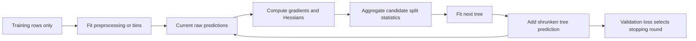
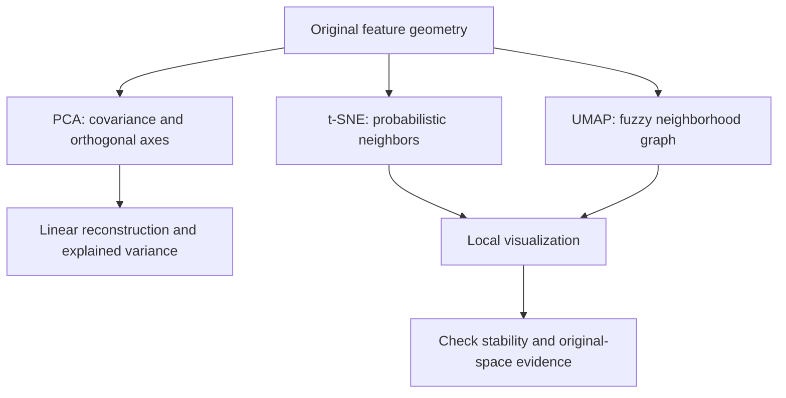
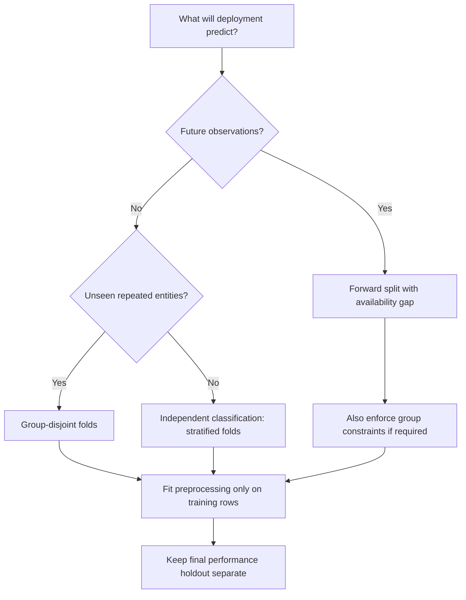

# Branch 2 notes — Classical statistical and machine learning

Use these notes with the [seven-hour schedule](index.md#session-schedule).
Attempt the [problems](problems.md) before opening their solutions.
The aim is a defensible baseline, not an exhaustive survey of every estimator.
Each method makes assumptions about geometry, noise, or sampling.
State those assumptions before you compare scores.

## Notation and execution

Let $X\in\mathbb R^{n\times d}$ contain one observation per row.
Let $x_i\in\mathbb R^d$ be a column vector for observation $i$.
Let $y\in\mathbb R^n$ hold regression targets or binary labels in $\{0,1\}$.
Use $w\in\mathbb R^d$ for coefficients and $b$ for an intercept.
Define the score $z_i=x_i^Tw+b$.
Use $\lambda\geq0$ for regularization strength unless a library names it differently.

All Python blocks in these notes are independent programs.
They generate their own small datasets and require no downloaded data.
Use Python 3.11 or later, NumPy, scikit-learn 1.6 or later, and XGBoost 2.1 or later.
The examples use the maintained estimator interfaces, including estimator-level XGBoost early stopping.
The UMAP discussion is conceptual and adds no runtime dependency.

Run snippets in an isolated environment with `uv run --with numpy --with scikit-learn --with xgboost python example.py`.
Record your resolved versions when you reproduce results.
Exact fitted coefficients can change slightly with numerical libraries.
Shapes, split invariants, and hand-computed examples do not depend on a random training outcome.

## 2.1 Supervised and unsupervised algorithms

Supervised learning estimates a relationship between features and observed targets.
Unsupervised learning describes feature structure without a target.
Neither setting removes the need for held-out evaluation.
For an embedding or clustering system, define the downstream criterion before choosing a visualization you like.

### Generalized linear models

A generalized linear model, or GLM, combines a response distribution from the exponential family with a linear predictor and a link function.
The link maps the conditional mean to $x^Tw+b$.
Gaussian regression with an identity link and Bernoulli regression with a logit link are the examples here.
Ridge, Lasso, and ElasticNet are penalties on a linear-model objective, not separate response distributions.
Their squared-loss forms are penalized Gaussian GLMs.

Primary references: [ISLP](https://www.statlearning.com/), [CS229](https://cs229.stanford.edu/), and [scikit-learn linear models](https://scikit-learn.org/stable/modules/linear_model.html).

#### Squared loss and Ridge

Center $X$ and $y$ first so the intercept separates from the coefficient calculation.
For uncentered data, use $b=\bar y-\bar x^Tw$ and leave $b$ unpenalized.
Define the Ridge objective as

$$
J(w)=\frac12\|Xw-y\|_2^2+\frac\lambda2\|w\|_2^2.
$$

Differentiate the residual sum using the chain rule:

$$
\nabla_w J=X^T(Xw-y)+\lambda w.
$$

Setting this gradient to zero gives

$$
(X^TX+\lambda I)\hat w=X^Ty,
\qquad
\hat w=(X^TX+\lambda I)^{-1}X^Ty.
$$

The inverse notation expresses the mathematics.
Use a linear solver, not an explicit inverse, in code.
For $\lambda>0$, the coefficient matrix is positive definite even when $X$ is rank-deficient.
At $\lambda=0$, a unique ordinary least-squares coefficient vector requires full column rank.
Use a pseudoinverse or least-squares solver otherwise.

For a one-feature example, take $x=(1,2)^T$, $y=(1,2)^T$, no intercept, and $\lambda=1$.
Then $X^TX=5$ and $X^Ty=5$.
The coefficient is $5/(5+1)=5/6$ rather than the unregularized value $1$.
The fitted values are $(5/6,5/3)$.
This is shrinkage toward zero, not a guarantee of lower test error on every dataset.

Library normalization matters.
`Ridge(alpha=a)` minimizes $\|Xw-y\|^2+a\|w\|^2$, so its `alpha` equals $\lambda$ in the objective above.
If you instead divide the data-fit term by $n$, multiply the corresponding Ridge library penalty by $n$ to keep the same optimum.
Always write the exact objective before comparing regularization values across estimators.

#### Lasso and ElasticNet

Use the normalized Lasso objective

$$
J_{\mathrm{Lasso}}(w)=\frac1{2n}\|Xw-y\|^2+\alpha\|w\|_1.
$$

For $w_j\neq0$, a subgradient of the penalty is $\alpha\operatorname{sign}(w_j)$.
At $w_j=0$, the subgradient is any value in $[-\alpha,\alpha]$.
Thus the stationarity condition is

$$
0\in\frac1nX^T(Xw-y)+\alpha\partial\|w\|_1.
$$

The interval at zero allows an exactly zero optimum.
There is no general matrix-inverse closed form for correlated features.
Coordinate descent solves one coefficient at a time.
For orthonormal columns with $X^TX/n=I$, let $z=X^Ty/n$.
Each optimum is the soft-thresholded value

$$
\hat w_j=\operatorname{sign}(z_j)\max(|z_j|-\alpha,0).
$$

For $z=(0.2,1.4)$ and $\alpha=0.5$, the solution is $(0,0.9)$.
You cannot apply this componentwise formula to an arbitrary correlated design.

ElasticNet mixes the two penalties:

$$
J_{\mathrm{EN}}(w)=\frac1{2n}\|Xw-y\|^2
+\alpha\rho\|w\|_1+\frac{\alpha(1-\rho)}2\|w\|_2^2,
\quad 0\leq\rho\leq1.
$$

Its stationarity condition adds $\alpha(1-\rho)w$ to the smooth gradient and $\alpha\rho\partial\|w\|_1$ to the subgradient.
In scikit-learn, `l1_ratio` is $\rho$.
ElasticNet often retains correlated feature groups more stably than pure Lasso.
Feature scaling remains necessary because the penalty acts on coefficient magnitudes, which depend on measurement units.

#### Logistic regression

For binary labels, define $p_i=\sigma(z_i)=1/(1+e^{-z_i})$.
The logit link is $\log(p_i/(1-p_i))=z_i$.
Minimize mean negative log likelihood, optionally with an L2 penalty:

$$
J(w,b)=-\frac1n\sum_i[y_i\log p_i+(1-y_i)\log(1-p_i)]
+\frac\lambda2\|w\|^2.
$$

For one observation, differentiating with respect to $p_i$ gives

$$
\frac{\partial\ell_i}{\partial p_i}
=-\frac{y_i}{p_i}+\frac{1-y_i}{1-p_i}.
$$

Multiply by $\partial p_i/\partial z_i=p_i(1-p_i)$ to obtain $\partial\ell_i/\partial z_i=p_i-y_i$.
Apply the linear predictor derivative to get

$$
\nabla_wJ=\frac1nX^T(p-y)+\lambda w,
\qquad
\frac{\partial J}{\partial b}=\frac1n\sum_i(p_i-y_i).
$$

The Hessian in $w$ is

$$
H=\frac1nX^TWX+\lambda I,
\qquad W_{ii}=p_i(1-p_i)\geq0.
$$

The objective is convex but has no general algebraic closed-form optimum.
Newton methods, quasi-Newton methods, or gradient methods solve it numerically.
With perfectly separable data and no penalty, finite maximum-likelihood coefficients need not exist.
A probability score and a decision threshold are separate objects.
Do not tune the threshold using the final test labels.

For $x=(1,2)$, $y=(0,1)$, and $w=b=0$, both probabilities equal $0.5$.
The scalar mean gradient is $[1(0.5)+2(-0.5)]/2=-0.25$.
The intercept gradient is zero.
One gradient step with learning rate $0.4$ gives $w=0.1$.
The model increases the score more for the positive observation because its feature value is larger.

#### Runnable example 1: leakage-safe linear baseline

```python
import numpy as np
from sklearn.datasets import make_regression
from sklearn.impute import SimpleImputer
from sklearn.linear_model import Ridge
from sklearn.model_selection import KFold, cross_val_score
from sklearn.pipeline import make_pipeline
from sklearn.preprocessing import StandardScaler

X, y = make_regression(n_samples=150, n_features=6, noise=8, random_state=7)
X[::13, 0] = np.nan
model = make_pipeline(
    SimpleImputer(strategy="median"),
    StandardScaler(),
    Ridge(alpha=1.0),
)
cv = KFold(n_splits=5, shuffle=True, random_state=7)
mse = -cross_val_score(model, X, y, cv=cv, scoring="neg_mean_squared_error")
print(mse.shape, np.isfinite(mse).all())
# Expected: (5,) True
```

The imputer and scaler fit separately inside each training fold.
The validation fold does not determine its own median or scaling statistics.
Use plain shuffled K-fold only when observations behave like independent samples from the target population.

### Tree ensembles

A decision tree recursively partitions feature space into leaves.
A classification leaf estimates a class distribution; a regression leaf predicts a constant.
Trees do not require feature standardization for axis-aligned threshold splits.
They do require careful control of depth, leaf size, and validation leakage.

Primary references: [ISLP](https://www.statlearning.com/), [XGBoost](https://xgboost.readthedocs.io/en/stable/tutorials/model.html), [LightGBM](https://lightgbm.readthedocs.io/en/stable/Features.html), and [CatBoost](https://catboost.ai/docs/en/concepts/algorithm-main-stages).

#### Split finding and impurity

For class probabilities $p_1,\ldots,p_K$ in a node, define Gini impurity and entropy as

$$
I_G=1-\sum_k p_k^2,
\qquad
I_H=-\sum_k p_k\log_2p_k,
$$

with $0\log 0=0$.
For a parent with $N$ rows, the split improvement is

$$
\Delta I=I(\text{parent})-\frac{N_L}{N}I(L)-\frac{N_R}{N}I(R).
$$

Exact split search sorts feature values and checks boundaries between distinct values.
For continuous features, midpoint thresholds represent those boundaries.
For squared-error regression, the improvement uses reductions in residual sums of squares instead of class impurity.

Suppose a parent contains four positives and four negatives.
A split creates a pure left child with four positives and a pure right child with four negatives.
The parent Gini impurity is $1-0.5^2-0.5^2=0.5$.
Both child impurities are zero, so the Gini gain is $0.5$.
The entropy gain is one bit.
This training gain says nothing by itself about generalization.

#### Random Forests

A Random Forest fits many randomized trees and aggregates them.
Each tree commonly uses a bootstrap sample: sample $n$ training rows with replacement.
At each split, it considers a random subset of features.
These two randomizations reduce correlation among trees.
Classification averages tree class probabilities before the final class decision in scikit-learn.
Regression averages numeric predictions.

If individual tree predictions have variance $\sigma^2$ and equal pairwise correlation $\rho$, the variance of their average is

$$
\operatorname{Var}\left(\frac1B\sum_bT_b\right)
=\sigma^2\left(\rho+\frac{1-\rho}{B}\right).
$$

More trees reduce the uncorrelated part but do not remove the correlation floor.
Out-of-bag evaluation uses rows absent from a tree's bootstrap sample.
It is useful for approximately independent rows, but it does not repair temporal or patient-level leakage.
Permutation importance on an appropriate held-out set is usually easier to interpret than raw impurity importance.
Correlated features can still divide or mask permutation importance.

#### Gradient boosted decision trees

Boosting adds weak trees sequentially:

$$
F_m(x)=F_{m-1}(x)+\eta f_m(x).
$$

The shrinkage factor $\eta$ is a learning rate.
For squared loss, the negative gradient is the residual $y-F_{m-1}(x)$.
For other losses, fit a tree to a gradient-derived target or score its leaves using derivatives.
Unlike a forest, a boosted ensemble depends on the order of its fitted trees.

XGBoost uses a second-order Taylor approximation around the current prediction.
For observation $i$, let

$$
g_i=\partial_{F_i}\ell(y_i,F_i),\qquad
h_i=\partial^2_{F_i}\ell(y_i,F_i).
$$

For a candidate leaf $j$, define $G_j=\sum_{i\in j}g_i$ and $H_j=\sum_{i\in j}h_i$.
With an L2 leaf penalty $\lambda$ and a per-leaf cost $\gamma$, the local objective is

$$
\widetilde J=\sum_j\left[G_jw_j+\frac12(H_j+\lambda)w_j^2\right]+\gamma T.
$$

Differentiate in $w_j$ to obtain $w_j^*=-G_j/(H_j+\lambda)$.
The gain from splitting one parent into two leaves is

$$
\operatorname{Gain}=\frac12\left[
\frac{G_L^2}{H_L+\lambda}+\frac{G_R^2}{H_R+\lambda}
-\frac{(G_L+G_R)^2}{H_L+H_R+\lambda}\right]-\gamma.
$$

For binary logistic loss using raw margins, $g_i=p_i-y_i$ and $h_i=p_i(1-p_i)$.
These derivatives are with respect to the raw score, not the probability.
The formula above omits optional L1 leaf penalties and implementation constraints.
Libraries can reject a positive-gain split if it violates a minimum-child condition.

#### Histogram binning and library differences

Histogram algorithms replace many distinct continuous values with a limited set of bins.
They accumulate gradient and Hessian sums per bin, then scan bin boundaries for gain.
This reduces candidate thresholds and memory traffic.
The approximation trades threshold resolution for speed.
Learn bin boundaries from training data, not from a final holdout you intend to evaluate independently.

| Library | Split and growth emphasis | Categorical handling | Practical constraint |
|---|---|---|---|
| XGBoost | Exact, approximate, or histogram-based search; second-order gain | Supported tree methods can use category partitions or one-hot splits when enabled | Preserve categorical types and mappings across training and inference |
| LightGBM | Histograms and leaf-wise best-first growth | Integer-coded categories; grouping guided by objective statistics | Limit leaves and enforce leaf sample sizes on small datasets |
| CatBoost | Quantized numeric features; symmetric trees by default | One-hot for eligible small-cardinality features; ordered target statistics otherwise | Declare categorical features and use native handling instead of global target encoding |

Leaf-wise growth expands the leaf with the largest available improvement, not every leaf at a common depth.
It can fit complex structure efficiently but also create deep paths on small datasets.
The libraries expose multiple growth and categorical settings; the table describes common configurations, not universal laws.
LightGBM documents its histogram and categorical mechanics in its [feature guide](https://lightgbm.readthedocs.io/en/stable/Features.html).

CatBoost's ordered statistics use permutation-based prefixes so a row's encoding does not directly use its own target.
This reduces a target-leakage mechanism that appears in naive whole-dataset mean encoding.
It does not make an invalid train/test split valid.
Do not encode a category with its full-dataset target average before cross-validation.
Read the [categorical-feature documentation](https://catboost.ai/docs/en/features/categorical-features) for conditions under which the library chooses one-hot encoding.



The diagram separates fitting from stopping.
Validation labels select the number of boosting rounds but do not supply training gradients.
Repeatedly tuning against the same validation set can still overfit that set.
Use a final untouched test set for the final performance claim.

#### Runnable example 2: XGBoost early stopping

```python
import numpy as np
from sklearn.datasets import make_classification
from sklearn.model_selection import train_test_split
from sklearn.metrics import log_loss
from xgboost import XGBClassifier

X, y = make_classification(
    n_samples=900, n_features=12, n_informative=6, random_state=7
)
X_dev, X_test, y_dev, y_test = train_test_split(
    X, y, test_size=0.2, stratify=y, random_state=7
)
X_train, X_val, y_train, y_val = train_test_split(
    X_dev, y_dev, test_size=0.25, stratify=y_dev, random_state=8
)
model = XGBClassifier(
    n_estimators=500, learning_rate=0.05, max_depth=3,
    tree_method="hist", eval_metric="logloss",
    early_stopping_rounds=20, random_state=7, n_jobs=1,
)
model.fit(X_train, y_train, eval_set=[(X_val, y_val)], verbose=False)
p = model.predict_proba(X_test)[:, 1]
print(0 <= model.best_iteration < 500, p.shape, np.isfinite(log_loss(y_test, p)))
# Expected: True (180,) True
```

`early_stopping_rounds` belongs in the estimator constructor for these APIs.
`eval_set` belongs in `fit`.
The scikit-learn XGBoost prediction interface uses the best iteration after early stopping.
The test set never appears in `eval_set`.
If you add preprocessing, fit it on `X_train` and transform validation and test with the same fitted object.
A plain pipeline does not automatically transform every library-specific `eval_set` argument.

### Dimensionality reduction

Dimensionality reduction maps $d$ features to fewer coordinates.
Use it to compress, denoise, or visualize data, but specify which aim you evaluate.
A visually separated plot is not a validated classifier.
Different methods preserve different aspects of geometry.

Primary references: [scikit-learn decomposition](https://scikit-learn.org/stable/modules/decomposition.html), the [original t-SNE paper](https://www.jmlr.org/papers/v9/vandermaaten08a.html), and [UMAP's explanation](https://umap-learn.readthedocs.io/en/latest/how_umap_works.html).

#### PCA from covariance

Principal component analysis, or PCA, finds orthogonal directions of maximal sample variance.
Center each feature to create $X_c$.
The sample covariance is

$$
S=\frac1{n-1}X_c^TX_c.
$$

A unit direction $v$ has projected sample variance $v^TSv$.
Maximize this quantity under $v^Tv=1$.
The Lagrangian is $\mathcal L(v,\mu)=v^TSv-\mu(v^Tv-1)$.
Its derivative gives $2Sv-2\mu v=0$, hence $Sv=\mu v$.
The first principal direction is an eigenvector for the largest eigenvalue.
Subsequent directions maximize variance subject to orthogonality to earlier directions.

Collect the first $k$ eigenvectors as columns of $V_k\in\mathbb R^{d\times k}$.
The scores are $Z=X_cV_k\in\mathbb R^{n\times k}$.
The reconstruction is $\hat X=ZV_k^T+\bar x$.
The fraction of variance explained is $\sum_{j=1}^k\lambda_j/\sum_{j=1}^d\lambda_j$.
PCA also minimizes squared reconstruction error among rank-$k$ orthogonal projections of centered data.

If

$$
S=\begin{pmatrix}2&1\\1&2\end{pmatrix},
$$

the eigenvalues are $3$ and $1$.
The first eigenvector is $(1,1)^T/\sqrt2$.
One component retains $3/(3+1)=75\%$ of the variance.
A centered point $(2,0)$ has first score $\sqrt2$ and reconstruction $(1,1)$.
The direction's sign is arbitrary: negating both direction and scores gives the same reconstruction.

PCA centers but does not standardize features automatically in scikit-learn.
Standardize first when a change of measurement units should not dominate the result.
Do not standardize automatically when absolute variance in physical units is the signal you need.
Fit the mean and principal directions inside each training fold for supervised evaluation.

#### t-SNE and perplexity

t-distributed stochastic neighbor embedding, or t-SNE, converts local distances into neighborhood probabilities.
For each point $i$, define conditional affinities

$$
p_{j|i}=\frac{\exp(-\|x_i-x_j\|^2/(2\sigma_i^2))}
{\sum_{k\ne i}\exp(-\|x_i-x_k\|^2/(2\sigma_i^2))},\quad j\ne i.
$$

Choose $\sigma_i$ so the entropy matches a requested perplexity:

$$
\operatorname{Perp}(P_i)=2^{H(P_i)},\qquad
H(P_i)=-\sum_{j\ne i}p_{j|i}\log_2p_{j|i}.
$$

Perplexity behaves like an effective neighborhood size, not a number of clusters.
Symmetrize with $p_{ij}=(p_{j|i}+p_{i|j})/(2n)$.
In the embedding, define Student-t affinities

$$
q_{ij}=\frac{(1+\|z_i-z_j\|^2)^{-1}}
{\sum_{k\ne l}(1+\|z_k-z_l\|^2)^{-1}}.
$$

Minimize the Kullback–Leibler divergence

$$
\operatorname{KL}(P\|Q)=\sum_{i\ne j}p_{ij}\log\frac{p_{ij}}{q_{ij}}.
$$

The asymmetric objective penalizes losing high-probability input neighbors strongly.
The heavy-tailed embedding distribution helps reduce crowding in low dimensions.
It does not preserve all global distances or cluster sizes.
Two far-apart islands in a plot need not be proportionally far apart in the original space.
Run several seeds and perplexities before interpreting a local pattern.
Scikit-learn t-SNE has no general out-of-sample `transform` method.

#### UMAP and topological intuition

Uniform Manifold Approximation and Projection, or UMAP, also builds a neighborhood graph.
A manifold is a space that resembles a low-dimensional Euclidean space locally.
UMAP estimates local neighborhood scales and converts edges into fuzzy membership strengths.
It combines directed memberships into an approximately symmetric fuzzy graph.
It optimizes low-dimensional coordinates so a second fuzzy graph resembles the input graph.

Think of preserving which local pieces connect, rather than reconstructing every original coordinate.
`n_neighbors` controls the local-versus-broader neighborhood tradeoff.
`min_dist` controls how tightly the embedding can pack nearby points.
Neither parameter reveals the true number of populations.
UMAP can transform unseen observations with a fitted model, unlike the scikit-learn t-SNE interface.
The transform remains dependent on the training graph and can mislead you under drift.
Do not infer causal structure from either embedding.



#### Runnable example 3: PCA followed by clustering

```python
import numpy as np
from sklearn.cluster import KMeans
from sklearn.decomposition import PCA
from sklearn.datasets import make_blobs
from sklearn.pipeline import make_pipeline
from sklearn.preprocessing import StandardScaler

X, _ = make_blobs(n_samples=120, n_features=4, centers=3, random_state=7)
model = make_pipeline(
    StandardScaler(),
    PCA(n_components=2, svd_solver="full"),
    KMeans(n_clusters=3, init="k-means++", n_init=10, random_state=7),
)
labels = model.fit_predict(X)
print(labels.shape, len(np.unique(labels)))
# Expected: (120,) 3
```

This example demonstrates interfaces, not evidence that three clusters exist in arbitrary data.
The generated data explicitly has three centers.
Assess reconstruction and clustering stability on a real dataset rather than copying this choice.

### Clustering

Clustering groups observations using a chosen notion of similarity.
A distance metric and feature scaling define that notion.
Encoding a category as an arbitrary integer can create a false distance order.
Do not interpret cluster identifiers as ordered labels or ground-truth classes.

Primary reference: [scikit-learn clustering](https://scikit-learn.org/stable/modules/clustering.html).

#### k-means and Lloyd's algorithm

For assignments $c_i\in\{1,\ldots,K\}$ and centroids $\mu_k$, minimize

$$
J(c,\mu)=\sum_{i=1}^n\|x_i-\mu_{c_i}\|^2.
$$

Lloyd's algorithm alternates two exact conditional minimizations.
First, assign each observation to its nearest centroid.
Second, replace each centroid with the mean of its assigned observations.
Neither step increases the objective when assignments and empty clusters are handled consistently.
The process reaches a local solution, not a guaranteed global minimum.

For points $0,2,8,10$ with initial centroids $0$ and $10$, the first assignments are $\{0,2\}$ and $\{8,10\}$.
The updated centroids are $1$ and $9$.
The sum of squared distances becomes $1+1+1+1=4$.
The next assignment step changes nothing.

k-means++ selects the first center randomly, then samples later centers with probability proportional to squared distance to the nearest chosen center.
This spreads initial centers and improves expected initialization quality.
It does not eliminate local minima.
Scikit-learn uses a greedy k-means++ variant with local trials.
Use explicit multiple initializations when reproducibility and robustness matter.
k-means favors roughly spherical Euclidean groups and reacts strongly to outliers.

#### DBSCAN and density reachability

DBSCAN uses a radius $\varepsilon$ and a minimum neighborhood count `min_samples`.
A core point has at least that many observations in its closed $\varepsilon$-neighborhood, including itself in scikit-learn.
A point is directly density-reachable from a core point when it lies within that core point's radius.
Density reachability follows a chain in which each expansion starts from a core point.
A border point lies near a core but does not have enough neighbors to expand a cluster itself.
A noise point has no assignment through these rules and receives label `-1`.

Reachability is not generally symmetric when the endpoint is a border point.
Core connectivity defines stable dense regions, but a border point adjacent to two regions can have an order-dependent assignment.
DBSCAN finds nonconvex shapes and need not specify the number of clusters.
One global radius can fail when cluster densities vary greatly.
Distance concentration in high dimensions also makes neighborhood choices difficult.

For one-dimensional points $0,0.1,0.2,3$ with $\varepsilon=0.15$ and `min_samples=3`, point $0.1$ is core.
Its neighbors are all three small values.
The endpoints $0$ and $0.2$ are border points.
Point $3$ is noise.
This yields one cluster plus noise, not two clusters.

#### Hierarchical clustering and linkage

Agglomerative hierarchical clustering starts with singleton clusters and repeatedly merges a pair.
A dendrogram records merge order and merge heights.
Cut the dendrogram at a chosen height or number of clusters.
The linkage criterion defines distance between clusters, not just between individual observations.

| Linkage | Definition for clusters $A,B$ | Consequence |
|---|---|---|
| Single | $\min_{a\in A,b\in B}d(a,b)$ | Can connect long chains through a few near points |
| Complete | $\max_{a\in A,b\in B}d(a,b)$ | Favors bounded-diameter groups; sensitive to extremes |
| Average | Mean of all cross-cluster pair distances | Balances the extremes without using only one pair |
| Ward | Increase in within-cluster sum of squares | Requires Euclidean geometry; favors compact groups |

Ward's increase is $\frac{|A||B|}{|A|+|B|}\|\bar x_A-\bar x_B\|^2$.
Implementations can display a transformed version of this quantity as a dendrogram height.
Do not compare Ward heights numerically with arbitrary non-Euclidean linkage distances.
Hierarchical methods can require substantial memory because pairwise relationships grow quadratically.
Use them on a suitable sample when the full pairwise structure is too large.

### Common pitfalls

- Penalizing raw coefficients with incompatible feature units changes the intended prior preference.
- Treating `alpha` or `C` as universally normalized ignores estimator-specific objectives.
- Precomputing target encodings before a split leaks labels into validation.
- Using a final test set for early stopping turns it into a validation set.
- Reading t-SNE island area as population size confuses the embedding with the data distribution.
- Running k-means on an arbitrary nonlinear embedding changes the geometry of the clustering problem.
- Reporting a cluster count without a stability or downstream criterion hides the actual choice you make.

### Checklist

- [ ] Write each objective and its penalty normalization.
- [ ] Derive one smooth gradient and one L1 stationarity condition.
- [ ] Explain training-only bins, categorical handling, and early stopping.
- [ ] Distinguish PCA reconstruction from neighborhood visualization.
- [ ] Calculate one Lloyd update and identify a DBSCAN core, border, and noise point.
- [ ] Choose a linkage from an explicit distance assumption.

## 2.2 Optimization, validation, and error diagnostics

A high validation score is useful only when the validation process simulates the deployment question.
Optimization asks whether you minimize the training objective.
Generalization asks whether that objective produces useful predictions on the target population.
Keep these questions separate when diagnosing errors.

### Convex optimization basics

A set $C$ is convex if $tx+(1-t)y\in C$ for all $x,y\in C$ and $t\in[0,1]$.
A function is convex on a convex domain if

$$
f(tx+(1-t)y)\leq tf(x)+(1-t)f(y).
$$

For a twice-differentiable function, a positive semidefinite Hessian everywhere on a convex open domain implies convexity.
Positive semidefinite means $v^THv\geq0$ for every vector $v$.
Every local minimum of a convex function is a global minimum.
Convexity alone does not ensure a unique minimizer or a finite attained minimizer.

Squared linear loss has Hessian $X^TX$ up to normalization.
For any $v$, $v^TX^TXv=\|Xv\|^2\geq0$.
Binary logistic loss has Hessian $X^TWX/n$ with nonnegative diagonal $W$.
Adding convex L1 or L2 penalties preserves convexity.
Positive L2 curvature makes the coefficient objective strictly convex when the intercept is fixed or treated appropriately.

The statement “GLMs are convex” needs a scope.
For canonical-link exponential-family GLMs, the negative log likelihood is convex in the linear predictor on its domain.
The Gaussian identity-link and Bernoulli logit models here satisfy this condition.
An arbitrary noncanonical link or an arbitrary nonlinear parameterization need not preserve it.
Neural-network training and tree-structure selection are not convex optimization problems in general.

Primary references: [CS229](https://cs229.stanford.edu/) and [scikit-learn linear models](https://scikit-learn.org/stable/modules/linear_model.html).

### Gradient descent, SGD, and Momentum

Full-batch gradient descent uses every training example at each step:

$$
\theta_{t+1}=\theta_t-\eta_t\nabla J(\theta_t).
$$

Here $\theta$ includes the model parameters and $\eta_t$ is the learning rate.
For a smooth convex objective with gradient Lipschitz constant $L$, a conservative constant step is $0<\eta\leq1/L$.
This is a sufficient rule, not a universal step-size law for nonsmooth L1 penalties.
Proximal gradient handles an L1 term by a smooth gradient step followed by soft thresholding.

Stochastic gradient descent, or SGD, replaces the full gradient with a random example or mini-batch estimate:

$$
g_t=\frac1{|B_t|}\sum_{i\in B_t}\nabla\ell_i(\theta_t)+\nabla R(\theta_t),
\qquad
\theta_{t+1}=\theta_t-\eta_tg_t.
$$

Uniformly sampled batches make this an unbiased estimate of a mean-loss gradient under the usual differentiability assumptions.
The noise can prevent exact convergence with a constant learning rate.
Shuffling, decaying step sizes, and averaging address different aspects of this behavior.
Do not multiply the regularizer by the batch size when the objective uses a mean data loss.

One common heavy-ball Momentum convention is

$$
v_{t+1}=\beta v_t+g_t,
\qquad
\theta_{t+1}=\theta_t-\eta v_{t+1},
\quad 0\leq\beta<1.
$$

The velocity accumulates persistent gradient directions.
Some libraries put $(1-\beta)$ in the gradient term or put the learning rate inside the velocity.
State your convention before comparing update values.
Momentum can reduce oscillation in narrow valleys, but an excessive learning rate can still diverge.

For $J(w)=w^2/2$, $w_0=2$, $\eta=0.1$, and $v_0=0$, the first gradient is $2$.
Gradient descent gives $w_1=1.8$.
With Momentum $\beta=0.9$, the first step is also $1.8$.
The next velocity is $0.9(2)+1.8=3.6$, giving $w_2=1.44$.
Plain gradient descent instead gives $1.62$.

### Cross-validation strategies

Cross-validation repeatedly fits a model on one subset and evaluates it on another.
The split defines which deployment claim you estimate.
A fold is a subset reserved for evaluation in one iteration.
The pipeline must fit every learned transform using only that iteration's training rows.

Primary reference: [scikit-learn cross-validation](https://scikit-learn.org/stable/modules/cross_validation.html).

| Strategy | Use when | Required invariant | Failure it does not solve |
|---|---|---|---|
| `StratifiedKFold` | Approximately independent classification observations; class counts need balancing | Each fold preserves class proportions approximately | Shared patients or future information across folds |
| `GroupKFold` | Deployment concerns unseen patients, users, devices, or documents | No group appears in both sides of a split | Chronological ordering within or across groups |
| `TimeSeriesSplit` | Deployment predicts later observations from earlier observations | Training indices precede validation indices in ordered data | A target that uses future windows longer than the chosen gap |

Stratification is appropriate for independent classification rows and especially useful with small minority classes.
It is not a substitute for independence.
Group-aware validation is required when repeated entities would otherwise leak their identity and you claim performance on unseen entities.
Temporal validation is required when future availability matters.
Sort observations by the feature-availability timestamp before splitting.
For equal-duration fold comparisons, `TimeSeriesSplit` assumes equally spaced samples.
For irregular events, build calendar-based windows explicitly.

`gap` removes rows immediately before the validation block from the training fold.
Choose it from label horizon and feature latency, not from the split function's default.
An observation-count gap does not automatically represent a fixed time interval for irregular timestamps.
If groups and time both matter, a plain `GroupKFold` or `TimeSeriesSplit` alone is insufficient.
Build splits that satisfy both constraints and inspect them directly.

Nested cross-validation separates hyperparameter selection from outer-fold performance estimation.
An inner loop selects settings; an outer loop evaluates the selected training procedure.
A final untouched chronological or grouped holdout is often simpler when data volume permits it.
Repeated experiments against a final holdout eventually make that holdout part of model selection.



#### Runnable example 4: inspect three split contracts

```python
import numpy as np
from sklearn.model_selection import GroupKFold, StratifiedKFold, TimeSeriesSplit

X = np.arange(48).reshape(24, 2)
y = np.tile([0, 1], 12)
groups = np.repeat(np.arange(6), 4)

stratified = StratifiedKFold(n_splits=3, shuffle=True, random_state=7)
for train, val in stratified.split(X, y):
    assert set(train).isdisjoint(val)
    assert np.bincount(y[val], minlength=2).tolist() == [4, 4]

grouped = GroupKFold(n_splits=3)
for train, val in grouped.split(X, y, groups=groups):
    assert set(groups[train]).isdisjoint(groups[val])

temporal = TimeSeriesSplit(n_splits=3, test_size=4, gap=2)
for train, val in temporal.split(X):
    assert train.max() + 2 < val.min()

print("stratified, grouped, temporal: OK")
# Expected: stratified, grouped, temporal: OK
```

The arrays demonstrate three different deployment assumptions.
Do not treat the three resulting estimates as interchangeable scores for one problem.
The assertions inspect the contract rather than merely checking that the API returns indices.

### Evaluation metrics

For a binary threshold, count true positives $TP$, false positives $FP$, true negatives $TN$, and false negatives $FN$.
Then define

$$
\operatorname{Precision}=\frac{TP}{TP+FP},\quad
\operatorname{Recall}=\operatorname{TPR}=\frac{TP}{TP+FN},\quad
\operatorname{FPR}=\frac{FP}{FP+TN}.
$$

Specify a policy for zero denominators.
Scikit-learn exposes options such as `zero_division` for relevant classification summaries.
A threshold is a business decision when mistakes have unequal costs.
A score ranking alone does not determine that threshold.

Primary references: [scikit-learn user guide](https://scikit-learn.org/stable/user_guide.html) and [probability calibration](https://scikit-learn.org/stable/modules/calibration.html).

#### Precision–recall curves and ROC AUC

A precision–recall curve sweeps the threshold and plots precision against recall.
Its positive-class prevalence baseline is important under imbalance.
Average precision, or AP, sums precision values weighted by recall increments.
AP is not generally identical to trapezoidal area under a linearly interpolated PR curve.
State which summary you report.

A receiver operating characteristic, or ROC, curve plots TPR against FPR.
ROC AUC is the probability that a random positive outranks a random negative, with half credit for ties.
It describes ranking across thresholds, not probability calibration.
Under unchanged class-conditional score distributions, changing prevalence leaves ROC rates unchanged but changes precision.
This does not make ROC AUC meaningless under imbalance; it makes the operating region and workload essential context.

Consider 10 positives and 990 negatives.
A threshold catches 8 positives and raises 20 false alarms.
Then $TP=8$, $FN=2$, $FP=20$, and $TN=970$.
Recall is $0.8$ and FPR is $20/990\approx0.0202$.
Precision is only $8/28\approx0.2857$.
A seemingly small FPR therefore creates more than two false alarms per true alert.
One operating point does not specify an entire ROC AUC or AP.

#### Macro and micro F1

For a class treated as positive against all others,

$$
F1=\frac{2PR}{P+R}=\frac{2TP}{2TP+FP+FN}.
$$

Macro F1 computes this per class, then averages class F1 values equally.
Micro F1 pools all class-specific $TP$, $FP$, and $FN$ before computing the ratio.
Macro F1 exposes failure on smaller classes more strongly.
In single-label multiclass classification with all classes included, micro F1 equals accuracy.
That equality does not generally hold in multilabel tasks or when you include only a subset of classes.
Do not compute macro F1 by taking the harmonic mean of macro precision and macro recall.

#### Brier score and decomposition

For binary outcomes and predicted positive probabilities $p_i$, use the unscaled binary Brier score

$$
BS=\frac1n\sum_i(p_i-y_i)^2.
$$

Lower values are better.
For $p=(0.1,0.8,0.6,0.3)$ and $y=(0,1,1,0)$, the squared errors are $0.01,0.04,0.16,0.09$.
Their mean is $0.30/4=0.075$.
Always state the binary convention because multiclass sum-of-squares conventions can differ by a factor of two.

Group predictions by exactly shared forecast values $p_k$.
Let $n_k$ be each group's size, $\bar y_k$ its event rate, and $\bar y$ the overall rate.
Then the exact finite-sample decomposition for these discrete forecasts is

$$
BS=\underbrace{\sum_k\frac{n_k}{n}(p_k-\bar y_k)^2}_{\mathrm{REL}}
-\underbrace{\sum_k\frac{n_k}{n}(\bar y_k-\bar y)^2}_{\mathrm{RES}}
+\underbrace{\bar y(1-\bar y)}_{\mathrm{UNC}}.
$$

Reliability, REL, measures forecast–frequency disagreement.
Resolution, RES, rewards separating groups with different event rates.
Uncertainty, UNC, is the outcome variance at the base rate.
Thus Brier score measures more than calibration alone.
A model can improve Brier score through resolution while remaining miscalibrated.

For eight observations, forecast $0.25$ to a group of four with one event and $0.75$ to a group of four with three events.
The group frequencies exactly match their forecasts, so $\mathrm{REL}=0$.
The base rate is $0.5$, giving $\mathrm{UNC}=0.25$.
The resolution is $0.5(0.25-0.5)^2+0.5(0.75-0.5)^2=0.0625$.
Hence $BS=0.1875$.
Direct summation gives the same result.

With continuous probabilities, ordinary reliability bins mix distinct forecasts.
The displayed three-term equality is exact for the coarsened forecasts, not automatically for every original probability in each bin.
Use reliability diagrams as estimates with binning and sampling uncertainty.
Do not claim that a coarse histogram proves perfect calibration.

#### Runnable example 5: cross-fitted probability calibration

```python
import numpy as np
from sklearn.calibration import CalibratedClassifierCV
from sklearn.datasets import make_classification
from sklearn.linear_model import LogisticRegression
from sklearn.metrics import brier_score_loss
from sklearn.model_selection import StratifiedKFold, train_test_split
from sklearn.pipeline import make_pipeline
from sklearn.preprocessing import StandardScaler

X, y = make_classification(
    n_samples=700, n_features=10, weights=[0.8, 0.2], random_state=7
)
X_train, X_test, y_train, y_test = train_test_split(
    X, y, test_size=0.25, stratify=y, random_state=7
)
base = make_pipeline(StandardScaler(), LogisticRegression(max_iter=1000))
folds = StratifiedKFold(n_splits=3, shuffle=True, random_state=7)
calibrated = CalibratedClassifierCV(estimator=base, method="sigmoid", cv=folds)
calibrated.fit(X_train, y_train)
p = calibrated.predict_proba(X_test)[:, 1]
score = brier_score_loss(y_test, p)
print(p.shape, np.isfinite(score), 0 <= score <= 1)
# Expected: (175,) True True
```

Each calibration fold receives predictions from a base estimator that does not fit that fold's labels.
The final holdout remains outside the calibration process.
Calibration need not improve a finite holdout score on every sample.
Isotonic calibration needs more calibration data because it fits a more flexible monotone mapping.
Do not use the deprecated prefit string interface for this example.

### Bias–variance tradeoff

Assume a new target follows $Y=f(x)+\varepsilon$ at a fixed input $x$.
Let $E[\varepsilon\mid x]=0$ and $\operatorname{Var}(\varepsilon\mid x)=\sigma^2$.
Let the training dataset $D$ be independent of the new test noise.
The fitted prediction $\hat f_D(x)$ varies across possible training datasets.
Set $m(x)=E_D[\hat f_D(x)]$.

Expand the error as

$$
Y-\hat f_D(x)
=\varepsilon+[f(x)-m(x)]+[m(x)-\hat f_D(x)].
$$

Square the sum and take expectation over both training sets and test noise.
The noise cross terms vanish because the noise has mean zero and is independent of training.
The other cross term vanishes because $E_D[m-\hat f_D]=0$.
Therefore

$$
E_{D,\varepsilon}[(Y-\hat f_D(x))^2]
=\underbrace{\sigma^2}_{\text{noise}}
+\underbrace{(f(x)-m(x))^2}_{\text{squared bias}}
+\underbrace{E_D[(\hat f_D(x)-m(x))^2]}_{\text{variance}}.
$$

For $f(x)=3$, predictions $2$ or $4$ with equal probability, and $\sigma^2=1$, the mean prediction is $3$.
Squared bias is zero and variance is one.
Expected test MSE is $1+0+1=2$.
If another procedure always predicts $2.5$, squared bias becomes $0.25$ and variance becomes zero.
Its expected MSE is $1.25$.
A biased estimator can therefore have lower expected prediction error.

This decomposition is for squared loss under the stated sampling assumptions.
It is not a universal identity for F1, classification error, or cross-entropy.
On a single dataset, you do not observe the true $f$ or the full distribution over training sets.
Use learning curves and resampling to gather evidence rather than pretending to measure exact bias from one training score.
High training and validation error suggests underfitting, poor features, or noisy targets.
Low training error with much higher deployment-aligned validation error suggests overfitting or a split/population mismatch.
These patterns are diagnostic clues, not proofs.

Primary reference: [ISLP](https://www.statlearning.com/).

### Regularization geometry

The constrained versions of Lasso and Ridge minimize squared loss subject to $\|w\|_1\leq t$ or $\|w\|_2\leq t$.
Under suitable convex duality conditions, a constrained optimum corresponds to a penalized optimum for some multiplier.
The mapping between $t$ and the penalty depends on the data.
You cannot substitute the same numeric value for both.

In two dimensions, an L1 ball is a diamond with corners on coordinate axes.
An L2 ball is a circle with a smooth boundary.
Loss contours expand from the unconstrained optimum until they meet the feasible region.
Contact with an L1 corner can set a coefficient exactly to zero.
The L1 subgradient interval at zero gives the algebraic version of this picture.
L2 shrinkage usually changes all coefficients continuously without making them exactly zero.
Symmetries or zero correlations can still yield zero L2 coefficients; “never zero” is too strong.

Correlated features create elongated loss contours.
Lasso can choose one of several interchangeable features and vary that choice across samples.
ElasticNet adds L2 curvature and often stabilizes the allocation across correlated predictors.
Feature selection does not establish causality.
Validate the whole selection procedure inside the training folds.

Primary references: [ISLP](https://www.statlearning.com/) and [scikit-learn linear models](https://scikit-learn.org/stable/modules/linear_model.html).

### Handling data drift

Data drift means the deployment distribution changes relative to a reference period.
Separate three related cases.
Covariate shift changes $P(X)$.
Label shift changes $P(Y)$, with the usual label-shift assumption that $P(X\mid Y)$ stays fixed.
Concept drift changes the prediction relationship $P(Y\mid X)$.
Real systems can show more than one change at once.

A changed feature histogram does not prove degraded predictions.
An unchanged marginal histogram does not prove that $P(Y\mid X)$ stays fixed.
Monitor input quality, prediction distributions, and delayed label-based metrics separately.
Use subgroup slices because aggregate scores can hide a failing population.
Compare against a seasonal or operationally matched reference rather than an arbitrary global average.

Use this response sequence:

1. Check missingness, schema, units, timestamps, and feature availability.
2. Compare reference and recent feature distributions with effect sizes and sample counts.
3. Check whether the change reflects a known traffic or policy change.
4. Join delayed outcomes and evaluate ranking, threshold workload, and calibration.
5. Validate recalibration, threshold adjustment, or retraining on a later chronological holdout.
6. Roll out with monitoring and a rollback criterion.

A two-sample test can flag tiny changes at large sample sizes.
A large p-value can reflect low power rather than stability.
Use distribution distances and domain thresholds alongside uncertainty estimates.
Do not automatically retrain on unlabeled changed traffic unless your training procedure actually supports that data.
Recalibration addresses probability mismatch but cannot repair an entirely broken ranking signal.
Retraining can preserve or amplify label collection bias if you ignore who receives outcomes.

The [scikit-learn user guide](https://scikit-learn.org/stable/user_guide.html) supplies evaluation and inspection tools for this workflow.
The monitoring and response policy remains a system-level decision rather than an estimator method.

#### Runnable example 6: drift summary without an automatic verdict

```python
import numpy as np

rng = np.random.default_rng(7)
reference = rng.normal(0.0, 1.0, size=1000)
recent = rng.normal(0.7, 1.0, size=1000)
standardized_mean_shift = (
    recent.mean() - reference.mean()
) / reference.std(ddof=1)
missing_rate = np.isnan(recent).mean()
print(round(standardized_mean_shift, 2), missing_rate)
# Expected: 0.81 0.0
# This describes a changed marginal feature, not measured model degradation.
```

The reference standard deviation sets the effect-size scale.
This simple statistic misses variance-only changes, multimodal changes, and changed feature dependence.
Keep the reference period fixed while evaluating a proposed intervention.
Changing the reference after every alert can erase the evidence you need to diagnose a slow drift.

### Common pitfalls

- Calling every GLM convex without specifying its link and parameterization overstates the result.
- Increasing optimizer effort does not repair target leakage or a wrong validation design.
- Stratifying rows from the same patient does not estimate performance on unseen patients.
- Randomly splitting future labels into training can make a temporal model appear accurate.
- Reporting ROC AUC alone hides false-alert workload and probability calibration.
- Computing a whole PR area from one confusion matrix invents missing ranking information.
- Equating Brier score with calibration ignores its resolution term.
- Using approximate reliability bins as an exact decomposition of varying forecasts omits within-bin effects.
- Treating an input-drift alarm as proof of concept drift skips the need for outcomes.

### Checklist

- [ ] Verify a positive semidefinite Hessian for one linear-model objective.
- [ ] State your Momentum convention and calculate two updates.
- [ ] Enforce entity and availability-time boundaries before fitting preprocessing.
- [ ] Separate hyperparameter selection, calibration, threshold choice, and final testing.
- [ ] Recompute precision, recall, FPR, F1, and Brier score from raw values.
- [ ] State the assumptions that eliminate the bias–variance cross terms.
- [ ] Explain L1 sparsity using both geometry and the subgradient at zero.
- [ ] Require deployment-aligned outcome evidence before claiming a drift fix succeeds.

Continue with [Part A and Part B](problems.md), then complete the [exit criteria](index.md#exit-criteria).
