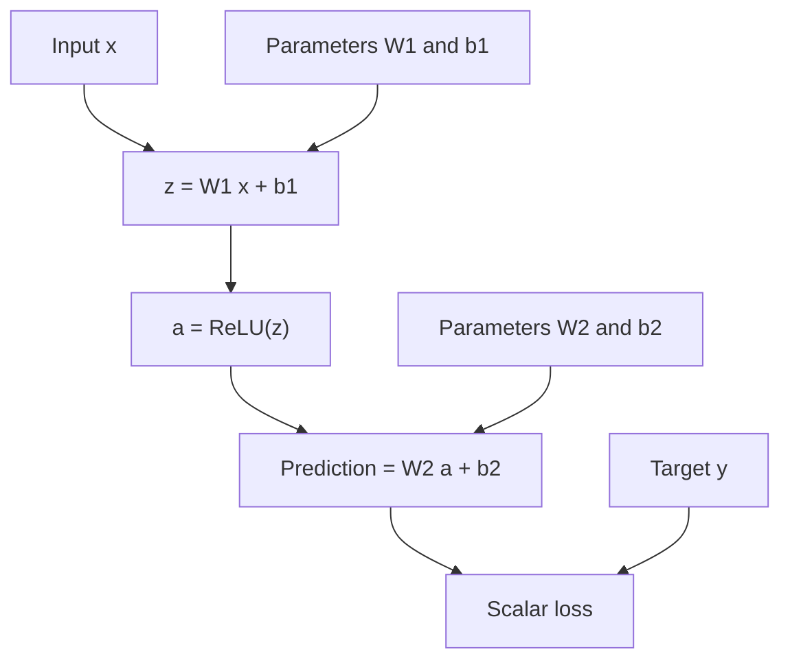
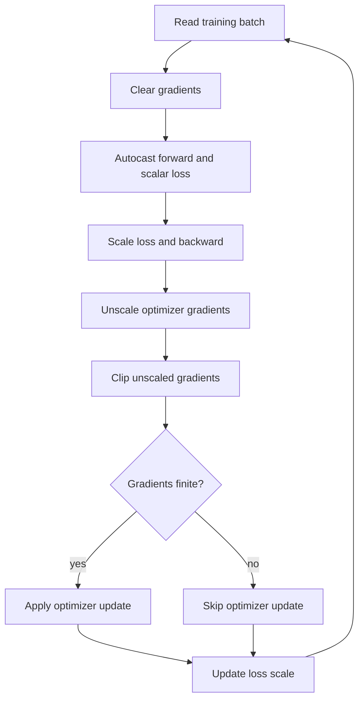
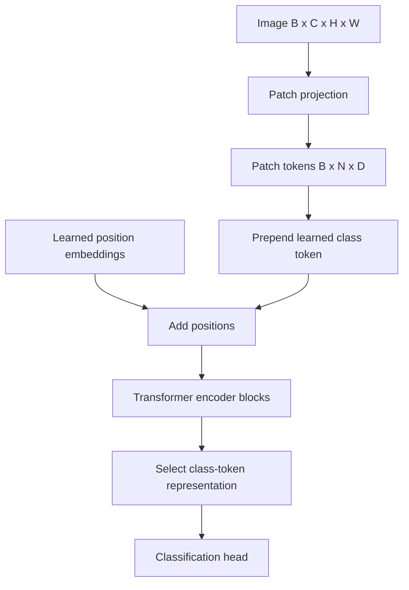
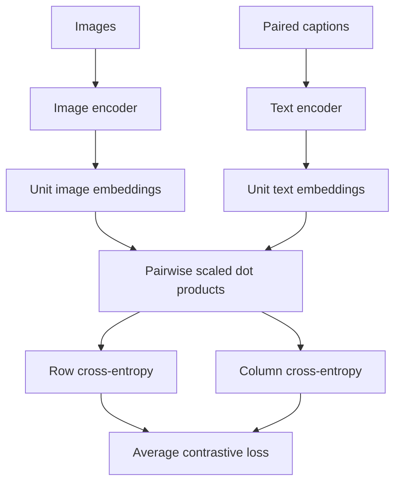

# Branch 3 notes — Deep learning foundations and representation learning

Use [the overview](index.md) to allocate your eight hours.
Keep [the exercises](problems.md) open, but hide their solutions until you finish an attempt.
This branch treats a neural network as a differentiable program with a measurable numerical state.
You should be able to explain both its mathematical update and its tensor implementation.

## 3.1 Neural network fundamentals and autograd mechanics

**Budget: 3 hours.**
Primary sources: [Deep Learning](https://www.deeplearningbook.org/), chapters 6 and 8, and [PyTorch autograd](https://docs.pytorch.org/docs/stable/autograd.html).
Use [D2L](https://d2l.ai/) for another worked treatment of multilayer perceptrons.
Review [Branch 1 notes, subtopic 1.1: matrix algebra and projections](../branch-01-math-foundations/notes.md) when a dimension or chain rule is unclear.

### Computation graphs and the forward pass

A computation graph records operations and the values that connect them.
A leaf holds an input or a trainable parameter.
An internal node applies an operation such as multiplication, addition, or ReLU.
The **forward pass** evaluates these operations in dependency order.
The loss is a scalar that measures the training error.

Consider a column-vector input $x\in\mathbb{R}^{d}$ and a hidden width $h$.
Use two affine layers, with ReLU between them:

$$
z=W_1x+b_1,\qquad a=\operatorname{ReLU}(z),\qquad
\hat y=W_2a+b_2.
$$

Here $W_1\in\mathbb{R}^{h\times d}$, $b_1\in\mathbb{R}^h$, $W_2\in\mathbb{R}^{o\times h}$, and $b_2\in\mathbb{R}^{o}$.
For regression, choose $L=\tfrac12\|\hat y-y\|_2^2$.
The factor $1/2$ cancels the derivative of the square.
For classification, retain raw output logits and pass them to cross-entropy.
Do not apply softmax before `torch.nn.functional.cross_entropy`.



The diagram shows dependencies, not a separate network for each training example.
For a minibatch, PyTorch usually stores examples as rows.
Then `nn.Linear(d, h)` computes `X @ W1.T + b1` for `X` of shape `(B, d)`.
Keep the mathematical convention and the library convention distinct.
Both describe the same affine function.

### Reverse-mode automatic differentiation

Reverse-mode automatic differentiation propagates a scalar loss derivative backward through the graph.
At each operation, it multiplies the incoming derivative by a local derivative.
It adds contributions when a value reaches the loss along several paths.
This is the chain rule applied in reverse dependency order.
It computes a vector–Jacobian product without constructing every dense Jacobian.

Write $\bar v=\partial L/\partial v$ for the derivative associated with a value $v$.
Start at $\bar L=1$.
For the two-layer network above:

$$
\bar{\hat y}=\hat y-y,\qquad
\bar W_2=\bar{\hat y}\,a^T,\qquad
\bar b_2=\bar{\hat y}.
$$

Propagate through the second affine layer:

$$
\bar a=W_2^T\bar{\hat y}.
$$

Propagate through ReLU element by element:

$$
\bar z=\bar a\odot\mathbf{1}[z>0].
$$

The symbol $\odot$ denotes elementwise multiplication.
At zero, ReLU has no unique classical derivative.
PyTorch chooses the subgradient zero.
Finally:

$$
\bar W_1=\bar z\,x^T,\qquad
\bar b_1=\bar z,\qquad
\bar x=W_1^T\bar z.
$$

Check shapes before numbers.
The outer product of an $h$-vector and a $d$-vector produces an $h\times d$ weight gradient.
For a mean minibatch loss, sum sample contributions and divide by the number of samples.
If the loss also averages output coordinates, include that divisor too.
Changing a reduction changes the effective gradient scale.

### Worked two-neuron example

Set $d=h=2$ and $o=1$.
Choose:

$$
x=\begin{bmatrix}1\\2\end{bmatrix},\quad
W_1=\begin{bmatrix}1&-1\\1&1\end{bmatrix},\quad
b_1=\begin{bmatrix}0\\0\end{bmatrix},\quad
W_2=\begin{bmatrix}2&-1\end{bmatrix},\quad b_2=0,\quad y=1.
$$

The forward pass gives $z=(-1,3)^T$ and $a=(0,3)^T$.
The prediction is $-3$.
The residual is $-3-1=-4$ and the loss is $(-4)^2/2=8$.
The output-layer gradients are $\bar W_2=(0,-12)$ and $\bar b_2=-4$.
The hidden activation gradient is $(2,-1)^T(-4)=(-8,4)^T$.
The first ReLU is inactive, so $\bar z=(0,4)^T$.
Therefore:

$$
\bar W_1=\begin{bmatrix}0&0\\4&8\end{bmatrix},\qquad
\bar b_1=\begin{bmatrix}0\\4\end{bmatrix},\qquad
\bar x=\begin{bmatrix}4\\4\end{bmatrix}.
$$

An inactive neuron can have a nonzero incoming activation derivative and still pass zero to its preactivation.
That distinction explains many apparently missing gradients.

### Runnable snippet 1: inspect autograd

Run this script on CPU.
It reproduces the example and prints deterministic values.
Leaf tensors retain `.grad`; intermediate tensors do not retain it unless you call `.retain_grad()`.

```python
import torch

torch.set_printoptions(precision=1)
x = torch.tensor([1.0, 2.0], requires_grad=True)
w1 = torch.tensor([[1.0, -1.0], [1.0, 1.0]], requires_grad=True)
b1 = torch.zeros(2, requires_grad=True)
w2 = torch.tensor([[2.0, -1.0]], requires_grad=True)
b2 = torch.zeros(1, requires_grad=True)
z = w1 @ x + b1
z.retain_grad()
a = torch.relu(z)
prediction = w2 @ a + b2
loss = 0.5 * (prediction - 1.0).square().sum()
loss.backward()
print("loss:", loss.item())
print("dz:", z.grad.tolist())
print("dw1:", w1.grad.tolist())
print("dw2:", w2.grad.tolist())
print("dx:", x.grad.tolist())
```

Expected output includes `loss: 8.0`, `dz: [0.0, 4.0]`, and `dx: [4.0, 4.0]`.
PyTorch records operations dynamically during the forward pass.
Calling `.backward()` accumulates into parameter gradients.
Use `optimizer.zero_grad(set_to_none=True)` before the next optimization step.
Do not retain old graphs unnecessarily.
Use `.detach()` only when you intentionally cut a gradient path.
Use `torch.no_grad()` for evaluation or parameter updates outside an optimizer.

### Activation functions and their derivatives

An activation makes a stack of affine maps nonlinear.
Without one, the composition collapses to a single affine map.
Different activations change gradient flow and the distribution of hidden values.
The formulas below apply elementwise except for softmax.

**ReLU:**

$$
f(x)=\max(0,x),\qquad
f'(x)=\begin{cases}1&x>0\\0&x<0.\end{cases}
$$

ReLU does not saturate on the positive side.
Large negative inputs produce zero derivatives.
A neuron that remains negative for every example can stop learning through its incoming weights.

**Leaky ReLU:** for a fixed $0<\alpha<1$,

$$
f(x)=\begin{cases}x&x\ge0\\\alpha x&x<0,\end{cases}
\qquad
f'(x)=\begin{cases}1&x>0\\\alpha&x<0.\end{cases}
$$

The negative slope keeps a gradient path for negative inputs.
The derivative at exactly zero still needs an implementation convention.
Do not use a finite-difference check at that nondifferentiable point.

**GeLU:** the Gaussian error linear unit uses the standard normal cumulative distribution $\Phi$:

$$
\operatorname{GeLU}(x)=x\Phi(x),\qquad
\operatorname{GeLU}'(x)=\Phi(x)+x\phi(x),
$$

where $\phi(x)=e^{-x^2/2}/\sqrt{2\pi}$ is the standard normal density.
This formula describes the exact GeLU.
The tanh approximation has a different derivative.
PyTorch's `F.gelu(x, approximate="none")` chooses the exact form.
Smoothness does not guarantee positive derivatives everywhere.

**SwiGLU:** a gated linear unit multiplies one learned branch by another.
For input row vector $x$, define $u=xW_u+b_u$ and $v=xW_v+b_v$.
Then:

$$
s(u)=\operatorname{SiLU}(u)=u\sigma(u),\qquad
h=s(u)\odot v,\qquad
y=hW_o.
$$

Here $\sigma(u)=1/(1+e^{-u})$ is the sigmoid.
The local derivatives are:

$$
s'(u)=\sigma(u)+u\sigma(u)(1-\sigma(u)),\qquad
\frac{\partial h}{\partial u}=v\odot s'(u),\qquad
\frac{\partial h}{\partial v}=s(u).
$$

These last two expressions denote diagonal elementwise Jacobians.
For an incoming gradient $\bar h$, multiply each by $\bar h$.
Both projection branches contribute to the input gradient.
The gate doubles input projections relative to a single ordinary hidden projection.
When comparing parameter budgets, account for the chosen intermediate width.
See [Shazeer's GLU variants](https://arxiv.org/abs/2002.05202) for the architecture convention.

### Runnable snippet 2: verify ReLU and GeLU derivatives

Use float64 to make the analytic comparison insensitive to ordinary float32 rounding.
The values exclude ReLU's kink at zero.
The code compares public function behavior, not an internal implementation detail.

```python
import math
import torch
import torch.nn.functional as F

x = torch.tensor([-1.0, 0.5, 2.0], dtype=torch.float64, requires_grad=True)
relu_gradient, = torch.autograd.grad(F.relu(x).sum(), x)
gelu_gradient, = torch.autograd.grad(F.gelu(x, approximate="none").sum(), x)
phi = torch.exp(-x.square() / 2) / math.sqrt(2 * math.pi)
cdf = 0.5 * (1 + torch.erf(x / math.sqrt(2)))
analytic = cdf + x * phi
print("ReLU:", relu_gradient.tolist())
print("GeLU matches:", torch.allclose(gelu_gradient, analytic))
```

Expected output is `ReLU: [0.0, 1.0, 1.0]` and `GeLU matches: True`.

### Softmax and its Jacobian

For logits $z\in\mathbb{R}^K$, softmax converts scores into a distribution:

$$
p_i=\frac{e^{z_i}}{\sum_k e^{z_k}}.
$$

Subtract $\max_k z_k$ before exponentiation for numerical stability.
The result stays unchanged because a shared additive shift cancels.
Apply the quotient rule:

$$
\frac{\partial p_i}{\partial z_j}
=p_i(\delta_{ij}-p_j),\qquad
J=\operatorname{diag}(p)-pp^T.
$$

The diagonal entries are $p_i(1-p_i)$.
The off-diagonal entries are $-p_ip_j$.
Every row and column sums to zero.
The zero direction corresponds to adding the same constant to every logit.
For $z=(\log 2,0)$, $p=(2/3,1/3)$ and:

$$
J=\begin{bmatrix}2/9&-2/9\\-2/9&2/9\end{bmatrix}.
$$

For one-hot target $t$ and cross-entropy $L=-\sum_i t_i\log p_i$, the chain rule simplifies to $\partial L/\partial z=p-t$.
This result is not the derivative of softmax alone.
Keep the loss and normalization together when deriving it.

### Weight initialization from variance preservation

Initialization should keep signal magnitudes useful across depth.
Suppose $z_j=\sum_{i=1}^{n}w_{ji}x_i$.
Assume weights are independent, zero mean, independent of inputs, and have variance $s^2$.
Assume each input has second moment $q=\mathbb{E}[x_i^2]$.
The cross terms vanish under these assumptions:

$$
\mathbb{E}[z_j^2]=ns^2q.
$$

When $z_j$ is zero mean, this second moment equals its variance.
This distinction matters after ReLU, whose output mean is positive.
Do not replace every second moment by a variance without checking the mean.

**Xavier/Glorot initialization** targets approximately linear or symmetric activations.
Preserving forward magnitudes suggests $s^2=1/n_{\mathrm{in}}$.
The analogous backward calculation suggests $s^2=1/n_{\mathrm{out}}$.
When widths differ, one scale cannot satisfy both exactly.
The compromise sets:

$$
\operatorname{Var}(w)=\frac{2}{n_{\mathrm{in}}+n_{\mathrm{out}}}.
$$

A zero-mean uniform variable on $[-a,a]$ has variance $a^2/3$.
Therefore Xavier uniform uses $a=\sqrt{6/(n_{\mathrm{in}}+n_{\mathrm{out}})}$.
For a normal distribution, use standard deviation $\sqrt{2/(n_{\mathrm{in}}+n_{\mathrm{out}})}$.
This argument is an approximation, not a guarantee after training begins.

**He/Kaiming initialization** accounts for ReLU's gate.
If the preactivation distribution is symmetric around zero:

$$
\mathbb{E}[\operatorname{ReLU}(z)^2]=\tfrac12\mathbb{E}[z^2].
$$

Set $\tfrac12n_{\mathrm{in}}s^2q=q$ to preserve the activation second moment.
This gives $s^2=2/n_{\mathrm{in}}$ and normal standard deviation $\sqrt{2/n_{\mathrm{in}}}$.
For Leaky ReLU with negative slope $\alpha$, replace $1/2$ by $(1+\alpha^2)/2$.
The resulting fan-in variance is $2/((1+\alpha^2)n_{\mathrm{in}})$.
For fan-in 128, ReLU uses variance $1/64=0.015625$ and standard deviation $0.125$.
If input second moment is one, the preactivation second moment is two and the ReLU output second moment returns to one.
The ReLU output variance itself is less than one because its mean is positive.

Zero initialization fails for hidden weights because it preserves symmetry between neurons.
Identical neurons compute identical features and receive identical updates.
In a fully zero-initialized ReLU MLP, output weights and hidden activations can also block gradients entirely.
Zero biases do not create the same problem when weights differ randomly.
Initializing a final linear head to zero can be valid when earlier features already differ.
The restriction concerns the whole hidden representation, not every zero parameter.

### Normalization layers: axes and placement

Normalization rescales a chosen group of activations using its mean or root mean square.
It does not replace careful initialization or appropriate learning rates.
State the axes before writing the formula.
Otherwise identical symbols can describe different layers.

For a group of $m$ scalars, define:

$$
\mu=\frac1m\sum_i x_i,\qquad
v=\frac1m\sum_i(x_i-\mu)^2,\qquad
\hat x_i=\frac{x_i-\mu}{\sqrt{v+\epsilon}},\qquad
y_i=\gamma_i\hat x_i+\beta_i.
$$

The small positive $\epsilon$ prevents division by zero.
The learned scale and offset let the model select its output distribution.
The way a layer shares those learned parameters depends on the normalization type.

**BatchNorm** normalizes each channel using minibatch statistics.
For an image tensor `(N, C, H, W)`, it reduces over `(N, H, W)` separately for each channel.
Training uses the current batch statistics and updates running estimates.
Under PyTorch defaults, evaluation uses those running estimates and does not update them.
Call `model.eval()` before validation, and restore `model.train()` before training.
`torch.no_grad()` alone does not switch BatchNorm behavior.

PyTorch uses the biased batch variance for the training normalization.
It uses an unbiased variance estimate when updating the running variance.
Its `momentum=m` means `running = (1-m) * running + m * batch_estimate`.
This coefficient is not the same convention as optimizer momentum.
With `track_running_stats=False`, BatchNorm uses batch statistics even at evaluation.
Small or distribution-shifted batches can make BatchNorm unreliable.

**LayerNorm** normalizes within one example over its specified feature axes.
For transformer activations `(B, T, D)`, `nn.LayerNorm(D)` reduces the last dimension independently for each token.
It uses the same statistic computation in training and evaluation.
It does not mix examples or token positions in this configuration.

**RMSNorm** divides by root mean square without subtracting a mean:

$$
\operatorname{RMSNorm}(x)_i
=\gamma_i\frac{x_i}{\sqrt{\frac1D\sum_{j=1}^D x_j^2+\epsilon}}.
$$

The standard form has a learned scale and no learned offset.
It normalizes magnitude without forcing the feature mean to zero.
For $x=(3,4)$ and negligible $\epsilon$, RMS is $\sqrt{12.5}\approx3.5355$.
The normalized values are about $(0.8485,1.1314)$.
Their squared mean is one, but their arithmetic mean is not zero.

Place BatchNorm after a convolution or affine layer and before the activation in a conventional Conv–BN–ReLU block.
Some architectures use another ordering, so match the architecture you implement.
For a residual transformer sublayer, **pre-norm** means $x+F(\operatorname{Norm}(x))$.
**Post-norm** means $\operatorname{Norm}(x+F(x))$.
Pre-norm retains a direct identity path in the residual stream.
LayerNorm or RMSNorm usually acts on the hidden dimension of each token.
Do not apply an image-channel normalization to the wrong layout.

### Runnable snippet 3: inspect normalization axes

This script implements the RMSNorm formula directly and checks LayerNorm's mean.
It does not depend on a specialized normalization package.

```python
import torch
from torch import nn

x = torch.tensor([[3.0, 4.0], [1.0, 1.0]])
layer_norm = nn.LayerNorm(2, elementwise_affine=False)
rms = x / torch.sqrt(x.square().mean(dim=-1, keepdim=True) + 1e-6)
print("LN means:", layer_norm(x).mean(dim=-1).tolist())
print("RMS squared means:", rms.square().mean(dim=-1).round(decimals=4).tolist())
print("RMS first row:", rms[0].round(decimals=4).tolist())
```

Expected means are `[0.0, 0.0]` and squared means approximately `[1.0, 1.0]`.
The first RMS-normalized row is approximately `[0.8485, 1.1314]`.

### Common pitfalls

- Treating `.backward()` as assignment rather than accumulation produces unintended large gradients.
- Calling `.item()` and rebuilding a tensor from that number breaks the original gradient path.
- Mutating saved tensors in place can invalidate the backward pass.
- Applying softmax before cross-entropy adds an unwanted second normalization.
- Claiming He initialization preserves ReLU variance exactly confuses variance with second moment.
- Forgetting `eval()` changes BatchNorm behavior during validation.

### Checklist

- [ ] Derive each MLP gradient and its shape without autograd.
- [ ] Explain the zero row in the worked $W_1$ gradient.
- [ ] Write ReLU, Leaky ReLU, GeLU, SwiGLU, and softmax derivatives.
- [ ] Derive Xavier and He variances from explicit assumptions.
- [ ] Identify BatchNorm, LayerNorm, and RMSNorm reduction axes.
- [ ] Distinguish pre-norm from post-norm residual placement.

## 3.2 Optimization dynamics and training stability

**Budget: 2.5 hours.**
Review [Branch 2 notes, subtopic 2.2: SGD and momentum](../branch-02-classical-ml/notes.md) before adding adaptive scales.
Primary sources include [Deep Learning](https://www.deeplearningbook.org/), [the AdamW paper](https://arxiv.org/abs/1711.05101), [the Lion paper](https://arxiv.org/abs/2302.06675), and [PyTorch AMP documentation](https://docs.pytorch.org/docs/stable/amp.html).

### Adaptive optimizers

Let $\theta_t$ denote parameters after step $t$ and $g_t=\nabla_\theta L_t(\theta_{t-1})$ the current gradient.
All squares, square roots, divisions, and signs below operate coordinatewise.
The learning rate is $\eta_t$.
The positive constant $\epsilon$ stabilizes small denominators.
An adaptive optimizer rescales different coordinates using their gradient history.
That rescaling does not remove the need to tune the learning rate.

**RMSProp** maintains an exponential average of squared gradients:

$$
v_t=\rho v_{t-1}+(1-\rho)g_t^2,\qquad
\theta_t=\theta_{t-1}-\eta_t\frac{g_t}{\sqrt{v_t}+\epsilon}.
$$

This is the uncentered, no-momentum variant.
Library variants can place $\epsilon$ differently or add momentum.
RMSProp usually does not use Adam-style bias correction.
With $v_0=0$, its initial scale therefore differs from a bias-corrected second moment.

**Adam** adds a first-moment estimate and corrects initialization bias:

$$
m_t=\beta_1m_{t-1}+(1-\beta_1)g_t,\qquad
v_t=\beta_2v_{t-1}+(1-\beta_2)g_t^2,
$$

$$
\hat m_t=\frac{m_t}{1-\beta_1^t},\qquad
\hat v_t=\frac{v_t}{1-\beta_2^t},\qquad
\theta_t=\theta_{t-1}-\eta_t\frac{\hat m_t}{\sqrt{\hat v_t}+\epsilon}.
$$

Initialize $m_0=v_0=0$.
The first moment smooths direction, while the second moment sets a coordinatewise scale.
For the first step with nonzero scalar $g$ and negligible $\epsilon$, the update magnitude is approximately $\eta$.
It is not $\eta|g|$ as in SGD.
Large raw gradients still matter through history, clipping, and finite precision.

**AdamW** applies decay outside that adaptive gradient transformation:

$$
\theta_t=(1-\eta_t\lambda)\theta_{t-1}
-\eta_t\frac{\hat m_t}{\sqrt{\hat v_t}+\epsilon}.
$$

Here $g_t$ excludes the weight-decay term.
The scalar $\lambda$ controls shrinkage.
Adding an L2 penalty $\lambda\|\theta\|^2/2$ to the loss instead adds $\lambda\theta$ to $g_t$.
Adam then puts that term into both moment estimates and adapts its scale.
The two procedures are not equivalent under adaptive preconditioning.
They coincide in the simple SGD case with compatible conventions.
Many recipes exclude biases and normalization scales from decay; reproduce the intended parameter groups rather than assuming a universal rule.

**Lion** stores one momentum state and uses the sign of a blended direction:

$$
c_t=\beta_1m_{t-1}+(1-\beta_1)g_t,
$$

$$
\theta_t=(1-\eta_t\lambda)\theta_{t-1}-\eta_t\operatorname{sign}(c_t),
\qquad
m_t=\beta_2m_{t-1}+(1-\beta_2)g_t.
$$

The direction blend uses $\beta_1$ and the stored-momentum update uses $\beta_2$.
Do not overwrite $m$ before computing $c$.
Unlike Adam, Lion stores no squared-gradient state and takes sign-sized coordinate steps.
Use the paper's tuning guidance rather than copying an Adam learning rate unchanged.
The sign of zero is zero in this equation.

### Worked AdamW coordinate

Let $\theta_0=1$, $g_1=2$, $\beta_1=0.9$, $\beta_2=0.999$, and $\eta=0.001$.
Then $m_1=0.2$ and $v_1=0.004$.
Bias correction gives $\hat m_1=2$ and $\hat v_1=4$.
Ignoring $\epsilon$, plain Adam gives $1-0.001(2/2)=0.999$.
With AdamW decay $\lambda=0.1$, the shrinkage is another $0.001\times0.1\times1=0.0001$.
The result is $0.9989$.
If the gradient were zero but decay stayed enabled, AdamW would still shrink a parameter with an explicit zero gradient.
A parameter whose gradient is `None` can instead be skipped by an implementation.

### Learning-rate schedules

A learning-rate schedule changes $\eta_t$ over training.
Count actual optimizer updates, not forward passes, when using gradient accumulation.
Advance the scheduler after the optimizer update for the usual PyTorch pattern.
If overflow skips an update, decide whether the schedule follows successful updates or attempted batches and implement that convention consistently.

**Warmup** starts with small updates while optimizer statistics and network scales settle.
For $W$ warmup updates and a one-indexed step $t\le W$:

$$
\eta_t=\eta_{\max}\frac{t}{W}.
$$

Warmup does not repair a divergent objective or an overflowing forward pass.
If the starting learning rate already destroys activations, inspect the model and data first.

**Cosine annealing** smoothly reduces the rate after warmup:

$$
\eta_t=\eta_{\min}+\frac{\eta_{\max}-\eta_{\min}}2
\left[1+\cos\left(\pi\frac{t-W}{T-W}\right)\right],\quad W<t\le T.
$$

Here $T$ is the total number of optimizer updates.
This formula has no restarts.
At $t=W$ it meets $\eta_{\max}$, and at $t=T$ it reaches $\eta_{\min}$.
Specify endpoints when comparing an equation with a library's zero-indexed step counter.

**1Cycle** raises the rate from a low initial value to a peak, then lowers it to a smaller final value.
It often moves momentum in the opposite direction.
PyTorch's common two-phase variant uses cosine or linear interpolation and does not exactly match every original three-phase description.
Configure `total_steps` from optimizer updates and check `pct_start`, `div_factor`, and `final_div_factor`.
An aggressive peak rate can regularize training, but it can also destabilize a poorly scaled model.

### Runnable snippet 4: inspect schedule endpoints

This explicit schedule avoids hidden scheduler indexing conventions.
The branch at `t <= warmup` includes the peak once.

```python
import math

def learning_rate(t, total=10, warmup=2, peak=0.01, floor=0.001):
    if not 1 <= t <= total or not 0 < warmup < total:
        raise ValueError("Use update indices 1..total and 0 < warmup < total")
    if t <= warmup:
        return peak * t / warmup
    phase = (t - warmup) / (total - warmup)
    return floor + 0.5 * (peak - floor) * (1 + math.cos(math.pi * phase))

print([round(learning_rate(t), 6) for t in (1, 2, 6, 10)])
```

Expected output is `[0.005, 0.01, 0.0055, 0.001]`.

### Mixed precision and overflow

Mixed precision uses different floating-point formats for different operations and states.
Autocast selects operation dtypes; it does not simply convert the whole model to half precision.
A common training setup retains FP32 parameters and optimizer state while using lower-precision matrix multiplications.
Actual memory savings depend on saved activations, state, and the chosen training implementation.

| Format | Sign / exponent / stored fraction bits | Main training implication |
|---|---|---|
| FP32 | 1 / 8 / 23 | Broad range and finer precision; common accumulation and optimizer-state format. |
| FP16 | 1 / 5 / 10 | Maximum finite value 65,504; small gradients can underflow and large activations can overflow. |
| BF16 | 1 / 8 / 7 | FP32-like exponent range with coarser precision; usually avoids FP16-style range problems. |
| FP8 | Variant-specific, often E4M3 or E5M2 | Requires supported kernels and scaling recipes; variants have different ranges and special values. |

Overflow converts an out-of-range finite result to infinity or another format-specific exceptional result.
Operations such as `inf - inf` can then produce NaN, meaning “not a number.”
Underflow rounds tiny values toward subnormal values or zero.
Some hardware flushes subnormals to zero.
FP8 is not one interchangeable format, and generic autocast is not a complete FP8 training recipe.
Use framework-supported hardware-specific tooling when you need it.

**Dynamic loss scaling** multiplies the loss by a positive scale $S$ before backpropagation.
The chain rule multiplies gradients by the same $S$.
The optimizer then unscales gradients before clipping or applying updates.
This helps represent tiny FP16 gradients during backward computation.
If gradients are nonfinite, the scaler skips the update and reduces $S$.
After sufficiently many finite steps, it can increase $S$.
Scaling cannot fix an activation that already overflowed in the forward pass.
It also cannot repair invalid data, division by zero, or `log` of a negative value.

### Runnable snippet 5: distinguish forward overflow from scaling

The first calculation overflows in FP16 and not in FP32.
The second intentionally produces NaN from two infinities.
These tensor operations run on CPU and need no CUDA device.

```python
import torch

x16 = torch.tensor([300.0], dtype=torch.float16)
x32 = x16.float()
square16 = x16.square()
square32 = x32.square()
print("FP16 square finite:", torch.isfinite(square16).item())
print("FP32 square:", square32.item())
print("inf - inf is NaN:", torch.isnan(square16 - square16).item())
```

Expected output is `False`, `90000.0`, and `True`, with the corresponding labels.
Reducing a loss scale after this forward overflow does not make `300**2` fit in FP16.
Use a safer dtype for the operation, rescale the inputs where appropriate, or correct the model.

### Runnable snippet 6: AMP training step with a CPU fallback

The preferred APIs are `torch.autocast` and `torch.amp.GradScaler`.
The older `torch.cuda.amp.autocast` and `torch.cuda.amp.GradScaler` entry points are deprecated.
This snippet uses FP16 autocast only on CUDA.
On CPU it runs a normal FP32 step so you can inspect the ordering without special hardware.

```python
import torch
from torch import nn

torch.manual_seed(0)
device = torch.device("cuda" if torch.cuda.is_available() else "cpu")
use_amp = device.type == "cuda"
model = nn.Linear(4, 1).to(device)
optimizer = torch.optim.AdamW(model.parameters(), lr=1e-3)
scaler = torch.amp.GradScaler("cuda", enabled=use_amp)
x = torch.randn(8, 4, device=device)
y = torch.randn(8, 1, device=device)
optimizer.zero_grad(set_to_none=True)
with torch.autocast(device_type=device.type, dtype=torch.float16, enabled=use_amp):
    prediction = model(x)
    loss = nn.functional.mse_loss(prediction, y)
scaler.scale(loss).backward()
scaler.unscale_(optimizer)
norm = nn.utils.clip_grad_norm_(model.parameters(), max_norm=1.0)
scaler.step(optimizer)
scaler.update()
print("finite loss:", torch.isfinite(loss).item())
print("finite preclip norm:", torch.isfinite(norm).item())
```

Expected output reports `True` twice for this finite toy batch.
If you use BF16 autocast on supported hardware, loss scaling is usually unnecessary because BF16 has a broad exponent range.
That does not eliminate rounding error or all possible overflows.
For gradient accumulation, divide the loss by the number of microbatches, accumulate scaled gradients, then unscale once per optimizer update.



The scaler checks finiteness during unscaling and uses that result when deciding whether to step.
The diagram places the decision near the update to show its effect on parameters.
Do not clip the scaled gradients: the threshold would change with the arbitrary loss scale.

### Vanishing and exploding gradients

Backpropagation through depth multiplies local Jacobians.
If typical singular values repeatedly fall below one, some gradient directions shrink.
If they repeatedly exceed one, some directions grow rapidly.
Saturating activations, poor initialization, and long chains can amplify this problem.
The exact behavior depends on the directions, not only on a single scalar norm.

For a residual block $y=x+F(x)$:

$$
\frac{\partial y}{\partial x}=I+J_F(x).
$$

The identity term provides a direct path when the residual branch has a small derivative.
It makes a near-identity transformation easier to represent.
Residual connections do not guarantee bounded gradients: $I+J_F$ can still amplify a direction.
Normalization, initialization, and learning-rate choices still matter.

**Global norm clipping** rescales the concatenated gradient vector:

$$
\tilde g=g\min\left(1,\frac{c}{\|g\|_2}\right)
$$

for positive threshold $c$, with no change when $g=0$.
It preserves direction when clipping occurs.
**Value clipping** instead clamps each coordinate to $[-c,c]$.
It can change direction substantially and does not bound the global norm by $c$.
For $g=(3,4)$ and norm threshold one, norm clipping gives $(0.6,0.8)$.
Value clipping at one gives $(1,1)$, whose norm is $\sqrt2$.
Clipping is a safeguard, not a substitute for finding a persistent source of instability.

### Dropout as a training-time regularizer

Dropout zeroes each activation independently with probability $p$ during training and scales the survivors by $1/(1-p)$ so the expected activation is unchanged.
The expectation check is $\mathbb E[\text{masked activation}]=x$: multiplying by $1/(1-p)$ converts a survival probability $1-p$ into an unbiased estimate.
This is inverted dropout: the training pass carries the correction, so inference needs no adjustment.
At evaluation time dropout is disabled and acts as the identity.
For example, activations $(2,0,4)$ with $p=0.5$ and a mask that keeps the first and third entries produce $(4,0,8)$ in training and $(2,0,4)$ at evaluation.

```python
import torch
from torch.nn import functional as F

x = torch.tensor([2.0, 0.0, 4.0])
torch.manual_seed(0)
train = F.dropout(x, p=0.5, training=True)
evaluation = F.dropout(x, p=0.5, training=False)
print(train)       # scaled survivors, zeros where dropped
print(evaluation)  # identical to x
```

Transformers apply dropout to attention weights and to sublayer outputs (Branch 4), and LoRA exposes a dropout probability on its adapter path (Branch 5).
Large language models typically use small values, 0.0 to 0.1, because pretraining data volume already regularizes them.
The original reference is [Srivastava et al., "Dropout", JMLR 2014](https://jmlr.org/papers/v15/srivastava14a.html).

### Common pitfalls

- Adding L2 to the loss and calling it AdamW changes the update.
- Updating Lion momentum before computing its direction changes the algorithm.
- Advancing a schedule on every microbatch shortens it under gradient accumulation.
- Scaling a NaN loss does not recover a valid gradient.
- Assuming BF16 has FP32 precision confuses exponent range with fraction precision.
- Clipping before unscaling makes the effective clipping threshold depend on the loss scale.
- Treating residuals as a proof against exploding gradients ignores the residual Jacobian.

### Checklist

- [ ] Compute a first Adam step and explain bias correction.
- [ ] Write the difference between AdamW decay and L2 regularization.
- [ ] State which Lion coefficient controls each moving average.
- [ ] Calculate warmup and cosine endpoints.
- [ ] Explain which FP16 failure loss scaling addresses.
- [ ] Distinguish norm clipping from coordinate clipping numerically.

## 3.3 Computer vision and multimodal baselines

**Budget: 2.5 hours.**
Primary sources: [CS231n](https://cs231n.stanford.edu/), [ConvNeXt](https://arxiv.org/abs/2201.03545), [ViT](https://arxiv.org/abs/2010.11929), and [CLIP](https://arxiv.org/abs/2103.00020).
The goal is to reason about the representation pipeline, not to train a large vision model in this time budget.
A **representation** is a learned feature vector or sequence that a later task consumes.

### Convolutions: shape and parameters

A convolution shares a small learned kernel across spatial positions.
PyTorch's `Conv2d` computes cross-correlation, without reversing the kernel.
Deep-learning literature usually calls this operation convolution.
Weight sharing reduces parameters and expresses a spatial inductive bias: the same local pattern can matter at many positions.

For input height $H$, symmetric padding $p$, kernel size $k$, dilation $d$, and stride $s$:

$$
H_{\mathrm{out}}=
\left\lfloor\frac{H+2p-d(k-1)-1}{s}\right\rfloor+1.
$$

Apply the formula separately to width.
Stride sets the spacing between output sample locations.
Padding extends the input boundary, often with zeros.
Dilation inserts gaps between kernel sample locations, giving effective kernel span $k_{\mathrm{eff}}=d(k-1)+1$.
It expands the span without adding kernel parameters.
Padding choices also affect how much real image information reaches boundary outputs.

With $C_{\mathrm{in}}$ input channels, $C_{\mathrm{out}}$ output channels, and $G$ groups:

$$
P=C_{\mathrm{out}}\frac{C_{\mathrm{in}}}{G}k_Hk_W
+\begin{cases}C_{\mathrm{out}}&\text{with bias}\\0&\text{without bias}.\end{cases}
$$

Both channel counts must be divisible by $G$.
For ordinary convolution, $G=1$.
For depthwise convolution with one output per input channel, $G=C_{\mathrm{in}}=C_{\mathrm{out}}$.
Its kernel parameter count is $C_{\mathrm{in}}k_Hk_W$ before bias.
A pointwise $1\times1$ convolution then mixes channels.

For a single image, the direct convolution multiply–accumulate count is:

$$
\operatorname{MACs}=H_{\mathrm{out}}W_{\mathrm{out}}C_{\mathrm{out}}
\frac{C_{\mathrm{in}}}{G}k_Hk_W.
$$

One MAC contains one multiplication and an accumulation.
State your convention: this branch estimates two floating-point operations per MAC.
It ignores bias additions and other layers unless stated otherwise.
Real kernels can use different algorithms, so this is an arithmetic estimate rather than a latency prediction.

For `(1, 3, 32, 32)`, 16 output channels, $k=3$, $p=1$, $s=1$, and bias:
output shape is `(1, 16, 32, 32)`.
Parameters are $16\times3\times9+16=448$.
MACs are $32\times32\times16\times27=442{,}368$.
The two-operations-per-MAC estimate is $884{,}736$ FLOPs, excluding bias.

### Runnable snippet 7: count convolution parameters and operations

Use the output tensor dimensions rather than assuming the spatial size remains unchanged.
This example checks the analytic count against the layer's public parameters.

```python
import torch
from torch import nn

conv = nn.Conv2d(3, 16, kernel_size=3, padding=1, bias=True)
x = torch.zeros(1, 3, 32, 32)
y = conv(x)
parameters = sum(p.numel() for p in conv.parameters())
kernel_terms = (conv.in_channels // conv.groups) * 3 * 3
macs = y.numel() * kernel_terms
print("shape:", tuple(y.shape))
print("parameters:", parameters)
print("MACs:", macs)
print("FLOPs excluding bias:", 2 * macs)
```

Expected values are `(1, 16, 32, 32)`, `448`, `442368`, and `884736`.

### Pooling and receptive fields

Pooling reduces spatial resolution without learned kernel weights.
Max pooling selects the largest value in each window and routes gradients to selected locations.
Average pooling computes a mean and distributes derivatives across the window.
Global average pooling reduces each complete feature map to one channel value.
For average pooling near padded boundaries, specify whether padding contributes to the divisor.
Downsampling trades spatial detail for smaller computation and larger spatial context per feature.
It can also alias high-frequency signals if the pipeline does not filter them adequately.

The **receptive field** is the input region that can influence an output location.
Track its theoretical span $r_l$ and the input-space jump $j_l$ between neighboring output centers.
Initialize $r_0=1$ and $j_0=1$.
For layer $l$:

$$
j_l=j_{l-1}s_l,\qquad
r_l=r_{l-1}+(k_l-1)d_lj_{l-1}.
$$

The derivation follows the first and last kernel sample.
They are $(k_l-1)d_l$ previous-layer positions apart.
Each previous-layer position is $j_{l-1}$ input pixels apart.
Add that span to the receptive field already covered by one previous-layer position.
Padding changes center alignment and boundary coverage, not this interior span recurrence.

For three $3\times3$ convolutions with stride one and dilation one:

| Layer | Kernel | Stride | Jump | Receptive-field span |
|---|---:|---:|---:|---:|
| Input | — | — | 1 | 1 |
| Conv 1 | 3 | 1 | 1 | 3 |
| Conv 2 | 3 | 1 | 1 | 5 |
| Conv 3 | 3 | 1 | 1 | 7 |

Changing the second stride to two gives spans $3,5,9$ and final jump two.
A $3\times3$ dilation-two layer after the first two stride-one layers adds $4\times1=4$, giving span nine.
Theoretical span does not imply that every input pixel contributes equally.
Learned weights, nonlinearities, and gaps from dilation affect the effective influence.

### ConvNeXt design brief

ConvNeXt is a convolutional family designed by revisiting ResNet choices with modern training and transformer-era design comparisons.
Its blocks use a large depthwise spatial convolution, channel-wise normalization, and pointwise channel expansion and contraction.
The original design uses a $7\times7$ depthwise kernel and GeLU.
At $C=384$ channels, that depthwise kernel stores $384\cdot7^2=18{,}816$ weights versus $384^2\cdot7^2=7{,}225{,}344$ for a dense $7\times7$ convolution — a 384x reduction — while the pointwise expansion to $4C$ adds $2\cdot384\cdot1536=1{,}179{,}648$ weights.
It uses LayerNorm rather than BatchNorm in the main design.
An inverted bottleneck expands channels inside the block and projects back before the residual addition.
Separate downsampling layers change resolution between stages.
The design also uses layer scaling and stochastic depth in its training recipe.

The point is not that a convolution becomes attention.
It keeps spatially shared convolutional mixing while changing block layout and training choices.
Compare total parameters, training data, augmentation, and compute before attributing accuracy to one architectural feature.
Use the [ConvNeXt paper](https://arxiv.org/abs/2201.03545) for the ablation sequence rather than treating this brief as a complete reproduction recipe.

### Vision transformers and patch embeddings

A vision transformer treats image patches as tokens.
For an image of shape `(B, C, H, W)` and nonoverlapping square patch side $P$, require $H$ and $W$ divisible by $P$ in the simple construction.
The number of patches is $N=(H/P)(W/P)$.
Flatten each patch to $CP^2$ scalars and project it to hidden width $D$.
The patch embedding matrix has $CP^2D$ weights and optionally $D$ biases.
A convolution with kernel and stride $P$ implements the same projection with shared parameters.

The original classification ViT prepends a learned **class token** to the patch sequence.
Self-attention lets that token aggregate information from the patches.
A classification head reads its final representation.
Other architectures use pooling instead, so a class token is not a universal transformer requirement.

Add a learned **position embedding** for each sequence position, including the class token.
Without position information, plain self-attention cannot distinguish patch arrangements through sequence index alone.
When changing input resolution, learned spatial position embeddings often need interpolation.
Keep the class-token embedding separate from the spatial grid during interpolation.



At image size $32\times32$ and patch side eight, there are 16 patch tokens.
Adding one class token gives sequence length 17.
With three input channels and hidden width 48, the patch projection has $3\times8^2\times48+48=9{,}264$ parameters.
The learned position table has $17\times48=816$ parameters.
Attention compares all token pairs, so its score matrices grow quadratically with sequence length.
Halving patch side at fixed image size quadruples the patch count and roughly multiplies the patch-only score count by 16.

### Runnable snippet 8: make patch tokens

This verifies the embedding shape without needing a pretrained model.
The convolution produces a grid; flattening preserves a fixed row-major spatial order.
Use that same order for position embeddings.

```python
import torch
from torch import nn

patch = nn.Conv2d(3, 48, kernel_size=8, stride=8)
image = torch.zeros(2, 3, 32, 32)
tokens = patch(image).flatten(2).transpose(1, 2)
class_token = nn.Parameter(torch.zeros(1, 1, 48))
position = nn.Parameter(torch.zeros(1, 17, 48))
sequence = torch.cat([class_token.expand(2, -1, -1), tokens], dim=1)
sequence = sequence + position
print("patch tokens:", tuple(tokens.shape))
print("sequence:", tuple(sequence.shape))
print("patch parameters:", sum(p.numel() for p in patch.parameters()))
```

Expected output is `(2, 16, 48)`, `(2, 17, 48)`, and `9264`.
Problem B3 adds an actual encoder block and a classifier.

### Cross-attention in multimodal systems

**Multimodal** systems combine data types such as images and text.
Cross-attention uses queries from one sequence and keys and values from another.
For text states $X_t\in\mathbb{R}^{B\times T\times D_t}$ and image states $X_i\in\mathbb{R}^{B\times N\times D_i}$:

$$
Q=X_tW_Q,\qquad K=X_iW_K,\qquad V=X_iW_V,
$$

$$
\operatorname{Attention}(Q,K,V)
=\operatorname{softmax}\left(\frac{QK^T}{\sqrt{d_k}}\right)V.
$$

The transpose swaps only the final two dimensions.
For one head, scores have shape `(B, T, N)` and softmax normalizes the image-position dimension.
The output has one vector per query token, not one vector per image patch.
Each text query can retrieve a different weighted combination of image values.
Apply padding masks to invalid image keys when image-token lengths vary.
Cross-attention can also reverse direction, with image queries reading text keys and values.

### Runnable snippet 9: inspect cross-attention shapes

This script makes the normalization axis explicit.
It does not learn projections, so it isolates the attention operation itself.

```python
import math
import torch

torch.manual_seed(0)
q = torch.randn(2, 5, 8)
k = torch.randn(2, 16, 8)
v = torch.randn(2, 16, 12)
weights = torch.softmax(q @ k.transpose(-2, -1) / math.sqrt(8), dim=-1)
output = weights @ v
print("weights:", tuple(weights.shape))
print("output:", tuple(output.shape))
print("rows sum to one:", torch.allclose(weights.sum(-1), torch.ones(2, 5)))
```

Expected output is `(2, 5, 16)`, `(2, 5, 12)`, and `True`.
CLIP's original two-tower encoder does not use this cross-attention operation between its image and text towers.
It aligns their final embeddings through a shared training objective instead.
Keep fusion through attention distinct from alignment through a loss.

### CLIP and the contrastive objective

CLIP trains an image encoder and a text encoder on paired images and captions.
Each encoder maps its input to a shared embedding dimension.
Normalize embeddings to unit length:

$$
u_i=\frac{f_{\mathrm{image}}(I_i)}{\|f_{\mathrm{image}}(I_i)\|_2},\qquad
v_j=\frac{f_{\mathrm{text}}(T_j)}{\|f_{\mathrm{text}}(T_j)\|_2}.
$$

For a batch of $B$ matched pairs, define logits $S_{ij}=u_i^Tv_j/\tau$.
The positive temperature $\tau$ controls score sharpness.
Equivalently, CLIP learns a log inverse-temperature and exponentiates it to get the score scale.
The matched pair lies on the diagonal.
Other batch pairs serve as negatives, though duplicate or semantically equivalent examples can be false negatives.

The image-to-text InfoNCE loss is:

$$
L_{I\rightarrow T}=-\frac1B\sum_{i=1}^B
\log\frac{\exp(S_{ii})}{\sum_{j=1}^B\exp(S_{ij})}.
$$

The text-to-image loss applies the same operation to $S^T$:

$$
L_{T\rightarrow I}=-\frac1B\sum_{i=1}^B
\log\frac{\exp(S_{ii})}{\sum_{j=1}^B\exp(S_{ji})},\qquad
L=\frac{L_{I\rightarrow T}+L_{T\rightarrow I}}2.
$$

This symmetric cross-entropy encourages matched pairs to outrank mismatched pairs in both directions.
For two orthogonal unit image embeddings and identical matching text embeddings, $S$ has diagonal $1/\tau$ and off-diagonal zero.
At $\tau=1$, each directional loss is $\log(1+e^{-1})\approx0.313262$.
The symmetric average has the same value, not twice that value.
This toy example tests the objective; it does not model real semantic errors.



### Zero-shot classification pipeline

**Zero-shot classification** uses class descriptions instead of fitting a new supervised classification head.
First, list the target class names and create prompts such as “a photo of a cat.”
Encode each prompt with the frozen text tower and normalize the result.
Encode each image with the frozen image tower and normalize it.
Compute scaled cosine similarities to all class embeddings.
Choose the highest score or apply softmax across the candidate classes.
No gradient update is needed for this inference procedure.

```python
import numpy as np

def zero_shot(image_emb: np.ndarray, class_embs: np.ndarray, scale: float = 100.0) -> np.ndarray:
    image = image_emb / np.linalg.norm(image_emb)
    classes = class_embs / np.linalg.norm(class_embs, axis=1, keepdims=True)
    logits = scale * classes @ image
    probs = np.exp(logits - logits.max())
    return probs / probs.sum()

image = np.array([1.0, 0.0, 0.0])
classes = np.array([[1.0, 0.0, 0.0], [0.0, 1.0, 0.0]])
print(zero_shot(image, classes))  # approximately [1.0, 0.0]
```

If you use several prompt templates, normalize each text embedding, average within a class, and normalize the resulting class vector again.
Prompt wording and the candidate label set affect the scores.
The resulting softmax values are not automatically calibrated real-world probabilities.
They normalize over the supplied candidates, not every possible concept.
Use the checkpoint's expected image preprocessing and tokenizer for a real deployment.
The toy code in B4 starts from embeddings and deliberately omits those pretrained components.

### Common pitfalls

- Counting bias as one scalar for an entire convolution misses one bias per output channel.
- Treating dilation as extra learned weights overcounts parameters.
- Reusing the receptive-field jump after updating it uses the wrong layer's spacing.
- Comparing MACs with another report's FLOPs without a convention can create a factor-of-two error.
- Omitting position information makes plain ViT attention insensitive to patch order in the intended way.
- Calling CLIP a cross-attention fusion model confuses alignment with token-level interaction.
- Using unnormalized embeddings changes cosine similarity into magnitude-sensitive dot products.
- Treating candidate-set softmax as calibrated confidence can hide distribution shift.

### Checklist

- [ ] Derive output dimensions with stride, padding, and dilation.
- [ ] Count grouped-convolution weights and state the MAC convention.
- [ ] Compute a receptive field while tracking jump separately.
- [ ] Explain ConvNeXt's depthwise convolution and inverted bottleneck.
- [ ] Produce patch tokens, a class token, and position embeddings with compatible shapes.
- [ ] Identify the query and key sequences in a multimodal cross-attention block.
- [ ] Write both directions of the CLIP objective and the zero-shot inference steps.

## Consolidation

Return to [Part A of the problems](problems.md) and recompute the numerical cases without the notes.
Then run all four [Part B code exercises](problems.md).
When an output differs, inspect shapes, reduction factors, dtypes, and model mode before changing hyperparameters.
Carry these habits into [Branch 4](../branch-04-transformers-nlp/index.md).
