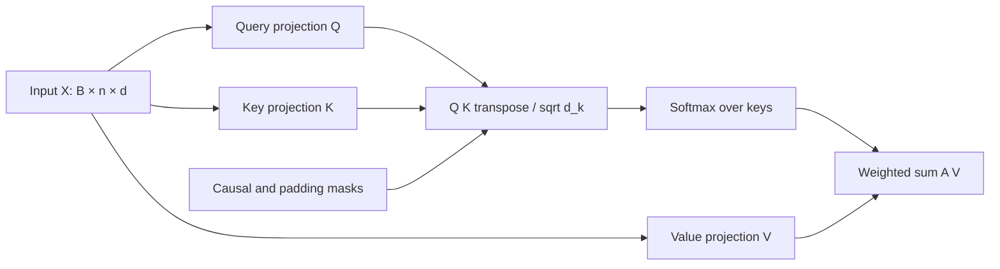
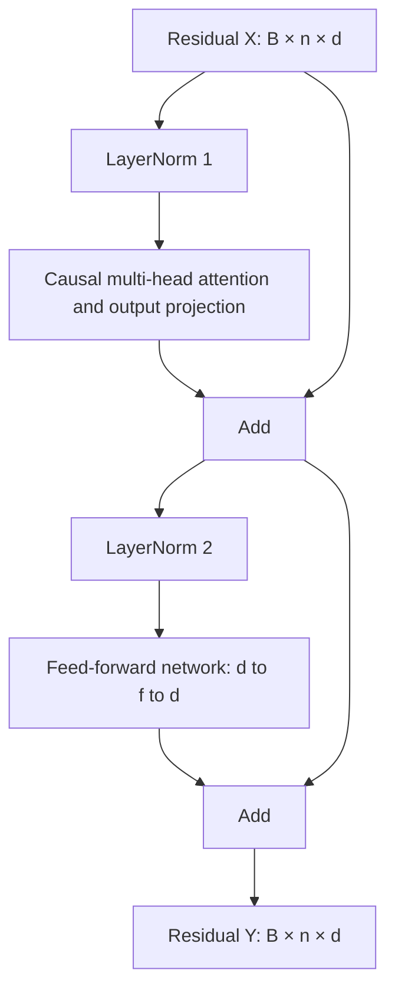
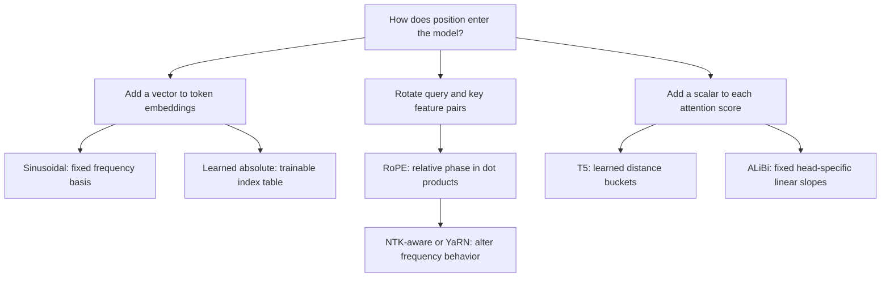

# Branch 4 notes — Transformers & Modern NLP

Read this branch as one chain of transformations.
Text becomes symbols, symbols become vectors, and attention makes those vectors depend on context.
The training objective decides which contextual dependencies the model learns.
The mask decides which dependencies the model is allowed to use.

## How to work through the notes

Spend two hours on 4.1 and seven hours on 4.2.
Use the [session plan](index.md) to alternate derivations with implementations.
The [problems](problems.md) contain eight pen-and-paper exercises and four coding exercises.
The examples use small dimensions so you can inspect every number.
Production dimensions change cost, not the underlying matrix operations.

Review [Branch 1 notes, subtopic 1.1: matrices and projections](../branch-01-math-foundations/notes.md) when a dimension does not match.
Review [Branch 3 notes, subtopic 3.1: autograd, softmax, and LayerNorm](../branch-03-deep-learning/notes.md) when a numerical or gradient detail is unclear.

### Running the examples

Each Python block marked as a snippet is independently runnable.
Save it as a file and use `uv run --with numpy --with torch --with tokenizers python your_file.py`.
The tokenizer example trains on its inline corpus and downloads no model.
The examples need NumPy, PyTorch, and Hugging Face Tokenizers, not a GPU.
Install only the packages needed by the snippet you run.
These libraries provide the public APIs used here as of 2026-10-16.

### Notation

| Symbol | Meaning | Typical shape or domain |
|---|---|---|
| $B$ | Batch size | Positive integer |
| $n$ | Query sequence length | Positive integer |
| $m$ | Key/value sequence length | Positive integer; $m=n$ in self-attention |
| $d$ | Residual width, also $d_{model}$ | Positive integer |
| $h$ | Number of query heads | Divides $d$ in the standard equal-head design |
| $g$ | Number of key/value heads | $1\leq g\leq h$ |
| $d_k$ | Query/key width per head | Usually $d/h$ |
| $d_v$ | Value width per head | Usually $d/h$ |
| $f$ | Feed-forward intermediate width | Often a multiple of $d$ |
| $V_{ocab}$ | Vocabulary size | Number of token IDs |
| $L$ | Number of transformer layers | Positive integer |

Vectors appear as row vectors in the attention matrix formulas.
The RoPE derivation temporarily uses column vectors so rotation matrices read directly.
The PyTorch implementation returns to a last-dimension feature layout.
Do not silently switch conventions inside a multiplication.

<a id="tokenization"></a>

## 4.1 Tokenization & linguistic representation

Tokenization maps text into a finite sequence of integer IDs.
The model's embedding table maps each ID to a learned vector.
These are separate operations with separate failure modes.
A correct embedding lookup cannot recover text that preprocessing discards.

Use the BPE, WordPiece, Unigram, SentencePiece, and embedding papers in the [key sources](index.md) as the primary references for this section.
Use the Hugging Face chapter 2 and chapter 6 links there to connect the algorithms to working APIs.

### A tokenizer is a pipeline

A practical tokenizer usually normalizes text, marks initial boundaries, segments pieces, and assigns IDs.
Normalization can apply Unicode normalization, case folding, or whitespace conversion.
Pre-tokenization can split on whitespace or punctuation before subword learning.
Post-processing can insert beginning, separator, or end tokens.
Decoding reverses the representation only to the extent that the earlier stages preserve information.

For example, lowercasing makes `US` and `us` indistinguishable.
Byte coverage cannot reverse that loss.
When you require exact round trips, choose reversible normalization and boundary handling.
Inspect both the normalizer and the decoder rather than assuming `decode(encode(x)) == x`.

The vocabulary trades sequence length against embedding-table size.
A small vocabulary represents rare words through many pieces.
A large vocabulary shortens common strings but adds parameters and leaves more rare embeddings weakly trained.
Vocabulary design also changes the unit of a context window.
A 4,096-token budget does not represent a fixed number of words or characters.

Subword units sit between characters and words, so they interact with linguistic structure: recurring stems and affixes appear as shared pieces in morphologically rich languages, and word-boundary markers keep languages without spaces segmentable.
A tokenizer therefore encodes a learned, statistical morphology rather than a linguistic dictionary.
When you debug spelling or agreement errors, inspect how the text fragmented before assuming a reasoning failure.

### Byte-Pair Encoding: learn repeated adjacent pairs

Byte-Pair Encoding, or BPE, builds a vocabulary through repeated pair merges.
Subword BPE starts with characters or bytes and repeatedly combines the most frequent adjacent pair.
Corpus counts matter: a word seen four times contributes four times as many pair occurrences as one seen once.
The learned merge order becomes part of the tokenizer artifact.

Follow this training procedure:

1. Choose the initial alphabet and any word-boundary marker.
2. Represent each training item as a sequence of initial symbols.
3. Count adjacent symbol pairs, weighted by item frequency.
4. Select the pair with the highest count, using a deterministic tie rule.
5. Replace non-overlapping occurrences of that pair from left to right.
6. Add the merged symbol to the vocabulary.
7. Recompute pair counts and repeat until the merge budget or vocabulary size is reached.

Replacement changes adjacency, so stale counts produce the wrong next merge.
Overlapping occurrences need a rule: merging `a a` in `a a a` produces `aa a`, not two overlapping merges.
Word-level pre-tokenization often prevents merges across words.
Byte-level implementations may use different initial boundaries and reversible byte-to-symbol mappings.
State those choices before hand tracing a tokenizer.

### A complete tiny BPE training trace

Use the corpus `low` with frequency 2 and `lower` with frequency 1.
Append an end-of-word symbol `</w>` to each item.
Do not merge across items.
Break equal-count ties by the lexicographic order of the pair's first symbol, then its second symbol.
Only ties listed below need this rule.

Initial representations:

| Item | Frequency | Symbols |
|---|---:|---|
| low | 2 | `l o w </w>` |
| lower | 1 | `l o w e r </w>` |

Initial weighted pair counts:

| Pair | Count calculation | Total |
|---|---|---:|
| `l o` | $2+1$ | 3 |
| `o w` | $2+1$ | 3 |
| `w </w>` | $2$ | 2 |
| `w e` | $1$ | 1 |
| `e r` | $1$ | 1 |
| `r </w>` | $1$ | 1 |

The tie rule selects `l o` rather than `o w`.
Merge 1 creates `lo`.
The corpus becomes `lo w </w>` with weight 2 and `lo w e r </w>` with weight 1.
The pair `lo w` now has count 3, so merge 2 creates `low`.
The corpus becomes `low </w>` with weight 2 and `low e r </w>` with weight 1.
Now `low </w>` has count 2; every other pair has count 1.
Merge 3 creates `low</w>`.

| Step | Winning pair | Weighted count | First item after merge | Second item after merge |
|---|---|---:|---|---|
| 1 | `l o` | 3 | `lo w </w>` | `lo w e r </w>` |
| 2 | `lo w` | 3 | `low </w>` | `low e r </w>` |
| 3 | `low </w>` | 2 | `low</w>` | `low e r </w>` |

At inference, apply the learned merge ranks to the new input.
Do not recompute frequencies from that input.
The model expects the training tokenizer's vocabulary and merge rules.
Changing merges while retaining the model weights changes the meaning of token IDs.

### WordPiece: related representation, different selection criteria

WordPiece also composes words from a finite subword vocabulary.
Many implementations mark noninitial pieces with `##`, such as `play` and `##ing`.
The marker is a representation convention, not two literal hash characters that must appear in the source text.
Other model families use different boundary conventions.

The original WordPiece family builds a vocabulary to improve a language-model likelihood criterion.
A common pedagogical approximation scores a candidate pair as

$$
score(a,b)=\frac{freq(a,b)}{freq(a)\,freq(b)}.
$$

This ratio favors pairs that co-occur more strongly than their individual frequencies suggest.
It is not BPE's raw pair count.
It is also not a universal specification of every proprietary WordPiece trainer.
The Hugging Face course explicitly distinguishes its reconstructed training account from published inference behavior.
Use that distinction when you compare implementations.

At inference, a typical WordPiece tokenizer uses greedy longest-match-first segmentation within each pre-tokenized word.
For a word `playing`, it tries the longest vocabulary prefix, then the longest legal continuation, until the word is covered.
If it cannot complete the word, many implementations emit one unknown token for that word.
This differs from applying a ranked BPE merge list.
An unknown-character policy therefore matters even when both tokenizers use subwords.

### Unigram: infer a segmentation distribution

The Unigram language-model tokenizer begins with a large candidate vocabulary.
Each piece $s$ has probability $p(s)$.
For a segmentation $z=(s_1,\ldots,s_k)$ of a string $x$, the model assigns

$$
P(z)=\prod_{i=1}^{k}p(s_i),\qquad
P(x)=\sum_{z\in\mathcal S(x)}\prod_{s\in z}p(s).
$$

The set $\mathcal S(x)$ contains segmentations that concatenate to $x$.
The word `unigram` refers to the independent piece probabilities inside each segmentation.
It does not mean that the training corpus has only one-token examples.

Training uses expectation-maximization, or EM, to handle the latent segmentation.
In the expectation step, a forward–backward dynamic program computes posterior expected piece counts across all valid segmentations.
In the maximization step, normalize those expected counts to update piece probabilities.
The trainer also prunes pieces whose removal has a small estimated likelihood cost.
It alternates probability estimation and vocabulary reduction until it reaches the target size.
Protected base characters or byte pieces preserve coverage when configured.

Suppose `ab` can segment as `[ab]` or `[a,b]`.
Let $p(ab)=0.4$, $p(a)=0.3$, and $p(b)=0.3$.
The two path probabilities are $0.4$ and $0.09$.
The posterior probability of `[ab]` is $0.4/0.49\approx0.8163$.
The `[a,b]` path receives posterior mass $0.09/0.49\approx0.1837$.
The expected count of `ab` is therefore 0.8163, while `a` and `b` each receive 0.1837 for this item.
These fractional counts, summed across the corpus, drive the next probability update.

At inference, Viterbi decoding — a dynamic program over token boundaries — finds the most probable segmentation.
Sampling from the segmentation distribution instead provides subword regularization during training.
Do not confuse the most probable single path with the marginal probability of the entire string.
The marginal sums over paths; the Viterbi result chooses one.

### SentencePiece is a framework, not a fourth merge objective

SentencePiece trains tokenizers directly from raw text without requiring language-specific word segmentation.
It supports algorithms including BPE and Unigram.
Its visible `▁` marker commonly represents a space boundary.
That marker helps the token stream preserve word-boundary information.
It does not imply that every model normalizes spaces identically.

SentencePiece's normalizer, model type, vocabulary, and special-token configuration form one tokenizer contract.
Some configurations normalize Unicode and whitespace, so decoding reconstructs normalized text rather than the original bytes.
Distinguish raw-text training from lossless raw-byte encoding.
The two properties are independent.

### Out-of-vocabulary handling and byte fallback

An out-of-vocabulary, or OOV, unit has no direct token representation.
Whole-word vocabularies encounter OOV words frequently.
Subword vocabularies reduce that problem by splitting rare words into known pieces.
They do not automatically cover characters absent from the base alphabet.

A byte-level tokenizer starts from all 256 byte values before learning merges.
Any UTF-8 string can then be represented as bytes, even if its characters never appear in training.
Byte fallback instead uses ordinary learned pieces when possible and emits byte tokens for otherwise uncovered characters.
Both require those byte tokens to exist and the decoder to reconstruct them correctly.
An arbitrary character-level BPE tokenizer without the full byte alphabet does not inherit this guarantee.

Byte coverage prevents unknown byte sequences from collapsing to a single `<unk>` ID.
It does not make every generated byte sequence valid UTF-8.
It does not preserve distinctions removed by normalization.
It also does not equalize token cost across languages.
A rare script can require several byte tokens per character while a common English phrase occupies one token.
Measure token lengths on the languages, code, and identifiers your application actually uses.

### Special tokens and chat templates

Special tokens reserve IDs for control or boundary functions.
Their printed spellings are human-readable labels, not universal strings shared by all models.
Use the tokenizer's configured IDs instead of guessing from angle-bracket names.

| Token or structure | Typical role | Failure to avoid |
|---|---|---|
| `<bos>` | Beginning of sequence | Adding it twice through both manual text and post-processing |
| `<eos>` | End of sequence or turn, depending on the model | Stopping on a token that the model uses only as a turn separator |
| `<pad>` | Batch-length alignment | Letting padded keys or padded labels affect training |
| Role delimiters | Mark system, user, assistant, or tool turns | Treating role text as if it is automatically trusted by the runtime |
| Chat template | Serializes messages and turn boundaries | Applying a different format during inference than during fine-tuning |

A system prompt is content assigned a system role by a serialization format and application policy.
It is not one universal special token.
Some templates have dedicated role tokens; others use ordinary text between control tokens.
An assistant-generation prefix tells the model which role to continue.
It is different from an already completed assistant answer.

For supported Hugging Face models, inspect `tokenizer.chat_template` and use `apply_chat_template`.
Choose whether that method returns IDs directly or returns text for later tokenization.
If you render text first and tokenize it later, avoid adding duplicate special tokens.
The exact role syntax must come from the selected model, not from this generic table.

Mask padding in attention and exclude padded targets from the loss.
Those are two different operations.
If a model aliases the pad ID to its EOS ID, an attention mask can still distinguish padded positions from real EOS positions.
Do not infer validity only from token equality in that case.
Chat delimiters also do not provide a security boundary against malicious instructions.
Branch 8 studies that separate problem.

### Snippet 1: train a byte-covering Hugging Face tokenizer

This example uses BPE over a reversible byte-level representation.
It reserves three special IDs and seeds all 256 byte symbols.
The vocabulary budget includes those base symbols and the learned merges.
The snippet does not add BOS or EOS automatically because it defines no post-processor.

```python
from tokenizers import Tokenizer, decoders, models, pre_tokenizers, trainers

corpus = ["low low lower", "transformers read text", "bytes cover scripts"]
tokenizer = Tokenizer(models.BPE(unk_token="<unk>"))
tokenizer.pre_tokenizer = pre_tokenizers.ByteLevel(add_prefix_space=False)
tokenizer.decoder = decoders.ByteLevel()
trainer = trainers.BpeTrainer(
    vocab_size=300,
    min_frequency=1,
    special_tokens=["<unk>", "<bos>", "<eos>"],
    initial_alphabet=pre_tokenizers.ByteLevel.alphabet(),
    show_progress=False,
)
tokenizer.train_from_iterator(corpus, trainer=trainer)
text = "low 🧪 नमस्ते"
encoded = tokenizer.encode(text)
decoded = tokenizer.decode(encoded.ids)
assert decoded == text
assert tokenizer.token_to_id("<unk>") not in encoded.ids
assert tokenizer.get_vocab_size() >= 259
print(decoded)
print("round-trip:", decoded == text)
print("unknown:", tokenizer.token_to_id("<unk>") in encoded.ids)
```

Expected output:

```text
low 🧪 नमस्ते
round-trip: True
unknown: False
```

Merge tie ordering can change IDs without changing these invariants.
Persist the trained tokenizer alongside model weights in a real project.
Do not retrain it independently on each deployment.

### Static embeddings: one vector per vocabulary item

A static embedding table assigns one vector to each word or piece.
The word `bank` receives the same lookup vector in `river bank` and `bank loan`.
The surrounding model can transform that vector later, but the table lookup itself has no context.
An embedding table with $V_{ocab}$ rows and width $d$ has $V_{ocab}d$ parameters.
An ID tensor of shape $(B,n)$ indexes it to produce $(B,n,d)$.

Word2Vec skip-gram predicts surrounding context words from a center word.
Let $u_c\in\mathbb R^{d}$ represent the center word and $v_o\in\mathbb R^{d}$ an observed context word.
The full softmax objective would normalize scores over the entire vocabulary.
Negative sampling replaces that expensive classification problem with binary discrimination on sampled pairs.

For one positive pair $(c,o)$ and $K$ noise words $w_1,\ldots,w_K$, minimize

$$
\mathcal L_{SGNS}
=-\log\sigma(v_o^Tu_c)
-\sum_{j=1}^{K}\log\sigma(-v_{w_j}^Tu_c).
$$

The sigmoid is $\sigma(t)=1/(1+e^{-t})$.
The positive term raises the observed pair's dot product.
Each negative term lowers a sampled pair's dot product.
The original practical noise distribution often uses unigram frequencies raised to the $3/4$ power and renormalized.
Noise words need not be linguistically incompatible with the center word; they are samples from that distribution.
Do not describe negative sampling as an exact computation of the original full-softmax likelihood.

GloVe instead fits corpus-wide co-occurrence statistics.
Let $X_{ij}$ count how often word $j$ appears in the context of word $i$.
It minimizes

$$
J=\sum_{i,j:X_{ij}>0} f(X_{ij})
\left(w_i^T\widetilde w_j+b_i+\widetilde b_j-\log X_{ij}\right)^2.
$$

The weighting function commonly takes

$$
f(x)=\begin{cases}(x/x_{max})^\alpha & x<x_{max},\\1 & x\geq x_{max}.\end{cases}
$$

The log target compresses very large counts.
The weight reduces the influence of unreliable low counts without letting the largest counts dominate without bound.
Separate word and context vectors, plus biases, fit the observed log-count structure.
The objective omits zero counts rather than taking $\log 0$.
SGNS and GloVe both exploit distributional evidence, but their losses are not interchangeable.

### Contextual embeddings: vectors depend on the whole permitted context

A transformer starts with static token embeddings and computes contextual hidden states.
At layer $\ell$, the vector $h_i^{(\ell)}$ depends on token $i$ and the positions it can attend to.
In a bidirectional encoder, that usually includes both earlier and later tokens.
In a causal decoder, it includes the prefix through position $i$ only.
The word `bank` can therefore acquire different hidden states in different sentences.

Do not equate a contextual token vector with a ready-made sentence embedding.
Retrieval models use pooling, normalization, and training objectives that shape whole-sequence similarity.
Branch 6 develops that distinction.
Likewise, a token's embedding-table row is not its final contextual representation.
The following section explains the computation between them.

<a id="architecture"></a>

## 4.2 The transformer architecture deep dive

Attention moves information between positions.
A feed-forward network transforms features independently at each position.
Residual additions preserve a path through depth, and normalization stabilizes the scale of that path.
Stacking these operations creates a transformer.

The original transformer paper, RoFormer, GQA, FlashAttention, BERT, GPT-2, and T5 supply the primary references in the [source table](index.md).
The illustrated guides provide alternate visual explanations, not replacement mathematical specifications.

### Start with a weighted retrieval operation

Suppose each input position stores a value vector.
To answer a query at position $i$, assign a compatibility score to every allowed position $j$.
Normalize those scores to nonnegative weights that sum to one.
Return the weighted average of the stored values.
This is a differentiable form of content-based retrieval.

The query asks what information a position needs.
The key describes what information a position offers for matching.
The value carries the information to aggregate.
These descriptions are useful roles, not literal natural-language statements inside the network.
The network learns the projections from its training objective.

### Query, key, and value projections

For one sequence $X\in\mathbb R^{n\times d}$, define

$$
Q=XW_Q,\qquad K=XW_K,\qquad V=XW_V.
$$

Here $W_Q,W_K\in\mathbb R^{d\times d_k}$ and $W_V\in\mathbb R^{d\times d_v}$.
Each row of $Q$ corresponds to a query position.
Each row of $K$ and $V$ corresponds to a source position.
Self-attention derives all three from the same sequence, but uses different learned matrices.
Cross-attention derives queries from a target sequence and keys and values from a source sequence.
In cross-attention, $n$ and $m$ need not match.

The score matrix is $QK^T\in\mathbb R^{n\times m}$.
Entry $(i,j)$ is a dot product between query $i$ and key $j$.
The output at position $i$ aggregates rows of $V$, not rows of $K$.
The keys decide the weights; the values supply the weighted content.
Sharing the source tensor does not make the learned key and value spaces identical.

### Why scale the dot product

Assume query coordinates and key coordinates are independent, have mean zero, and have variance one.
Assume the products across dimensions are uncorrelated.
For one coordinate, $E[q_rk_r]=0$ and $Var(q_rk_r)=E[q_r^2]E[k_r^2]=1$.
For a $d_k$-dimensional score,

$$
Var\left(\sum_{r=1}^{d_k}q_rk_r\right)=d_k.
$$

Dividing by $\sqrt{d_k}$ makes this variance approximately one.
Without that division, increasing head width tends to make the softmax more concentrated at initialization.
Very concentrated softmax weights often give small gradients for nonwinning logits.
The scaling helps maintain a useful score scale.
It does not guarantee unit variance after training or when the independence assumptions fail.

The complete attention operation is

$$
S=\frac{QK^T}{\sqrt{d_k}}+M,\qquad
A=\operatorname{softmax}_{\text{keys}}(S),\qquad
O=AV.
$$

The additive mask $M$ is zero for allowed pairs and $-\infty$ for forbidden pairs.
Softmax normalizes each query row across the key axis.
Subtract each row's maximum before exponentiation to improve numerical stability.
That subtraction leaves the probability distribution unchanged.
No finite-width implementation should exponentiate huge raw logits unnecessarily.

### Attention flow diagram



Each query row obtains its own distribution over source positions.
This diagram omits output projection and residual addition; the block diagram includes them later.

### A two-token attention calculation

Choose $d_k=1$ so the scale is one.
Let

$$
Q=\begin{bmatrix}0\\\log3\end{bmatrix},\quad
K=\begin{bmatrix}0\\1\end{bmatrix},\quad
V=\begin{bmatrix}2&0\\0&4\end{bmatrix}.
$$

The score matrix is $S=\begin{bmatrix}0&0\\0&\log3\end{bmatrix}$.
The first softmax row is $(1/2,1/2)$.
The second is $(1/4,3/4)$ because $e^{\log3}=3$.
Therefore

$$
O=\begin{bmatrix}1/2&1/2\\1/4&3/4\end{bmatrix}
\begin{bmatrix}2&0\\0&4\end{bmatrix}
=\begin{bmatrix}1&2\\0.5&3\end{bmatrix}.
$$

With a causal mask, the first query cannot use the second key.
Its weights become $(1,0)$ and its output becomes $(2,0)$.
The second row remains $(0.5,3)$ because both keys are in its prefix.
This example separates matching, normalization, and value aggregation into independently checkable steps.

### Snippet 2: NumPy scaled dot-product attention

The function handles a single head without a batch axis.
It rejects any query row with no permitted key.
This prevents an all-masked softmax from becoming `NaN`.
The same row-validity rule matters in batched production implementations.

```python
import numpy as np

def attention(q, k, v, allowed=None):
    # q: (n, d_k), k: (m, d_k), v: (m, d_v)
    assert q.ndim == k.ndim == v.ndim == 2
    assert q.shape[1] == k.shape[1] and k.shape[0] == v.shape[0]
    scores = q @ k.T / np.sqrt(q.shape[-1])  # (n, m)
    if allowed is not None:
        assert allowed.shape == scores.shape
        assert allowed.dtype == np.bool_
        if not allowed.any(axis=-1).all():
            raise ValueError("Each query needs at least one allowed key")
        scores = np.where(allowed, scores, -np.inf)
    weights = np.exp(scores - scores.max(axis=-1, keepdims=True))
    weights /= weights.sum(axis=-1, keepdims=True)
    return weights @ v, weights  # (n, d_v), (n, m)

q = np.array([[0.0], [np.log(3.0)]])
k = np.array([[0.0], [1.0]])
v = np.array([[2.0, 0.0], [0.0, 4.0]])
out, weights = attention(q, k, v)
np.testing.assert_allclose(out, [[1.0, 2.0], [0.5, 3.0]])
print(np.round(weights, 3))
print(np.round(out, 3))
```

Expected output:

```text
[[0.5  0.5 ]
 [0.25 0.75]]
[[1.  2. ]
 [0.5 3. ]]
```

### Multi-head attention and its shape contract

One attention head has one learned matching space.
Multi-head attention, or MHA, uses several such spaces in parallel.
Each head can assign a different distribution over the same source positions.
Concatenate the head outputs, then project them back to the residual width.
Do not average the heads unless the architecture explicitly does so.

For the standard configuration, set $d_k=d_v=d/h$.
Fused projections are algebraically equivalent to separate matrices for each head.
Reshaping changes the view of the projected features; it does not introduce parameters.
Transposing the head and sequence axes enables batched matrix multiplication.
The output projection mixes information across head feature slices.

| Tensor or operation | General shape | Example: $B=2,n=5,d=12,h=3,d_k=d_v=4$ |
|---|---|---|
| Token IDs | $(B,n)$ | $(2,5)$ |
| Embedding table | $(V_{ocab},d)$ | $(V_{ocab},12)$ |
| Input/residual $X$ | $(B,n,d)$ | $(2,5,12)$ |
| Fused $W_Q,W_K$ | Each $(d,h d_k)$ | Each $(12,12)$ |
| Fused $W_V$ | $(d,h d_v)$ | $(12,12)$ |
| Optional $b_Q,b_K,b_V$ | $(h d_k),(h d_k),(h d_v)$ | Each $(12)$ |
| Projected $Q,K$ before split | Each $(B,n,h d_k)$ | Each $(2,5,12)$ |
| Projected $V$ before split | $(B,n,h d_v)$ | $(2,5,12)$ |
| Split $Q,K$ before transpose | Each $(B,n,h,d_k)$ | Each $(2,5,3,4)$ |
| Split $V$ before transpose | $(B,n,h,d_v)$ | $(2,5,3,4)$ |
| Head-major $Q,K$ | Each $(B,h,n,d_k)$ | Each $(2,3,5,4)$ |
| Head-major $V$ | $(B,h,n,d_v)$ | $(2,3,5,4)$ |
| $K^T$, last two axes swapped | $(B,h,d_k,n)$ | $(2,3,4,5)$ |
| Scores $S$ | $(B,h,n,n)$ | $(2,3,5,5)$ |
| Causal mask, broadcastable | $(1,1,n,n)$ | $(1,1,5,5)$ |
| Key-padding mask, broadcastable | $(B,1,1,n)$ | $(2,1,1,5)$ |
| Combined allowed mask | $(B,1,n,n)$ | $(2,1,5,5)$ |
| Attention probabilities $A$ | $(B,h,n,n)$ | $(2,3,5,5)$ |
| Head outputs $AV$ | $(B,h,n,d_v)$ | $(2,3,5,4)$ |
| Transposed outputs | $(B,n,h,d_v)$ | $(2,5,3,4)$ |
| Concatenated outputs | $(B,n,h d_v)$ | $(2,5,12)$ |
| $W_O$ | $(h d_v,d)$ | $(12,12)$ |
| Optional $b_O$ | $(d)$ | $(12)$ |
| Final projected output | $(B,n,d)$ | $(2,5,12)$ |

For cross-attention, replace the source length in $K,V$ with $m$.
Scores and probabilities then have shape $(B,h,n,m)$.
The query length stays $n$, so the result still has shape $(B,n,d)$.
Bias vectors broadcast across batch and sequence axes.
The number of heads does not multiply the residual width when each head becomes proportionally narrower.

### Causal masking mechanics

A causal decoder predicts the next token using only the prefix.
With zero-based positions, query $i$ may attend to key $j$ exactly when $j\leq i$.
The diagonal is allowed because the hidden state at position $i$ predicts token $i+1$.
Training typically shifts labels by one position rather than hiding the current input token.
Masking the diagonal would implement a different information pattern.

For three positions, the additive mask is

$$
M=\begin{bmatrix}0&-\infty&-\infty\\0&0&-\infty\\0&0&0\end{bmatrix}.
$$

Apply this mask before softmax.
Zeroing probabilities after softmax without renormalization produces rows that no longer sum to one.
Multiplying logits by a zero/one mask is also wrong: a forbidden logit of zero can still receive substantial probability.
Use an additive negative-infinity mask or a library's correctly interpreted Boolean mask.
Boolean mask semantics differ between APIs, so read the selected function's contract.

### Snippet 3: causal and padding masks in PyTorch

This example uses `True` to mean allowed because it applies `masked_fill` to the inverse mask.
The first batch item has three valid tokens and the second has two.
The second item's padded query still computes an unused output, but the snippet zeros it afterward.
Training must also mask that query's loss.

```python
import torch

B, h, n, d_k, d_v = 2, 2, 3, 4, 4
torch.manual_seed(0)
q = torch.randn(B, h, n, d_k)
k = torch.randn(B, h, n, d_k)
v = torch.randn(B, h, n, d_v)
valid = torch.tensor([[True, True, True], [True, True, False]])  # (B, n)
causal = torch.ones(n, n, dtype=torch.bool).tril()  # (n, n)
allowed = causal[None, None, :, :] & valid[:, None, None, :]  # (B, 1, n, n)
assert allowed.any(dim=-1).all()
scores = q @ k.transpose(-2, -1) / d_k**0.5  # (B, h, n, n)
weights = scores.masked_fill(~allowed, float("-inf")).softmax(dim=-1)
out = weights @ v  # (B, h, n, d_v)
out = out * valid[:, None, :, None]
assert torch.allclose(weights.sum(-1), torch.ones(B, h, n))
assert torch.count_nonzero(weights.masked_select(~allowed.expand_as(weights))) == 0
assert torch.count_nonzero(out[1, :, 2, :]) == 0
print(tuple(out.shape))
print("future and padded keys have zero weight")
```

Expected output:

```text
(2, 2, 3, 4)
future and padded keys have zero weight
```

This simple example uses right padding and at least one valid prefix key.
Left padding can create all-masked query rows unless you handle invalid queries explicitly.
Library kernels vary in how they handle those rows.
Do not rely on an accidental `NaN`-to-zero conversion.
During cached decoding, query positions start at the cache offset, not necessarily at zero.
The causal relation uses absolute sequence positions even when the current query length is one.

### Where the transformer block puts attention

The residual stream carries a width-$d$ vector at every token position through the stack.
In a common pre-normalization decoder block, compute

$$
U=X+\operatorname{Attention}(\operatorname{LN}_1(X)),\qquad
Y=U+\operatorname{FFN}(\operatorname{LN}_2(U)).
$$

LayerNorm, abbreviated LN, normalizes features within one token's vector and applies learned scale and bias.
It does not normalize all token positions into one shared scalar.
Pre-normalization places normalization before each sublayer.
The original transformer uses post-normalization, with normalization after each residual addition.
Both are transformers, but they have different optimization behavior.
Do not move normalization while claiming to reproduce a specific checkpoint's architecture.

The ordinary two-matrix feed-forward network is

$$
\operatorname{FFN}(x)=\phi(xW_1+b_1)W_2+b_2.
$$

Here $W_1\in\mathbb R^{d\times f}$ and $W_2\in\mathbb R^{f\times d}$.
The nonlinear function $\phi$ can be ReLU or GELU, depending on the architecture.
The same weights act at every position, independently of other positions.
Attention performs token mixing; the FFN performs per-token feature transformation.
Gated variants such as SwiGLU add another projection and require a different parameter count.

| Block tensor | Shape |
|---|---|
| Residual input $X$, normalized input, attention output | Each $(B,n,d)$ |
| Residual sum $U$ | $(B,n,d)$ |
| First FFN weight and bias | $(d,f)$ and $(f)$ |
| FFN intermediate before and after activation | $(B,n,f)$ |
| Second FFN weight and bias | $(f,d)$ and $(d)$ |
| Block output $Y$ | $(B,n,d)$ |
| Each LayerNorm scale and bias | Each $(d)$ |

### Pre-normalization decoder block diagram



This diagram omits dropout for clarity.
During training, dropout can act on attention weights or sublayer outputs, depending on the model.
Evaluation disables dropout rather than changing the underlying attention formula.
Some modern models replace LayerNorm with RMSNorm or use parallel residual branches.
Keep those variants separate from the specific block being counted here.

### Why attention needs positional information

Unmasked self-attention without positional information is permutation-equivariant.
If you reorder the input rows, it reorders the output rows in the same way.
To see this, let $P$ be a permutation matrix.
Then $Q'=PQ$, $K'=PK$, and $V'=PV$.
The score matrix becomes $PQK^TP^T$.
Row-wise softmax commutes with consistent row and column permutation, so the final output is $PO$.

This behavior is useful for sets but insufficient for arbitrary ordered language.
A causal mask already supplies a directional structure, but models still benefit from explicit position signals.
Position encodings specify how distance or index affects representation or matching.
Some add vectors to the residual stream; others alter the score computation.
Do not call all position methods `position embeddings` if no learned embedding table exists.

### Absolute sinusoidal encoding: a frequency basis

For even width $d$, choose frequencies

$$
\omega_i=10000^{-2i/d},\qquad i=0,\ldots,d/2-1.
$$

At position $p$, encode each frequency as a sine–cosine pair:

$$
PE(p,2i)=\sin(p\omega_i),\qquad
PE(p,2i+1)=\cos(p\omega_i).
$$

The exponent spaces frequencies geometrically rather than linearly.
Low-index pairs change rapidly; high-index pairs change slowly.
Their wavelengths are $2\pi/\omega_i$, spanning several orders of magnitude.
Add the resulting $(n,d)$ table to token embeddings, broadcasting across the batch dimension.
The original transformer also scales token embeddings by $\sqrt d$ before adding positions.

The addition formulas explain the relative-shift property:

$$
\begin{bmatrix}\sin((p+\Delta)\omega)\\\cos((p+\Delta)\omega)\end{bmatrix}
=
\begin{bmatrix}\cos(\Delta\omega)&\sin(\Delta\omega)\\-\sin(\Delta\omega)&\cos(\Delta\omega)\end{bmatrix}
\begin{bmatrix}\sin(p\omega)\\\cos(p\omega)\end{bmatrix}.
$$

For a fixed offset $\Delta$, the same linear transform shifts every position's frequency pair.
This makes relative offsets representable through structured interactions.
It does not force arbitrary learned attention projections to depend only on relative distance.
The signal is still an absolute position vector added to content.

For the unprojected encoding alone, the inner product satisfies

$$
PE(p)^TPE(q)=\sum_i\cos((p-q)\omega_i).
$$

Each sine–cosine pair has squared norm one, so $\|PE(p)\|^2=d/2$.
The formula can evaluate positions beyond the training length without adding parameters.
That ability does not guarantee good extrapolation, because the model may not generalize to unfamiliar combinations of phases.
Finite precision and frequency aliasing also matter at large positions.

### Snippet 4: construct sinusoidal encodings

Require an even width rather than silently mishandling the final cosine column.
The returned table has sequence length first and features last.
The first position has zero sine entries and unit cosine entries.

```python
import numpy as np

def sinusoidal(length, width, base=10000.0):
    if width <= 0 or width % 2:
        raise ValueError("width must be positive and even")
    positions = np.arange(length, dtype=np.float64)[:, None]  # (n, 1)
    frequencies = base ** (-np.arange(0, width, 2) / width)  # (d/2,)
    angles = positions * frequencies[None, :]  # (n, d/2)
    pe = np.empty((length, width), dtype=np.float64)
    pe[:, 0::2] = np.sin(angles)
    pe[:, 1::2] = np.cos(angles)
    return pe

pe = sinusoidal(3, 4)
np.testing.assert_allclose(pe[0], [0, 1, 0, 1])
np.testing.assert_allclose((pe * pe).sum(axis=-1), [2, 2, 2])
print(np.round(pe, 4))
```

Expected output:

```text
[[ 0.      1.      0.      1.    ]
 [ 0.8415  0.5403  0.01    1.    ]
 [ 0.9093 -0.4161  0.02    0.9998]]
```

### Learned absolute positions

A learned absolute position table stores a trainable vector for each supported index.
For a maximum length $n_{max}$ and width $d$, it adds $n_{max}d$ parameters.
Training can adapt each position independently.
The table supplies no defined vector beyond its allocated range.
Extending the table therefore requires a deliberate initialization or interpolation strategy and usually further training.

The model's configured context length can impose limits beyond the position table itself.
An inference framework accepting a longer input does not prove the checkpoint handles that input well.
Treat supported context as a quality claim that needs task-specific evaluation.

### Relative position bias: the T5 pattern

T5 adds a learned scalar bias to each query–key logit based on their relative distance.
For head $a$, write

$$
S_{a,i,j}=\frac{q_{a,i}^Tk_{a,j}}{\sqrt{d_k}}+b_{a,\operatorname{bucket}(j-i)}+M_{i,j}.
$$

This formula isolates the general relative-bias mechanism; exact score scaling follows the chosen implementation.
T5's original architecture uses its own initialization and scaling conventions.
Do not infer checkpoint compatibility from this generic equation alone.

The bucket function assigns nearby distances fine resolution and compresses larger distances into coarser buckets.
Bidirectional attention distinguishes positive and negative offsets.
Causal attention needs only allowed past offsets.
The bias table has shape $(h,r)$ for $r$ distance buckets and broadcasts to $(1,h,n,m)$ after lookup.
T5 shares relative-bias parameters across layers within a stack rather than learning an independent table in every block.

Bucketed bias provides a distance preference without adding a full position vector to each token.
Large unseen distances can map into an existing far-distance bucket.
This avoids a missing-table-row failure but does not ensure useful behavior at arbitrary lengths.
Its coarse far-distance resolution is a design tradeoff.

### RoPE: rotate queries and keys

Rotary Position Embedding, or RoPE, applies position-dependent rotations to query and key feature pairs.
It generally does not rotate values.
For one two-dimensional column vector, use

$$
R(\theta)=\begin{bmatrix}\cos\theta&-\sin\theta\\\sin\theta&\cos\theta\end{bmatrix},
\qquad q'_p=R(p\omega)q_p,\quad k'_t=R(t\omega)k_t.
$$

For a wider even-dimensional head, form a block-diagonal rotation with one frequency for each pair.
A common frequency schedule is $\omega_i=base^{-2i/d_k}$.
Some models rotate only a fraction of the head dimensions.
Some pair adjacent coordinates; others pair the first and second halves.
Both layouts work if the projections and checkpoint use the same convention.
The runnable example below pairs adjacent coordinates.

Orthogonal rotations preserve vector norms.
They also create the relative-position identity

$$
(R(p\omega)q)^T(R(t\omega)k)
=q^TR(p\omega)^TR(t\omega)k
=q^TR((t-p)\omega)k.
$$

The positional part of the score depends on $t-p$, not the two absolute indices separately.
The content vectors $q$ and $k$ can still depend on their contexts.
RoPE does not make every complete hidden state translation-invariant.
It gives the query–key bilinear interaction a particular relative-position structure.

For $q=(1,0)^T$ and $\theta=\pi/2$, the rotated vector is $(0,1)^T$.
For $x=(2,1)^T$ at the same angle, it is $(-1,2)^T$.
Both keep their original squared norms, one and five respectively.
These small examples expose sign errors that can hide in large tensor code.

### Snippet 5: adjacent-pair RoPE in PyTorch

The input layout is $(B,h,n,d_k)$.
The `positions` vector has length $n$ and contains the actual sequence positions, including cache offsets.
The snippet performs trigonometry in float32 and casts the result back to the input dtype.
It expects floating-point input and an even head dimension.

```python
import torch

def rope(x, positions, base=10000.0):
    # x: (B, h, n, d_k); positions: (n,)
    if x.ndim != 4 or x.shape[-1] % 2 or not x.is_floating_point():
        raise ValueError("x must be floating point with an even last dimension")
    if positions.shape != (x.shape[-2],):
        raise ValueError("positions must match the sequence length")
    width = x.shape[-1]
    freq = base ** (-torch.arange(0, width, 2, device=x.device).float() / width)
    angles = positions.to(device=x.device, dtype=torch.float32)[:, None] * freq
    cos = angles.cos()[None, None, :, :]  # (1, 1, n, d_k/2)
    sin = angles.sin()[None, None, :, :]
    even, odd = x.float()[..., 0::2], x.float()[..., 1::2]
    result = torch.stack((even * cos - odd * sin, even * sin + odd * cos), dim=-1)
    return result.flatten(-2).to(x.dtype)  # (B, h, n, d_k)

x = torch.tensor([[[[1.0, 0.0], [1.0, 0.0]]]])
positions = torch.tensor([0.0, torch.pi / 2])
y = rope(x, positions)
assert torch.allclose(y.norm(dim=-1), x.norm(dim=-1), atol=1e-6)
assert torch.allclose(y[0, 0, 1], torch.tensor([0.0, 1.0]), atol=1e-6)
print(tuple(y.shape))
print("norm preserved:", torch.allclose(y.norm(dim=-1), x.norm(dim=-1)))
```

Expected output:

```text
(1, 1, 2, 2)
norm preserved: True
```

The fractional positions make the right-angle example easy to inspect.
Ordinary language-model positions are integer indices.
Rotate queries and keys using their corresponding positions before computing the dot products.
When caching already rotated keys, do not rotate them again on every generation step.

| RoPE tensor | Shape |
|---|---|
| Query or key input | $(B,h,n,d_k)$, or $(B,g,m,d_k)$ for grouped keys |
| Position vector | $(n)$ for queries; $(m)$ for keys |
| Frequencies | $(d_k/2)$ |
| Angle table | $(n,d_k/2)$ |
| Broadcast sine/cosine | $(1,1,n,d_k/2)$ |
| Even and odd feature slices | Each $(B,h,n,d_k/2)$ |
| Stacked rotated pairs | $(B,h,n,d_k/2,2)$ |
| Flattened rotated output | $(B,h,n,d_k)$ |

### Long-context methods: change the distance behavior deliberately

RoPE's ability to evaluate a large index does not make long-context extrapolation reliable.
At unfamiliar distances, its phases can create score patterns absent during training.
Extending context therefore requires both a position strategy and validation on long inputs.
Evaluate retrieval, local coherence, and instruction following at different positions, not only perplexity.

Position interpolation maps a longer interval into the training interval, often by replacing $p$ with $p/s$ for extension factor $s$.
This keeps phases in familiar ranges but compresses local position differences.
NTK-aware scaling changes the RoPE frequency base to spread this compression unevenly across frequencies.
A commonly used static form sets

$$
base'=base\,s^{d_k/(d_k-2)},\qquad d_k>2.
$$

This formula leaves the fastest pair unchanged because its exponent is zero and scales the slowest pair's frequency by $1/s$.
Intermediate frequencies receive intermediate changes.
The name refers to a neural tangent kernel motivation; it does not establish a general theorem of context-length quality.
Dynamic implementations choose the scale as a function of sequence length and can use different formulas.
If that scale changes during cached decoding, keys encoded under an earlier scale can become inconsistent.
Follow the checkpoint and runtime's defined cache behavior rather than mixing implementations.

YaRN combines frequency-dependent interpolation with an attention-scaling adjustment and a context-extension training recipe.
Its frequency bands preserve some high-frequency behavior while interpolating lower-frequency components.
Use the YaRN paper for the exact ramp and scaling choices.
Do not label uniform position interpolation as YaRN.
The architecture change, training recipe, and evaluation length all matter.

ALiBi is not a RoPE variant.
It removes explicit position vectors and adds a head-specific linear distance penalty to attention logits.
For causal attention with allowed $j\leq i$, a common expression is

$$
S_{a,i,j}=\frac{q_{a,i}^Tk_{a,j}}{\sqrt{d_k}}-m_a(i-j),\qquad m_a>0.
$$

Different slopes give heads different recency preferences.
The original method chooses fixed slopes rather than learning an absolute position table.
The same formula evaluates longer distances, but useful extrapolation still requires empirical checks.
Unlike a rotary transform, the bias changes scores directly and does not preserve a query-vector norm because it does not transform that vector.

### Positional-encoding comparison diagram



This classification separates the location of the operation from the length-extension claim.
Two methods that both support large indices can impose very different inductive biases.
An inductive bias is a structural preference the architecture gives the learned function.
Here it can mean a preference for nearby positions or a particular frequency structure.

| Method | Added trainable position parameters | Entry point | Length caveat |
|---|---:|---|---|
| Sinusoidal | 0 | Residual input | Formula extrapolates; learned behavior may not |
| Learned absolute | $n_{max}d$ | Residual input | No row beyond the allocated table |
| T5 relative bias | $hr$ per shared bias table | Attention logits | Far distances share coarse buckets |
| RoPE | 0 for fixed frequencies | Queries and keys | Unseen phases can degrade quality |
| NTK-aware scaling | Usually 0 | RoPE frequencies | Formula and cache policy must match |
| YaRN | Usually 0 for position mechanism | RoPE frequencies and attention scale | Follow the extension training recipe |
| ALiBi | 0 in the original fixed-slope design | Attention logits | Distance penalty continues to grow |

### MHA, MQA, and GQA: share stored keys and values

During autoregressive decoding, past tokens' keys and values do not change.
A key/value cache, or KV cache, stores them so each new token need not recompute the whole prefix's projections.
For $L$ layers, $B$ sequences, cache length $n$, $g$ KV heads, and common head width $d_k=d_v$, the cache contains

$$
N_{KV}=2LBngd_k
$$

scalars.
The factor two stores both keys and values.
Multiply by bytes per scalar to obtain the raw storage size.
This excludes allocator padding, metadata, quantization scales, and framework workspace.
It is an architectural estimate, not a complete GPU-memory budget.

MHA sets $g=h$: every query head has its own key and value head.
Multi-query attention, or MQA, sets $g=1$: all query heads share one key and one value head.
Grouped-query attention, or GQA, chooses $1<g<h$ and assigns $h/g$ query heads to each KV head.
The query-head count stays $h$, so GQA still computes $h$ attention distributions.
The sharing reduces KV projection width, stored cache size, and repeated cache reads.

| Variant | $Q$ shape | Stored $K,V$ shape, each | Logit shape | Raw cache ratio |
|---|---|---|---|---:|
| MHA | $(B,h,n,d_k)$ | $(B,h,n,d_k)$ | $(B,h,n,n)$ | $1$ |
| GQA | $(B,h,n,d_k)$ | $(B,g,n,d_k)$ | $(B,h,n,n)$ | $g/h$ |
| MQA | $(B,h,n,d_k)$ | $(B,1,n,d_k)$ | $(B,h,n,n)$ | $1/h$ |

During one-token decoding, the query length becomes one and the key length remains the cached prefix length.
The score shape becomes $(B,h,1,n)$.
A conceptual implementation repeats KV heads to match query heads.
An efficient kernel reuses them without physically storing those repeated copies.
Materializing repeated KV tensors can erase part of the memory benefit.

For $L=24$, $B=1$, $n=4096$, $h=16$, $d_k=64$, and two-byte elements, MHA needs

$$
2\cdot24\cdot1\cdot4096\cdot16\cdot64\cdot2
=402{,}653{,}184\text{ bytes}=384\text{ MiB}.
$$

With four KV heads, GQA uses 96 MiB.
With one KV head, MQA uses 24 MiB.
One MiB is $2^{20}$ bytes; do not mix it with decimal megabytes.
The quality tradeoff depends on the model and training procedure.
The GQA paper studies recovering quality through conversion and additional training; reducing KV heads is not guaranteed to preserve a checkpoint's outputs exactly.

### Architecture families and their objectives

An encoder-only transformer applies bidirectional self-attention to its input.
BERT trains contextual representations through masked language modeling, or MLM.
It selects some input positions, corrupts their visible tokens, and predicts the original tokens at those positions.
The original BERT recipe selects 15% of positions; among selected positions, 80% become a mask token, 10% become random tokens, and 10% remain unchanged.
Those percentages describe BERT's recipe, not every encoder's objective.

The encoder can use tokens on both sides of a selected position.
It therefore does not define ordinary left-to-right generation by repeatedly sampling its final hidden state.
Task heads can classify a sequence, label each token, or produce retrieval embeddings with suitable training.
Original BERT also includes next-sentence prediction; MLM alone does not reproduce every part of its original pretraining.

A decoder-only transformer uses causal self-attention.
GPT-style causal language modeling factorizes

$$
P(x_1,\ldots,x_n)=\prod_{t=1}^{n}P(x_t\mid x_{<t}).
$$

The first conditional uses an empty prefix or a beginning token, depending on the convention.
In a training array, position $i$ consumes token $x_i$ and predicts $x_{i+1}$.
Cross-entropy compares logits of shape $(B,n-1,V_{ocab})$ with next-token labels of shape $(B,n-1)$.
The causal mask permits all those positions to train in parallel without future-token leakage.
Generation still proceeds sequentially because each next input token depends on the previous sample.

An encoder-decoder transformer separates source representation from target generation.
The encoder attends bidirectionally over the source.
The decoder attends causally over earlier target tokens and cross-attends to the encoder outputs.
Its target query length and source key length can differ.
Translation is a direct fit: read the whole source sentence and generate a target sentence one token at a time.

T5 pretrains this architecture through span corruption.
It replaces contiguous source spans with sentinel tokens and asks the decoder to generate the missing spans, separated by corresponding sentinels.
For illustration, `The red fox jumps` can become encoder input `The <s0> jumps` and target `<s0> red fox <s1>`.
The exact sentinel spelling comes from the tokenizer, commonly forms such as `<extra_id_0>`.
The example omits EOS and decoder-start handling to isolate span alignment.
The target does not simply copy the entire uncorrupted input.

| Family | Input attention | Output objective | Typical use |
|---|---|---|---|
| Encoder-only, BERT | Bidirectional self-attention | Predict selected corrupted tokens | Classification, tagging, trained retrieval |
| Decoder-only, GPT | Causal self-attention | Predict next token at each position | Autoregressive generation |
| Encoder-decoder, T5 | Bidirectional encoder; causal decoder; source cross-attention | Generate missing spans or task targets | Conditional text-to-text generation |

Architecture and objective interact, but a family name is not a complete model specification.
Normalization, activation, position mechanism, tokenization, and parameter tying also matter.
Instruction fine-tuning changes data and losses without necessarily changing these core attention paths.
Branch 5 builds on this separation.

### From logits to text: decoding modes

A decoder-only model assigns a logit to every vocabulary token at each position, and a decoding rule selects the next token.
Greedy decoding takes the largest logit.
Temperature divides the logits before the softmax: $p_i\propto\exp(z_i/T)$, so $T<1$ sharpens the distribution, $T>1$ flattens it, and $T=1$ leaves it unchanged.
Top-k sampling restricts candidates to the $k$ largest probabilities; top-p, or nucleus sampling, takes the smallest set whose cumulative probability exceeds $p$.
The limit $T\to0$ approaches greedy decoding and is treated as deterministic per forward pass, but batched kernels and floating-point nondeterminism mean the same request can still differ across runs or hardware.
Serving stacks expose these controls per request; Branch 7 covers the serving-side parameters, and Branch 8 covers calibration and evaluation of sampled outputs.

### Parameter counting: state the conventions first

Count scalar trainable parameters, not activation elements or optimizer states.
Consider standard MHA with $d_k=d_v=d/h$ and four dense projections.
Each of $W_Q,W_K,W_V,W_O$ has $d^2$ weights.
The attention weight count is therefore $4d^2$.
With one width-$d$ bias on each projection, the count becomes $4d^2+4d$.
Changing $h$ while keeping $d$ fixed does not change this count in standard MHA.

A two-matrix FFN with intermediate width $f$ has $2df$ weights and $f+d$ biases.
Two LayerNorms with learned scale and bias add $4d$ parameters.
For one pre-normalization block with all these biases and affine LayerNorms,

$$
N_{block}=4d^2+2df+9d+f.
$$

The linear terms collect $4d$ attention biases, $d+f$ FFN biases, and $4d$ normalization parameters.
This count excludes embeddings, position tables, final normalization, and the language-model output head.
It also excludes cross-attention, which would add another attention sublayer to an encoder-decoder's decoder block.
No single parameter formula covers every transformer variant without its architectural assumptions.

For $d=128$, $h=8$, $d_k=16$, and $f=512$:

- MHA weights: $4(128)^2=65{,}536$.
- MHA with biases: $65{,}536+512=66{,}048$.
- FFN with biases: $2(128)(512)+512+128=131{,}712$.
- Two LayerNorms: $4(128)=512$.
- Whole block: $66{,}048+131{,}712+512=198{,}272$.

If a vocabulary of 32,000 uses width 128, the input embedding table adds 4,096,000 parameters.
A tied output head reuses those weights instead of adding another 4,096,000.
An output bias, if present, still adds 32,000 parameters.
Parameter tying changes the count of unique weights, not the number of matrix multiplications during inference.

For grouped attention with $d=h d_k=h d_v$, the projection weight count becomes

$$
N_{attn,GQA}=d^2+dg d_k+dg d_v+d^2
=2d^2+2dg d_k.
$$

The first and last terms are the unchanged query and output projections.
The narrower key and value projections produce the savings.
This formula counts weights only; add the narrower biases separately if the model uses them.
A smaller KV cache and fewer projection parameters are related but distinct benefits.

### Snippet 6: an auditable parameter counter

The function validates the relation between model width and head width.
It counts only the ordinary block defined above.
Use actual module parameters to audit a real checkpoint with different normalization or gating.

```python
def block_parameters(d_model, heads, d_head, d_ff):
    if min(d_model, heads, d_head, d_ff) <= 0:
        raise ValueError("dimensions must be positive")
    if heads * d_head != d_model:
        raise ValueError("this counter assumes d_model = heads * d_head")
    attention_weights = 4 * d_model * heads * d_head
    attention_biases = 3 * heads * d_head + d_model
    ffn = 2 * d_model * d_ff + d_ff + d_model
    norms = 4 * d_model
    return {
        "attention": attention_weights + attention_biases,
        "ffn": ffn,
        "norms": norms,
        "total": attention_weights + attention_biases + ffn + norms,
    }

counts = block_parameters(128, 8, 16, 512)
assert counts["total"] == 198272
print(counts)
```

Expected output:

```text
{'attention': 66048, 'ffn': 131712, 'norms': 512, 'total': 198272}
```

### Dense attention complexity

Ignore batch and layer factors temporarily and set total head width to $d$.
Forming all query–key scores costs $O(n^2d)$ arithmetic operations.
Multiplying attention weights by values costs another $O(n^2d)$.
Naively storing probabilities or scores uses $O(hn^2)$ elements.
The projections cost $O(nd^2)$ and the FFN costs $O(ndf)$.
At short sequences and wide models, those other terms can dominate wall-clock time.

For $n=4096$ and $h=16$, one score tensor has $16\cdot4096^2=268{,}435{,}456$ elements per batch item.
At two bytes per element, that is 512 MiB for just one such tensor.
Storing multiple score-like tensors during training can cost more.
This calculation is separate from the 384 MiB example KV cache because the layouts and assumptions differ.
Scores scale quadratically with length; the KV cache scales linearly with length.

Cached one-token decoding computes scores against $n$ past keys, so its attention work per step is $O(nd)$.
Generating a whole length-$n$ sequence still sums work over growing prefixes and is quadratic in total attention interactions.
Caching avoids recomputing past projections and hidden states.
It does not remove the new query's need to inspect the allowed past keys in dense attention.

### What FlashAttention changes

FlashAttention computes exact dense attention with an input/output-aware tiled algorithm.
Here input/output means transfers between GPU high-bandwidth memory and faster on-chip memory.
It loads blocks of queries, keys, and values, computes score tiles, and updates a running softmax and output.
It avoids writing the full $n\times n$ attention matrix to high-bandwidth memory.
Its backward pass recomputes selected intermediates instead of storing the full probability matrix.

For one query row, maintain a running maximum $m$, normalization sum $\ell$, and unnormalized output accumulator $u$.
For a new score block $s$ and matching value rows $V_b$, update

$$
m'=\max(m,\max_j s_j),\qquad
\alpha=e^{m-m'},\qquad p_j=e^{s_j-m'},
$$

$$
\ell'=\alpha\ell+\sum_jp_j,\qquad
u'=\alpha u+\sum_jp_j(V_b)_j.
$$

After all blocks, return $u/\ell$.
Initialize with $m=-\infty$, $\ell=0$, and $u=0$ and process at least one valid score.
Rescaling the old accumulators keeps them consistent with the new maximum.
This online softmax produces the same mathematical attention result as the full-row computation.
Floating-point rounding and kernel reduction order can still produce small numerical differences.

FlashAttention does not make unrestricted dense attention linear-time.
It still evaluates the dense query–key interactions, so arithmetic remains $O(n^2d)$.
It changes memory traffic, intermediate storage, and execution efficiency.
It is not the same as sparse attention, a sliding window, or an approximation to the softmax kernel.
Branch 7 covers serving kernels, scheduling, cache layout, and hardware bottlenecks in detail.

### A debugging sequence you can reuse

First verify the tokenizer round trip and special-token policy.
Then check projection dimensions and inspect one attention row before and after masking.
Verify that each valid row sums to one and forbidden positions receive exactly zero probability.
Change a future value vector and confirm that earlier causal outputs stay fixed.
Next test position transforms on two-dimensional vectors before applying them to many heads.
Finally count parameters and estimate score and cache memory separately.

If every output is nearly uniform, inspect score scale and projection initialization.
If the loss is implausibly low, inspect the target shift and future-token leakage.
If padding changes valid-token outputs, inspect the key-padding mask and position IDs.
If cached generation differs from full-prefix inference, inspect position offsets, cache rotation, and dropout mode.
If a model handles short contexts but fails at long ones, separate implementation errors from unsupported extrapolation.
These checks give Branches 5 and 6 a reliable architecture foundation.

### Synthesis and handoff

Tokenization defines the discrete interface and the effective cost of text.
Embedding tables initialize token vectors; attention makes them context-dependent.
Masks encode information constraints, while positions encode order and distance.
Architecture families combine those constraints with different learning targets.
Parameter and complexity estimates turn the architecture into an engineering budget.

Complete [the problems](problems.md) and [exit criteria](index.md) before moving on.
In [Branch 5](../branch-05-llm-fine-tuning/index.md), reuse these shapes to reason about adaptation and training memory.
In [Branch 6](../branch-06-rag-agents/index.md), distinguish contextual token states from trained retrieval representations.
The optional mini-transformer milestone extends this branch beyond its nine-hour core budget.
