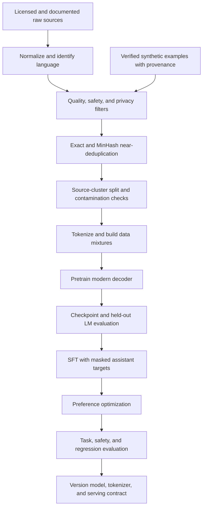
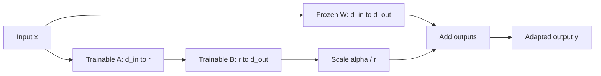
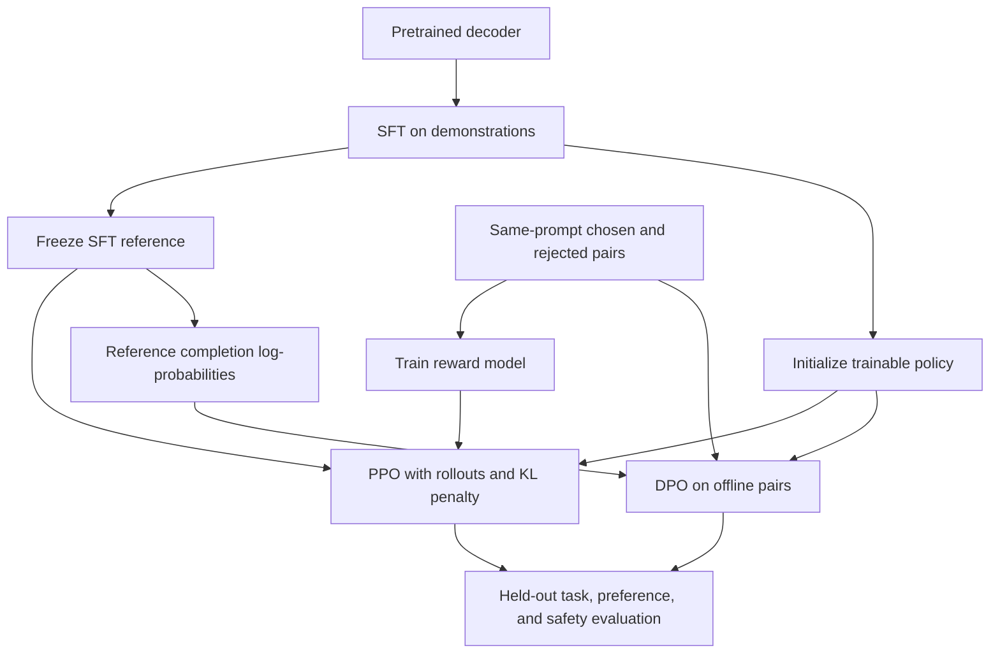

# Branch 5 notes — LLM engineering and fine-tuning

This branch follows one artifact through the training stack: a decoder language model.
Pretraining fits a broad distribution over tokens.
Supervised fine-tuning (SFT) teaches a response format and task behavior.
Preference optimization changes how the model ranks plausible responses.
These stages use different data contracts and different evaluation signals.

The [overview](index.md) allocates exactly nine hours.
The [problems](problems.md) turn the equations into reproducible checks.
Review [attention and LM objectives](../branch-04-transformers-nlp/notes.md) and [AdamW and mixed precision](../branch-03-deep-learning/notes.md) when a tensor or optimizer term feels unclear.

## Reading and execution contract

The small Python examples run on a CPU.
Snippets labeled PyTorch require `torch`.
The SFT example additionally requires `transformers`, `datasets`, `peft`, `trl`, and `accelerate`.
QLoRA additionally requires a supported GPU/backend and `bitsandbytes`.
No large training run is necessary to finish the core branch.

Use your existing project environment.
If you create an isolated lab, the following command installs the core teaching dependencies through `uv`.
It does not install CUDA drivers or guarantee support for your accelerator.

```bash
uv venv .venv
uv pip install --python .venv/bin/python torch transformers datasets peft trl accelerate
```

Record exact package versions when you save a training artifact.
The trainer examples use `SFTConfig`, `processing_class`, and `max_length` from the verified TRL documentation.
Do not substitute an old blog's `tokenizer=` or `max_seq_length=` arguments without checking its version.
Prefer a tiny local check before reserving GPU time.

## 5.1 Pre-training dynamics and architecture variants

### Separate model scale, data scale, and compute

Let $N$ denote the number of model parameters and $D$ the number of training tokens.
Let $C$ denote total floating-point operations, abbreviated FLOPs.
FLOPs count operations; FLOP/s measures an execution rate.
Do not compare a token count directly with a GPU's peak FLOP/s.

A common dense-decoder estimate is

$$
C \approx 6ND.
$$

The factor six approximates a forward pass and its backward pass over dense parameters.
It omits details such as long-context attention, embeddings, activation recomputation, and optimizer work.
It is a planning estimate, not a profiler.
For a mixture-of-experts model, total stored parameters and parameters active per token differ.
A learned router sends each token to a small subset of experts, so most stored weights stay idle for any single token.
Report both numbers: memory is sized by stored parameters, while compute and latency track active parameters.
Compare routing quality and expert load balance against a dense model of similar active size.
Do not insert the total stored parameter count into this dense estimate without qualification.

Parameter count also depends on convention.
Scaling-law fits often count non-embedding parameters.
Small models with large vocabularies make that distinction important.
Use one counting convention consistently when comparing predictions.

### Kaplan power laws and their scope

[Kaplan et al.](https://arxiv.org/abs/2001.08361) measure smooth power-law trends in held-out language-model loss.
In a model-limited regime, a simplified trend is

$$
L(N) \propto N^{-\alpha_N}.
$$

In a data-limited regime, a corresponding trend is

$$
L(D) \propto D^{-\alpha_D}.
$$

The paper reports fitted exponents near $\alpha_N=0.076$ and $\alpha_D=0.095$ for its setup.
These are empirical fits over particular architectures, datasets, and training procedures.
They are not universal constants.
The irreducible loss floor also matters when extrapolating far beyond the fitted range.

The practical lesson is to run several small, controlled experiments before committing a large budget.
Fit loss against model size, token count, and measured compute.
Hold tokenizer, evaluation set, and data mixture fixed when comparing points.
A changed validation distribution can invalidate an otherwise smooth curve.

Kaplan's compute-optimal results favor increasing model size relatively aggressively as compute grows.
Later Chinchilla experiments revise that allocation toward substantially more data.
Do not mix coefficients from the two experimental setups into one purported exact law.

### Chinchilla allocation

[Hoffmann et al.](https://arxiv.org/abs/2203.15556) study the joint allocation of parameters and tokens.
A useful approximation near their studied regime is

$$
D \approx 20N.
$$

Read this as roughly twenty training tokens per parameter for a compute-efficient training allocation.
It is not a required dataset size for every model.
Tokenizer, repeated data, data quality, target loss, and training method change the trade-off.
Inference cost can change the engineering optimum as well.

One fitted loss model takes the form

$$
L(N,D) = E + A N^{-\alpha} + B D^{-\beta},
$$

where $E$ estimates an irreducible floor.
Substitute $D=C/(6N)$ for a fixed compute budget.
The resulting one-variable objective balances model-limited and data-limited error.
The empirical near-equal scaling of $N$ and $D$ motivates the simple twenty-to-one rule of thumb.

Combining the rule with the dense compute approximation gives

$$
C \approx 6N(20N)=120N^2,
\qquad
N \approx \sqrt{C/120}.
$$

Check dimensions: parameters and tokens are counts, and the factor six represents FLOPs per parameter-token pair.
The numeric constant 120 belongs to this approximation, not to physics.

### Worked budget: an eight-billion-parameter decoder

Suppose $N=8\times10^9$.
The approximate compute-optimal token budget is

$$
D=20(8\times10^9)=160\times10^9
\text{ tokens}.
$$

The training operation budget is

$$
C=6(8\times10^9)(160\times10^9)
 =7.68\times10^{21}\text{ FLOPs}.
$$

Suppose an eight-GPU cluster sustains $2\times10^{14}$ FLOP/s per GPU on this workload.
The aggregate rate is $1.6\times10^{15}$ FLOP/s.
The estimated compute time is

$$
t=\frac{7.68\times10^{21}}{1.6\times10^{15}}
 =4.8\times10^6\text{ s}
 \approx55.56\text{ days}.
$$

This calculation uses a measured sustained rate, not the hardware's marketing peak.
Add operational headroom for evaluation, restarts, checkpointing, and data stalls.
If your rate already includes those pauses, do not subtract utilization a second time.

The following standalone script reproduces the arithmetic.

```python
n = 8_000_000_000
d = 20 * n
c = 6 * n * d
cluster_rate = 8 * 2e14
days = c / cluster_rate / 86_400
print(f"tokens={d / 1e9:.0f}B")
print(f"flops={c:.2e}")
print(f"days={days:.2f}")
```

Expected output is `tokens=160B`, `flops=7.68e+21`, and `days=55.56`.
Changing $N$ by a factor of two changes this approximate optimal compute by a factor of four.
That quadratic relation follows from scaling both parameters and tokens.

### Training-optimal is not product-optimal

A product can serve trillions of output tokens after one training run.
A smaller model trained on more tokens can cost more to train but less to serve.
Its lifetime cost can therefore be lower than that of the training-compute-optimal model.
The [Llama 3 report](https://arxiv.org/abs/2407.21783) gives a concrete modern training reference rather than treating twenty tokens per parameter as a ceiling.

Write the decision as a lifecycle budget:

$$
\text{total cost}
=\text{training cost}+\text{expected inference cost}.
$$

Add quality and latency constraints before selecting a model size.
An estimate that ignores inference volume answers only the training-allocation question.
Repeated low-quality tokens also do not equal fresh high-quality data merely because their counts match.

### Modern decoders versus the vanilla transformer

Branch 4 introduces the attention mechanism and causal objective.
Modern models retain those core ideas but change several components.
The following comparison describes common choices, not a mandatory universal architecture.
Inspect the target model's actual configuration before selecting adapter modules.

| Component | Vanilla reference | Common modern choice | Engineering consequence |
|---|---|---|---|
| Feed-forward network | Two projections and ReLU | SwiGLU gated feed-forward block | Different parameter accounting and activation behavior |
| Normalization | LayerNorm, often post-residual in the original design | RMSNorm, often pre-residual | Different normalization statistics and stable residual pathways |
| Token embeddings | Some implementations tie input/output weights | Some models use untied embeddings | More parameters and independent output logits |
| Attention execution | Materialize attention scores in device memory | FlashAttention-2/3 kernels | Less memory traffic without changing causal attention semantics |
| Key/value heads | Multi-head attention | Often grouped-query attention | Smaller key/value cache and nonsquare adapter target shapes |

SwiGLU uses a gated product:

$$
\operatorname{FFN}(x)
=W_{\mathrm{down}}
\left[\operatorname{SiLU}(W_{\mathrm{gate}}x)
\odot(W_{\mathrm{up}}x)\right],
\qquad
\operatorname{SiLU}(z)=z\sigma(z).
$$

The elementwise product is the gate.
The three projections replace the usual two-projection block.
Implementations often reduce the intermediate width relative to a naive three-matrix replacement to control parameter count.
Do not assume a fixed width multiplier across model families.

RMSNorm rescales a vector by its root-mean-square magnitude:

$$
\operatorname{RMSNorm}(x)_i
=g_i\frac{x_i}{\sqrt{\frac{1}{d}\sum_j x_j^2+\epsilon}}.
$$

Unlike LayerNorm, it does not subtract the feature mean.
The learned scale $g$ preserves per-feature flexibility.
Pre-normalization places this operation before a sublayer inside the residual block.
Normalization type and normalization placement are separate choices.

With vocabulary size $V$ and hidden width $d$, an embedding table contains $Vd$ parameters.
Tying the output projection to that table shares those weights.
Untying it adds another $Vd$ parameters compared with the tied configuration.
For $V=128{,}000$ and $d=4096$, the additional count is $524{,}288{,}000$ parameters.
That is not a negligible addition in a small decoder.

### FlashAttention changes execution, not the model objective

[FlashAttention-2](https://arxiv.org/abs/2307.08691) improves attention's work partitioning and parallelism.
It tiles computation so that the full attention matrix need not live in high-bandwidth memory.
It computes exact attention in the algorithmic sense, subject to floating-point rounding differences.
It is not a sparse approximation of the attention pattern.

[FlashAttention-3](https://arxiv.org/abs/2407.08608) targets Hopper GPUs with asynchronous execution and hardware-specific scheduling.
Its benefits and supported dtypes depend on the kernel and device.
An installation that supports FA2 does not automatically support FA3.
Measure end-to-end training tokens per second rather than assuming every workload obtains the paper's kernel speedup.

For ordinary dense attention, the quadratic sequence-length arithmetic remains.
Reducing memory traffic does not remove every long-context compute bottleneck.
Use the same attention mask and positional convention when comparing kernels.

### Data curation is part of the training algorithm

Raw web text contains duplicated pages, boilerplate, personal data, licensing restrictions, and malicious instructions.
A larger crawl does not automatically create a better training set.
Keep provenance metadata so you can remove a source and reproduce a filtering decision.
Use the [FineWeb report](https://arxiv.org/abs/2406.17557) as a concrete curation reference.

MinHash estimates the similarity of sets without comparing every pair of full documents.
Split each normalized document into overlapping token or word shingles.
A shingle is a short consecutive subsequence, such as five words.
The Jaccard similarity of two shingle sets is

$$
J(A,B)=\frac{|A\cap B|}{|A\cup B|}.
$$

For a random permutation, the chance that two sets share the minimum hashed element equals their Jaccard similarity.
Several independent hashes form a compact signature.
Locality-sensitive hashing groups likely similar signatures into candidate buckets.
Verify candidate similarities before applying a deletion policy when feasible.

MinHash detects near duplicates, not semantic paraphrases in general.
Its threshold and shingle size change what it removes.
Normalize carefully: aggressive normalization can collapse distinct code or mathematics examples.
Keep one representative per duplicate cluster and record the cluster decision.

Split at the source or duplicate-cluster level before building train and evaluation sets.
Otherwise a near duplicate can appear in both splits and inflate validation quality.
Also scan for benchmark contamination against protected evaluation sources.
Never tune filters on the final held-out benchmark's answer content.

Quality filtering can combine language identification, boilerplate rules, source metadata, and trained quality classifiers.
A quality classifier can encode its annotators' linguistic and cultural preferences.
Audit retained and removed samples across languages and subject areas.
Low classifier confidence is not proof that a dialect or low-resource language has low educational value.

Synthetic data comes from a model rather than direct human authorship.
It can supply task coverage, difficult variants, and machine-checkable solutions.
Generate with diverse prompts, record the generator and license constraints, and verify outputs with independent checks.
Do not use the same model's confidence as your only correctness signal.

Risks include hallucinated facts, copied personal information, narrow style distributions, and contamination from benchmark-like prompts.
Repeated self-generated training can amplify errors and reduce diversity.
Synthetic preference pairs can encode a judge's verbosity or formatting preferences instead of task success.
Keep a human-reviewed holdout and label synthetic provenance explicitly.

### Diagram: the modern training stack



Every arrow carries a versioned artifact or a reproducible transformation.
A tokenizer change invalidates cached token counts and can alter the model's input contract.
A failed evaluation sends you back to the relevant stage; it does not justify silently changing the holdout.

### Common pitfalls

- Treating twenty tokens per parameter as a minimum quality guarantee.
- Reporting peak GPU FLOP/s as sustained training throughput.
- Calling FlashAttention a different attention objective.
- Assuming all decoder models tie or untie embeddings in the same way.
- Deduplicating after a random document split without checking cross-split clusters.
- Keeping synthetic examples whose answers no independent process verifies.

### Checklist

- [ ] State what $N$, $D$, and $C$ count before inserting numbers.
- [ ] Recompute the eight-billion-parameter example without a calculator script.
- [ ] Distinguish a data budget from a wall-clock and hardware budget.
- [ ] Explain RMSNorm and SwiGLU in one equation each.
- [ ] Identify a data provenance artifact and a contamination check.

## 5.2 Adaptation, SFT, and parameter-efficient fine-tuning

### Choose the adaptation objective before choosing a library

Continued pretraining uses a language-model objective on domain text.
SFT uses demonstrations of the responses you want under a specified prompt format.
Preference optimization compares responses or uses labeled response desirability.
These are not interchangeable ways of adding facts to a model.

Use retrieval when facts change frequently and must remain attributable.
Use SFT when examples teach stable behavior, output structure, or domain-specific response patterns.
You can combine both, but evaluate each intervention separately.
The [PEFT docs](https://huggingface.co/docs/peft) and [TRL docs](https://huggingface.co/docs/trl) separate adapter mechanics from training objectives.

### Dataset schemas: Alpaca, messages, and ChatML

An Alpaca-style record stores an instruction, optional context, and an output.
The schema alone does not specify the tokenizer's special tokens.
The following JSON is one complete record.

```json
{
  "instruction": "Convert the temperature to Celsius.",
  "input": "68 degrees Fahrenheit",
  "output": "20 degrees Celsius."
}
```

A literal Alpaca-style rendering uses section delimiters.
This text shows the actual training string, not a dictionary representation.

```text
### Instruction:
Convert the temperature to Celsius.

### Input:
68 degrees Fahrenheit

### Response:
20 degrees Celsius.
```

ShareGPT-like datasets often store a list of `from`/`value` objects.
Map `human` to `user` and `gpt` to `assistant` before using a standard tokenizer chat template.
Different exported datasets use different field names; validate the schema rather than inferring it from the filename.

```json
{
  "conversations": [
    {"from": "human", "value": "What is 2 + 2?"},
    {"from": "gpt", "value": "4."}
  ]
}
```

ChatML is a serialized chat format with explicit role boundaries.
This teaching example uses the common `im_start` and `im_end` markers.
It does not imply that every pretrained model recognizes those strings as special tokens.

```text
<|im_start|>user
What is 2 + 2?<|im_end|>
<|im_start|>assistant
4.<|im_end|>
```

The next standalone formatter converts a validated ShareGPT-style record into that exact string.
It rejects unknown roles and missing turns instead of silently changing training intent.
For deployment, use the actual model tokenizer's chat template rather than hard-coding ChatML for a different model family.

```python
def sharegpt_to_chatml(record):
    roles = {"human": "user", "gpt": "assistant", "system": "system"}
    turns = record["conversations"]
    if not turns:
        raise ValueError("At least one turn is required")
    parts = []
    for turn in turns:
        role = roles[turn["from"]]
        text = turn["value"]
        if not isinstance(text, str) or not text.strip():
            raise ValueError("Each turn needs nonempty text")
        parts.append(f"<|im_start|>{role}\n{text}<|im_end|>\n")
    return "".join(parts)


sample = {"conversations": [
    {"from": "human", "value": "What is 2 + 2?"},
    {"from": "gpt", "value": "4."},
]}
print(sharegpt_to_chatml(sample), end="")
```

Expected output matches the two-turn ChatML block above.
Escaping untrusted delimiter-like content and enforcing turn-order rules require a production schema policy.
Do not mistake this minimal serializer for a complete dataset validator.

The [Transformers chat-template guide](https://huggingface.co/docs/transformers/main_classes/chat_templating) explains model-specific rendering.
For a tokenizer with a configured template, call `apply_chat_template(messages, tokenize=True, add_generation_prompt=False)` for complete training conversations.
At inference, an unfinished assistant turn often needs `add_generation_prompt=True`.
Do not append duplicate beginning-of-sequence tokens after rendering a template.

### Prompt masking: what the model must predict

A causal language model predicts the next token at every non-masked target position.
For instruction tuning, the user prompt supplies context but usually does not receive supervised loss.
Set its target labels to the ignore index, conventionally `-100` in PyTorch cross-entropy.
Keep the prompt tokens in the input and attention context.
Masking their labels does not remove them from attention.

For response target positions $T$, the loss is

$$
\mathcal L_{\mathrm{SFT}}
=-\frac{1}{|T|}\sum_{t\in T}
\log\pi_\theta(x_t\mid x_{<t}).
$$

The first response token is predicted by the logit immediately before it.
Most causal language-model classes shift logits and labels internally.
Do not manually shift the stored label vector and then let the model shift it again.
Mask padding labels too, even if the padding ID equals an end-of-sequence ID.

Here is a runnable token-level example with a deliberately tiny vocabulary.
The labels align with input positions; a normal causal LM performs the shift during its loss calculation.
The final input token is padding.

```python
input_ids = [10, 11, 12, 20, 21, 2, 0]
prompt_length = 3
attention_mask = [1, 1, 1, 1, 1, 1, 0]
labels = [
    token if i >= prompt_length and attention_mask[i] else -100
    for i, token in enumerate(input_ids)
]
print(labels)
print("supervised positions:", [i for i, y in enumerate(labels) if y != -100])
```

Expected labels are `[-100, -100, -100, 20, 21, 2, -100]`.
The supervised positions are `[3, 4, 5]`.
The model learns to emit the response and its end marker, but not the prompt or padding.

For multi-turn chat, mark each assistant span rather than one suffix of the whole conversation.
A chat template can expose an assistant mask through generation markers when the tokenizer supports it.
Inspect decoded tokens and masks on several real examples before training.
Finding a boundary by separately tokenizing a text prefix can fail when a tokenizer merges across that boundary.

### Sequence packing

Packing concatenates multiple short examples into fewer model input sequences.
It reduces wasted padding and can increase useful supervised tokens per second.
It does not create additional independent examples.
Count effective training exposure in tokens as well as rows.

Each packed example still needs its own completion mask and end marker.
If the implementation allows cross-example attention, the second example can condition on the first.
Some training pipelines accept that trade-off; others use block-diagonal attention or variable-length kernels to preserve boundaries.
An end-of-sequence token alone does not mathematically block attention.

Packing behavior depends on the trainer, attention backend, and packing strategy.
Inspect the actual collated inputs, position IDs, and attention behavior.
Keep packing off for the first correctness run.
Enable it only after the un-packed loss mask and boundaries pass inspection.

### LoRA as a low-rank weight update

[LoRA](https://arxiv.org/abs/2106.09685) freezes a pretrained weight matrix and trains a low-rank correction.
Use column-vector notation with $W\in\mathbb R^{d_{\mathrm{out}}\times d_{\mathrm{in}}}$.
Let $A\in\mathbb R^{r\times d_{\mathrm{in}}}$ and $B\in\mathbb R^{d_{\mathrm{out}}\times r}$.
Then

$$
W'=W+sBA,\qquad s=\frac{\alpha}{r}.
$$

Some introductions write $W'=W+BA$ and absorb $s$ into a factor.
Keep the scale explicit when comparing adapter checkpoints.
The rank $r$ bounds the rank of the correction, not the rank of the full adapted matrix.
The frozen $W$ can remain full rank.

The trainable parameter count for one targeted matrix is

$$
P_{\mathrm{LoRA}}=r(d_{\mathrm{in}}+d_{\mathrm{out}}).
$$

The frozen dense matrix contains $d_{\mathrm{in}}d_{\mathrm{out}}$ parameters.
Biases, saved embedding modules, and extra trainable heads add parameters outside this formula.
Sum the formula over every actual targeted matrix rather than multiplying by a guessed model name.

Standard initialization samples $A$ randomly and sets $B=0$.
That makes $BA=0$ at the start, so the model initially preserves the base output.
It also allows $B$ to receive a gradient immediately.
If both $A$ and $B$ start at zero, both gradients vanish and the update cannot begin learning.
At the standard initialization, $A$ often receives zero gradient on the first step because $B=0$.

### Diagram: adapter injection



The frozen branch still participates in forward computation.
For internal layers, autograd also needs the base operation to propagate gradients to earlier adapters.
Freezing parameters does not mean removing the base model from memory or disabling all its computations.

### Worked count: attention-only adapters

Assume 32 layers, hidden width 4096, and ordinary multi-head attention.
Each of $W_q,W_k,W_v,W_o$ is $4096\times4096$.
Target all four projections at rank 16.

For one projection,

$$
P_1=16(4096+4096)=131{,}072.
$$

For the model,

$$
P=32\times4\times131{,}072=16{,}777{,}216.
$$

Relative to an eight-billion-parameter base, this is approximately $0.210\%$.
It excludes biases and other saved modules.
If $\alpha=32$, then the update scale is $\alpha/r=2$.
Changing $\alpha$ does not change the trainable parameter count.

Grouped-query attention often makes $W_k$ and $W_v$ narrower than $W_q$ and $W_o$.
For 4096 input dimensions and 1024 output dimensions, one key projection has $16(4096+1024)=81{,}920$ adapter parameters.
The square-matrix count above is therefore a stated hypothetical, not a universal count for every 8B model.
The problems include the grouped-query variant.

### Runnable LoRA linear layer and identity regression check

This standalone PyTorch example uses row-major batches of shape `[batch, d_in]`.
`F.linear(x, W)` computes $xW^T$.
The adapter computes `F.linear(F.linear(x, A), B)`, which equals $xA^TB^T$.
That is the row-vector form of $BAx$.

```python
import math
import torch
from torch import nn
from torch.nn import functional as F


class LoRALinear(nn.Module):
    def __init__(self, base, rank=2, alpha=4):
        super().__init__()
        if rank <= 0:
            raise ValueError("rank must be positive")
        self.base = base
        self.base.requires_grad_(False)
        self.scale = alpha / rank
        self.A = nn.Parameter(base.weight.new_empty(rank, base.in_features))
        self.B = nn.Parameter(base.weight.new_zeros(base.out_features, rank))
        nn.init.kaiming_uniform_(self.A, a=math.sqrt(5))

    def forward(self, x):
        update = F.linear(F.linear(x, self.A), self.B)
        return self.base(x) + self.scale * update


torch.manual_seed(7)
base = nn.Linear(4, 3, bias=False)
layer = LoRALinear(base, rank=2, alpha=4)
x = torch.randn(5, 4)
torch.testing.assert_close(layer(x), base(x), rtol=0, atol=0)
loss = layer(x).square().mean()
loss.backward()
assert base.weight.grad is None
assert layer.B.grad.abs().sum().item() > 0
assert layer.A.grad.abs().sum().item() == 0
print("identity=True frozen_base=True trainable=14")
```

There are $2(4+3)=14$ trainable parameters.
The assertions check the unchanged initial function and the first-step gradient behavior.
This is a regression check embedded in the teaching example, not a benchmark of task quality.
After updating $B$, later steps can update both factors.

### Target modules and practical rank choices

Attention targets commonly include query, key, value, and output projections.
In many Transformers decoders their names are `q_proj`, `k_proj`, `v_proj`, and `o_proj`.
Other models combine projections into one matrix or use different names.
Print `model.named_modules()` and verify the matched modules before training.

Targeting feed-forward projections increases adaptation capacity and trainable parameters.
QLoRA experiments often target many or all linear layers rather than only query/value projections.
Begin with a documented baseline, then change rank or target coverage one factor at a time.
A larger rank cannot repair incorrect labels or a contaminated validation set.

### QLoRA: which memory does quantization save?

[QLoRA](https://arxiv.org/abs/2305.14314) trains low-rank adapters through a frozen, quantized base model.
The base weights use compact storage while computation dequantizes blocks into a suitable compute dtype.
The adapters remain trainable in a higher precision.
This is not full four-bit backpropagation through every base parameter.

NF4, or NormalFloat4, uses a four-bit codebook designed around a normal weight distribution.
It is not ordinary floating-point arithmetic with four bits everywhere.
Blockwise scales and quantization metadata remain necessary.
Use the [bitsandbytes integration guide](https://huggingface.co/docs/transformers/quantization/bitsandbytes) to check backend support.

Double quantization quantizes the quantization constants themselves.
This reduces metadata overhead beyond simply packing two weight codes per byte.
Its exact saving depends on block sizes and metadata representation.
Do not report a model's total memory as precisely four bits per parameter.

Paged optimizers use unified-memory mechanisms to handle optimizer-memory spikes.
They can reduce out-of-memory failures during some training phases.
They do not create unlimited GPU memory or remove host-device transfer costs.
The optimizer still holds states for the trainable adapter parameters.

### Worked memory floor for an 8B base

Assume a conventional full fine-tuning accounting model:
two bytes of BF16 weights, two bytes of gradients, four bytes of FP32 master weights, and eight bytes of Adam moments per parameter.
This totals sixteen bytes per parameter before activations and temporary buffers.
Some implementations omit the master copy or store gradients differently, so state the assumption.

$$
M_{\mathrm{full}}=8\times10^9\times16
=128\times10^9\text{ bytes}=128\text{ GB}.
$$

A four-bit base weight floor is

$$
M_{\mathrm{base,4bit}}=8\times10^9\times0.5
=4\times10^9\text{ bytes}=4\text{ GB}.
$$

For 16,777,216 adapter parameters and the same sixteen-byte training accounting,

$$
M_{\mathrm{adapter}}=268{,}435{,}456\text{ bytes}
\approx0.268\text{ GB}.
$$

The combined illustrative floor is about $4.268$ GB before quantization metadata and activations.
The ratio $128/4.268\approx29.99$ compares these stated parameter-state models only.
The commonly quoted $16/0.5=32$ ratio compares full-training bytes with quantized base-weight bytes and ignores adapters entirely.
Neither ratio predicts peak end-to-end VRAM use.

Here GB means $10^9$ bytes.
GiB means $2^{30}$ bytes.
Activation memory, sequence length, attention implementation, checkpointing, logits, and optimizer temporaries can dominate the remaining budget.
Measure allocated and reserved GPU memory after a real training step.

### Practical hyperparameters

Use these values as starting experiments, not universal defaults.
Separate full fine-tuning rates from adapter rates.
An adapter can often tolerate a larger learning rate because the base weights stay fixed.
Small or noisy datasets still overfit quickly.

| Quantity | Starting experiment | What to monitor |
|---|---|---|
| LoRA SFT learning rate | $1\times10^{-4}$ to $2\times10^{-4}$ | Validation response loss and task success |
| Full fine-tuning learning rate | $5\times10^{-6}$ to $2\times10^{-5}$ | Forgetting and instability |
| Effective batch | 16–64 sequences initially | Supervised tokens per update and gradient noise |
| Epochs | 1–3 initially | Held-out loss and repeated-example memorization |
| LoRA rank | 8–32 for an initial comparison | Quality, memory, and adapter size |
| LoRA dropout | 0–0.05 initially | Overfitting versus convergence speed |
| Warmup ratio | About 0.03 initially | Early loss spikes |
| Gradient clipping | Norm 1.0 initially | Frequent clipping and loss spikes |

Effective batch size is

$$
B_{\mathrm{eff}}=B_{\mathrm{device}}
\times G_{\mathrm{accum}}
\times n_{\mathrm{devices}}.
$$

For two examples per device, eight accumulation steps, and four devices, $B_{\mathrm{eff}}=64$ sequences.
Packing and variable-length examples make token counts more informative than sequence counts alone.
Check how your trainer normalizes token losses across microbatches and distributed workers.
Unequal target lengths can make naive averages of batch means differ from a global token mean.

### Runnable SFTTrainer configuration

The next script performs one tiny SFT step and saves an adapter.
It downloads an ungated small model and needs internet access plus enough RAM or accelerator memory.
The dataset uses explicit prompt/completion fields, so TRL can mask the prompt without guessing text boundaries.
This intentionally uses `packing=False` for a correctness-first run.

See the verified [SFTTrainer reference](https://huggingface.co/docs/trl/sft_trainer) for the current constructor and masking behavior.
This is a smoke run, not a useful task fine-tune.
Use independently held-out examples and evaluation scheduling in a real experiment.

```python
import torch
from datasets import Dataset
from peft import LoraConfig
from transformers import AutoModelForCausalLM, AutoTokenizer
from trl import SFTConfig, SFTTrainer

model_id = "Qwen/Qwen2.5-0.5B-Instruct"
tokenizer = AutoTokenizer.from_pretrained(model_id)
if tokenizer.pad_token_id is None:
    tokenizer.pad_token = tokenizer.eos_token
model = AutoModelForCausalLM.from_pretrained(model_id, dtype=torch.float32)
model.config.use_cache = False
dataset = Dataset.from_list([
    {"prompt": "Question: What is 2 + 2?\nAnswer:", "completion": " 4."},
    {"prompt": "Question: What is 3 + 3?\nAnswer:", "completion": " 6."},
])
adapter = LoraConfig(
    r=8,
    lora_alpha=16,
    lora_dropout=0.0,
    target_modules=["q_proj", "k_proj", "v_proj", "o_proj"],
    bias="none",
    task_type="CAUSAL_LM",
)
args = SFTConfig(
    output_dir="sft-smoke",
    per_device_train_batch_size=1,
    gradient_accumulation_steps=2,
    learning_rate=2e-4,
    max_steps=1,
    max_length=128,
    packing=False,
    completion_only_loss=True,
    bf16=False,
    fp16=False,
    report_to="none",
    save_strategy="no",
    logging_steps=1,
    seed=7,
)
trainer = SFTTrainer(
    model=model,
    args=args,
    train_dataset=dataset,
    processing_class=tokenizer,
    peft_config=adapter,
)
trainer.train()
trainer.save_model("sft-smoke/adapter")
tokenizer.save_pretrained("sft-smoke/adapter")
print("adapter saved")
```

Expected behavior is one optimizer update and an adapter artifact under `sft-smoke/adapter`.
Loss and wall-clock time depend on the package versions and hardware.
The example uses a plain prompt contract deliberately; it does not claim to preserve the model's instruction chat template.
For real conversational SFT, supply structured `prompt`/`completion` message lists or `messages` with an appropriate assistant mask.

Set `assistant_only_loss=True` only when the template exposes assistant generation spans.
The current TRL guide requires generation markers or a supported template patch for that path.
Do not enable both arbitrary text formatting and assistant masking without checking their compatibility.
The trainer cannot recover roles from an unstructured string reliably.

### QLoRA loader configuration

This optional loader shows the NF4 settings, not a second complete trainer.
Run it only on a CUDA backend supported by your installed bitsandbytes build.
It downloads the same small model so you can inspect the storage contract before attempting an 8B run.
Install `bitsandbytes` in the lab environment first.

```python
import torch
from peft import prepare_model_for_kbit_training
from transformers import AutoModelForCausalLM, BitsAndBytesConfig

if not torch.cuda.is_available() or not torch.cuda.is_bf16_supported():
    raise RuntimeError("This example requires BF16-capable CUDA and bitsandbytes")
quantization = BitsAndBytesConfig(
    load_in_4bit=True,
    bnb_4bit_quant_type="nf4",
    bnb_4bit_use_double_quant=True,
    bnb_4bit_compute_dtype=torch.bfloat16,
)
model = AutoModelForCausalLM.from_pretrained(
    "Qwen/Qwen2.5-0.5B-Instruct",
    quantization_config=quantization,
    device_map={"": torch.cuda.current_device()},
    dtype=torch.bfloat16,
)
model = prepare_model_for_kbit_training(model)
print("quantized base prepared; attach LoRA before training")
```

Attach a `LoraConfig` through PEFT or the SFT trainer before constructing a training optimizer.
The preparation helper freezes base parameters and handles training-related preparation.
It does not by itself add trainable adapter matrices.
For a supported bitsandbytes optimizer path, `optim="paged_adamw_8bit"` is a trainer setting, not a quantization field.

### Merge-on-save versus adapter serving

Adapter serving keeps the base checkpoint and LoRA factors separate.
It supports sharing one base across several task adapters and makes small artifact distribution convenient.
The serving engine must support the adapter's target modules, rank, dtype, and base revision.
Record the exact base revision; matching a human-readable model family name is insufficient.

Merging adds $sBA$ into each targeted dense weight and removes the extra adapter path.
For ordinary non-quantized weights, PEFT exposes `merge_and_unload()`.
The result is a merged model rather than a switchable adapter.
Keep the unmerged adapter artifact if you need reversible task selection.

Merging into a quantized base can involve dequantization, unsupported paths, or another quantization pass.
Prefer loading the exact base in a supported full precision, applying the adapter, then saving and validating the merged result.
Requantization can change quality and numeric outputs.
Never assume byte-for-byte equivalence between adapter serving and every quantized merged export.

The [PEFT documentation](https://huggingface.co/docs/peft) describes supported adapter operations.
Save the tokenizer, template, adapter config, data revision, and package lock alongside the artifact.
An adapter without its input contract is not a reproducible model release.

### Common pitfalls

Overfitting appears when training response loss falls while held-out performance degrades.
Inspect duplicated examples, excessive epochs, and a mismatch between validation and deployment tasks.
Reduce exposure or adapter capacity only after checking the data and evaluation contract.
Do not use the final benchmark as an early-stopping set.

Catastrophic forgetting means adaptation damages previously useful behavior.
LoRA can still cause forgetting because its update changes the model's effective function.
Evaluate general instruction following, safety behavior, and relevant base capabilities alongside the target task.
Use conservative learning rates and a justified mixture of retention examples when forgetting appears.

Other frequent failures include prompt loss leakage, truncated answers, missing end markers, and an incorrect base checkpoint.
A response-only loss can look small when the pipeline masks nearly every token.
Log the number of supervised tokens and decode sample masks.
Treat an empty target after truncation as a data error, not a harmless row.

### Checklist

- [ ] State whether the task needs continued pretraining, SFT, retrieval, or a combination.
- [ ] Show the rendered string or messages and the exact label mask.
- [ ] Preserve assistant spans when packing or truncating examples.
- [ ] Calculate LoRA counts from actual projection shapes.
- [ ] Check the zero-update initialization and frozen base gradient.
- [ ] Separate parameter storage, optimizer states, and activations in memory estimates.
- [ ] Save the adapter and its complete base/tokenizer contract.
- [ ] Compare target-task quality and retained base capabilities.

## 5.3 Alignment and preference optimization

### Feedback changes the training contract

A demonstration says what response to imitate.
A preference says which response is better under a rubric.
A binary desirability label says whether one response is acceptable or desirable.
Do not treat these labels as identical supervision formats.

Define the rubric before collecting preferences.
Separate factual correctness, task completion, style, and safety whenever the application needs distinct controls.
Record annotator disagreements and source policy.
A model can optimize a noisy proxy without improving the actual product task.

### RLHF: reward modeling from pairwise comparisons

Reinforcement learning from human feedback, or RLHF, commonly begins with an SFT policy.
For a prompt $x$, collect a preferred response $y_w$ and a rejected response $y_l$.
A reward model $r_\phi(x,y)$ maps a prompt-response pair to a scalar score.
The [InstructGPT paper](https://arxiv.org/abs/2203.02155) describes this pipeline with PPO.

The Bradley–Terry model converts a score difference into a preference probability:

$$
P(y_w\succ y_l\mid x)
=\sigma\left(r_\phi(x,y_w)-r_\phi(x,y_l)\right).
$$

Training minimizes the negative log-probability of the observed preference:

$$
\mathcal L_{\mathrm{RM}}
=-\mathbb E\log\sigma(r_w-r_l).
$$

Only differences matter; adding the same prompt-dependent constant to both rewards leaves the probability unchanged.
For scores $r_w=1.2$ and $r_l=0.2$, the difference is one.
The predicted preference probability is $\sigma(1)\approx0.7311$, and the pair loss is about $0.3133$.
Scores do not become calibrated human utility units merely because the loss converges.

Split preference data by prompt/source family rather than individual response pairs alone.
Otherwise different responses to the same prompt can leak across splits.
Audit length bias and judge preference for a particular answer style.
A reward model can learn an easy annotation shortcut instead of the intended criterion.

### PPO and the reference KL penalty

Let $\pi_\theta$ be the policy and $\pi_{\mathrm{ref}}$ a frozen reference, often the SFT policy.
For a fixed prompt distribution, a simplified regularized objective is

$$
\max_\pi\;
\mathbb E_{x,y\sim\pi}[r_\phi(x,y)]
-\beta\,\mathbb E_x
D_{\mathrm{KL}}(\pi(\cdot\mid x)\Vert\pi_{\mathrm{ref}}(\cdot\mid x)).
$$

Here $\beta>0$ controls pressure to stay near the reference.
Larger $\beta$ penalizes deviations more strongly in this reward-optimization objective.
This discourages reward hacking — the policy raising its measured reward while degrading the behavior the reward was meant to proxy — and excessive drift, but it does not guarantee safety.
The reference must use the same response support and tokenization.

PPO, or proximal policy optimization, performs policy updates using sampled rollouts and estimated advantages.
Its clipped surrogate limits the incentive for large probability-ratio changes in one update.
Practical RLHF systems may also train a value model to reduce variance.
Reward-model inference, policy rollouts, reference log-probabilities, and optimization all add operational cost.

The KL term has the sequence-level form

$$
D_{\mathrm{KL}}(\pi\Vert\pi_{\mathrm{ref}})
=\mathbb E_{y\sim\pi}
\left[\log\pi(y\mid x)-\log\pi_{\mathrm{ref}}(y\mid x)\right].
$$

For an autoregressive sequence, each log-probability is a sum over response tokens.
A sampled log-ratio can be negative even though the exact expected KL is nonnegative.
Do not label one sample's signed ratio as the exact nonnegative KL divergence.
Implementations can use different KL estimators and normalization conventions.

### Worked KL penalty

Suppose a one-step policy assigns probabilities $(0.8,0.2)$ to two responses.
The reference assigns $(0.5,0.5)$.
Using natural logarithms,

$$
\begin{aligned}
D_{\mathrm{KL}}
&=0.8\log(0.8/0.5)+0.2\log(0.2/0.5)\\
&=0.8\log1.6+0.2\log0.4\\
&\approx0.192745\text{ nats}.
\end{aligned}
$$

At $\beta=0.1$, the penalty is approximately $0.019275$ reward units.
If expected reward is $0.7$, the regularized objective is approximately $0.680725$.
Nats indicate that the calculation uses natural logarithms.
Changing log bases changes the numeric scale and requires consistent coefficients.

### Derive DPO from the regularized objective

[Direct Preference Optimization](https://arxiv.org/abs/2305.18290), or DPO, rewrites the reward relationship in terms of the policy.
Start with the same KL-regularized objective for one prompt:

$$
\max_\pi\sum_y\pi(y\mid x)r(x,y)
-\beta\sum_y\pi(y\mid x)
\log\frac{\pi(y\mid x)}{\pi_{\mathrm{ref}}(y\mid x)}.
$$

Add a Lagrange multiplier for $\sum_y\pi(y\mid x)=1$.
Differentiate with respect to each $\pi(y\mid x)$ and set the derivative to zero.
Solving the stationarity equation gives

$$
\pi^*(y\mid x)
=\frac{\pi_{\mathrm{ref}}(y\mid x)\exp(r(x,y)/\beta)}{Z(x)},
$$

where

$$
Z(x)=\sum_y\pi_{\mathrm{ref}}(y\mid x)\exp(r(x,y)/\beta).
$$

Take logarithms and rearrange:

$$
r(x,y)
=\beta\log\frac{\pi^*(y\mid x)}{\pi_{\mathrm{ref}}(y\mid x)}
+\beta\log Z(x).
$$

This is the implicit reward representation.
For two responses to the same prompt, the $\beta\log Z(x)$ term cancels.
Substitute a trainable policy $\pi_\theta$ into the Bradley–Terry preference model.
The resulting DPO pair logit is

$$
z=\beta\left[
\log\frac{\pi_\theta(y_w\mid x)}{\pi_{\mathrm{ref}}(y_w\mid x)}
-\log\frac{\pi_\theta(y_l\mid x)}{\pi_{\mathrm{ref}}(y_l\mid x)}
\right].
$$

The loss is

$$
\mathcal L_{\mathrm{DPO}}=-\mathbb E\log\sigma(z).
$$

DPO therefore needs a preference dataset, the trainable policy, and reference log-probabilities.
It does not need to fit a separate reward model or run an online RL rollout loop for this objective.
Reference log-probabilities can be cached when the reference and dataset stay fixed.
The reference requirement does not disappear simply because the optimizer is ordinary gradient descent.

The derivation assumes an appropriate response support and a Bradley–Terry preference model.
It motivates the objective; it does not prove that finite data or a restricted neural policy reaches the global optimum.
Offline preferences can leave the model poorly evaluated on responses outside the dataset.
Collect better data when the learned policy changes the response distribution substantially.

### Worked DPO pair

Suppose the policy completion log-probabilities are $-2$ for the preferred response and $-3$ for the rejected response.
The reference values are $-2.5$ and $-2.7$.
Use $\beta=0.2$.

The preferred log-ratio is $-2-(-2.5)=0.5$.
The rejected log-ratio is $-3-(-2.7)=-0.3$.
The margin is $0.5-(-0.3)=0.8$, so $z=0.16$.
Therefore

$$
\mathcal L=-\log\sigma(0.16)
=\log(1+e^{-0.16})\approx0.616344.
$$

A zero logit gives $\log2\approx0.693147$.
A positive margin lowers the loss below that baseline.
Both responses must share the same prompt; otherwise the canceled prompt-dependent constant need not match.
These are summed completion log-probabilities, not raw logits and not probabilities.

### Runnable stable DPO loss

This PyTorch example computes the same result without explicit sigmoid followed by logarithm.
`logsigmoid` avoids numerical instability for large negative logits.
Each input tensor has shape `[batch]` and represents one completion log-probability per pair.
The frozen reference tensors do not require gradients.

```python
import torch
from torch.nn import functional as F


def dpo_loss(policy_chosen, policy_rejected, ref_chosen, ref_rejected, beta):
    if beta <= 0:
        raise ValueError("beta must be positive")
    chosen_ratio = policy_chosen - ref_chosen.detach()
    rejected_ratio = policy_rejected - ref_rejected.detach()
    logits = beta * (chosen_ratio - rejected_ratio)
    return -F.logsigmoid(logits).mean()


pc = torch.tensor([-2.0], dtype=torch.float64, requires_grad=True)
pr = torch.tensor([-3.0], dtype=torch.float64, requires_grad=True)
rc = torch.tensor([-2.5], dtype=torch.float64)
rr = torch.tensor([-2.7], dtype=torch.float64)
loss = dpo_loss(pc, pr, rc, rr, beta=0.2)
loss.backward()
print(f"loss={loss.item():.6f}")
print(f"chosen_grad={pc.grad.item():.6f}")
print(f"rejected_grad={pr.grad.item():.6f}")
```

Expected output is `loss=0.616344`, `chosen_grad=-0.092017`, and `rejected_grad=0.092017`.
Gradient descent increases the preferred log-probability relative to the rejected one.
Real model probabilities are coupled by normalization, so these scalar directions are a local diagnostic rather than independent probability controls.

To obtain sequence log-probabilities, apply `log_softmax` to shifted token logits, gather the observed token IDs, mask prompt and padding positions, and sum over completion positions.
The original DPO loss uses sequence sums, not arbitrary length averages.
Length-normalized variants change the objective and must be named separately.
The [DPOTrainer guide](https://huggingface.co/docs/trl/dpo_trainer) describes accepted `prompt`, `chosen`, and `rejected` data formats.

### Diagram: RLHF versus the SFT-to-DPO stack



The SFT-to-DPO path implements the intended pretrained-model, SFT, and preference-alignment sequence.
The parallel PPO path shows which reward-model and rollout machinery DPO avoids.
The two paths are alternatives, not mandatory consecutive stages.
Always compare the aligned model with its SFT baseline.

### ORPO: reference-free odds-ratio optimization

[ORPO](https://arxiv.org/abs/2403.07691) combines a preferred-response likelihood term with an odds-ratio preference term.
It avoids a separate frozen reference model.
The original method can combine supervised learning and preference optimization in one stage.
It still needs paired preferred and rejected responses.

The paper uses a length-normalized sequence probability for its odds construction.
Let

$$
\bar p_\theta(y\mid x)
=\exp\left(\frac{1}{|y|}\log\pi_\theta(y\mid x)\right),
\qquad
\operatorname{odds}(y)=\frac{\bar p_\theta(y\mid x)}{1-\bar p_\theta(y\mid x)}.
$$

Its preference term has the form

$$
\mathcal L_{\mathrm{OR}}
=-\log\sigma\left(
\log\frac{\operatorname{odds}(y_w)}{\operatorname{odds}(y_l)}
\right).
$$

Combine that term with a chosen-response negative log-likelihood using a coefficient $\lambda$.
The chosen-response term anchors imitation while the odds ratio penalizes relative preference mistakes.
Compute log-odds stably; values close to zero or one can make naive arithmetic fail.
ORPO is not DPO with its reference tensors silently set to zero.

Choose ORPO when you have preference pairs, want a joint SFT/preference objective, and want to avoid reference-model storage.
Evaluate whether its normalization and imitation trade-off suit your response lengths and domain.
Reference-free does not mean evaluation-free or drift-free.

### KTO: utility from binary desirability

[KTO](https://arxiv.org/abs/2402.01306) uses desirable/undesirable labels for individual responses.
It does not require a preferred and rejected response for every identical prompt.
This can fit feedback streams such as thumbs-up/down more directly than pairwise data collection.
Those labels still need a clear rubric and bias checks.

KTO builds a utility-shaped objective from a reference-relative log-probability.
One explanatory form uses

$$
r_\theta(x,y)=\beta\log\frac{\pi_\theta(y\mid x)}{\pi_{\mathrm{ref}}(y\mid x)}.
$$

Let $b$ denote a detached estimate of the corresponding KL-based reference point.
A desirable example receives utility shaped like $\sigma(r_\theta-b)$.
An undesirable example receives utility shaped like $\sigma(b-r_\theta)$.
The loss penalizes low utility, with separate weights for desirable and undesirable examples.

This sketch exposes the role of the reference point and asymmetric feedback weights.
Consult the paper and trainer implementation for the precise estimator and batching assumptions.
KTO is utility-based, but standard KTO is not reference-model-free.
Do not group it with ORPO on that operational property.

Class imbalance matters when undesirable feedback arrives more often than desirable feedback.
Use the method's weighting controls deliberately rather than duplicating rows blindly.
A lack of response pairs removes one collection constraint, not selection bias in who gives feedback.

### Choose an objective from the feedback you possess

| Method | Required signal | Extra machinery | Suitable starting situation | Main risk to inspect |
|---|---|---|---|---|
| PPO-based RLHF | Reward model data plus fresh policy rollouts | Reward model, reference, often value model | You need online exploration against a useful reward signal | Reward hacking, unstable updates, rollout cost |
| DPO | Same-prompt preferred/rejected pairs | Frozen reference or cached reference scores | You have a clean offline pair dataset and an SFT baseline | Dataset coverage, length/style bias, reference mismatch |
| ORPO | Same-prompt preferred/rejected pairs | No frozen reference model | You want joint imitation and preference learning | Objective weighting and drift without a reference constraint |
| KTO | Labeled desirable/undesirable responses | Reference scores and KL-reference estimate | You have independent binary feedback rather than matched pairs | Label imbalance and noisy feedback selection |

Start with the simplest objective that matches a reliable feedback contract.
Do not collect artificial pairs solely to satisfy a trainer if the original feedback is better represented as binary utility labels.
Do not choose PPO solely because it contains reinforcement learning in the name.
An offline DPO baseline can reveal data problems before you pay for online rollouts.

### Evaluate alignment as a controlled comparison

Reserve prompts before preference collection or model selection.
Evaluate the SFT baseline and aligned model with identical decoding settings.
Randomize answer order when using human or model judges.
Hide model identity from judges and check a sample manually.

Report wins, losses, and ties rather than only a single favorable percentage.
Stratify by response length and task category when style bias is plausible.
Measure task correctness and safety separately from general preference.
An answer can win a style comparison while becoming less truthful.

For 50 held-out prompts, uncertainty remains large.
State the sample size and avoid small-difference claims without uncertainty estimates.
Check regression prompts for forgetting, refusals, privacy, and output-schema validity.
Archive failures as examples for the next data revision, not as reasons to edit the evaluation answers.

### Common pitfalls

- Reversing chosen and rejected examples and optimizing the wrong preference.
- Including prompt-token log-probabilities in only one side of a pair.
- Mixing reference and policy tokenizers or chat templates.
- Reading the DPO coefficient as an automatic guarantee of smaller empirical KL.
- Calling KTO reference-free because it does not require pairs.
- Reporting reward-model score gains as proof of human preference gains.
- Ignoring length bias in judges, reward models, or sequence-level training.

The same symbol $\beta$ appears in the theoretical RLHF regularizer and the DPO implicit-reward derivation.
Their algebraic relationship follows the equations above.
In finite-data neural training, changing a DPO hyperparameter does not guarantee a monotonic change in measured KL or safety.
Tune with held-out behavior, not a slogan about temperature.

### Checklist

- [ ] Write the Bradley–Terry pair likelihood from two scalar rewards.
- [ ] Explain what PPO adds beyond reward-model training.
- [ ] Recompute the two-outcome KL penalty.
- [ ] Derive the implicit reward and cancel the prompt-specific partition term.
- [ ] Reproduce the DPO loss and gradient signs on the tiny pair.
- [ ] State whether your method requires pairs, binary labels, a reference, or rollouts.
- [ ] Compare an aligned model with the exact SFT checkpoint that initializes it.
- [ ] Keep a held-out evaluation and a versioned feedback rubric.

## Optional portfolio extension: a reproducible adaptation artifact

This extension sits outside the nine core hours.
Follow [Project 2](../index.md#project-2-domain-specific-peft-fine-tuning) after the tiny examples work.
Choose a domain with a legal, auditable data source and a clear task metric.
Do not start with the largest model your GPU can barely load.

Deliver a dataset card with source licenses, deduplication method, split counts, and synthetic provenance.
Save a masked SFT sample with decoded input tokens and visible label decisions.
Record rank, alpha, target modules, optimizer, token budget, and exact package/model revisions.
Keep the SFT checkpoint separate from the preference-aligned artifact.

Then run one preference method whose data contract matches your feedback.
Compare on 50 held-out prompts with order-randomized judging and manual spot checks.
Report task metrics, regression failures, peak memory, and measured throughput with hardware details.
Publish or archive the adapter with its base revision and serving contract.
