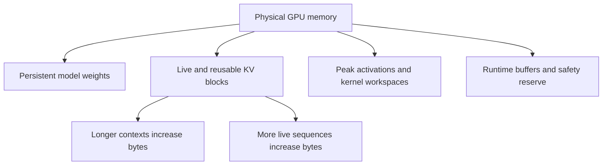
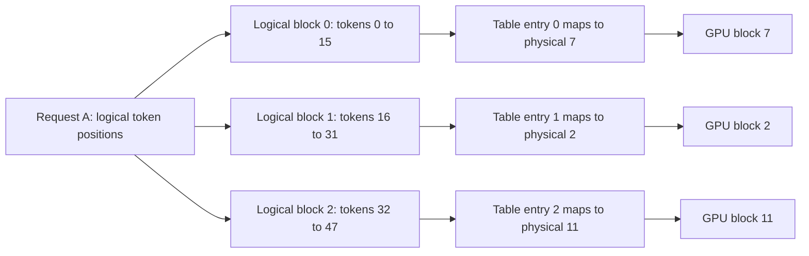
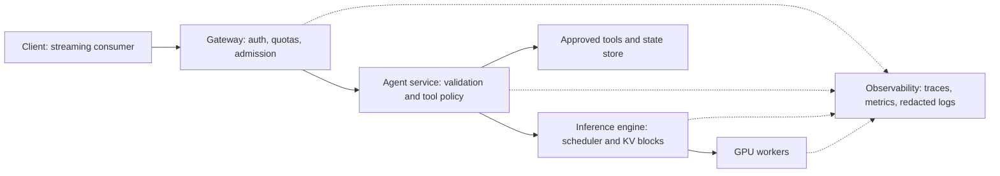

# Branch 7 notes — LLMOps, high-throughput serving & systems

Use these notes with the [seven-hour schedule](index.md#seven-session-schedule).
Complete the [problems](problems.md) as you finish each section.
Read [Branch 4 notes, subtopic 4.2](../branch-04-transformers-nlp/notes.md) for attention and key-value caching.
Read [Branch 5 notes, subtopic 5.2](../branch-05-llm-fine-tuning/notes.md) for quantization basics.

An inference service does more than execute a matrix multiplication.
It admits requests, allocates memory, schedules GPU work, streams partial answers, and records evidence about failures.
Optimize the complete request path rather than one isolated kernel.
The sources in the [overview](index.md#key-sources) support both subtopics.

## 7.1 Inference mechanics & memory bottlenecks

Allocate four hours to this subtopic.
Your output is a memory budget and an explanation of which optimization addresses each bottleneck.
Use the PagedAttention, GPTQ, AWQ, speculative decoding, and SGLang papers as primary references.

### Prefill and decode

**Prefill** processes the prompt and creates the initial key-value cache.
The model processes many prompt positions together, so substantial matrix multiplication can run in parallel.
Long prompts also create large temporary tensors and attention work.
Efficient attention kernels reduce materialized intermediate storage; they do not remove the need to process the prompt.

**Decode** generates subsequent tokens autoregressively.
Each request supplies one new position per ordinary decoding iteration.
The model reads cached keys and values rather than recomputing every previous position.
At small batch sizes, weight and cache movement can dominate arithmetic.
At larger batches, hardware, model shape, and context length determine whether bandwidth or computation dominates.

Do not infer a bottleneck from model size alone.
A long-context request can become cache-bandwidth-heavy even after you quantize its weights.
A large prefill batch can become compute-heavy while decode on the same service remains bandwidth-heavy.
Measure the phase before you select an optimization.

### Memory footprint accounting

Use **GB** for decimal gigabytes, where $1\text{ GB}=10^9$ bytes.
Use **GiB** for binary gibibytes, where $1\text{ GiB}=2^{30}$ bytes.
Likewise, $1\text{ KiB}=1024$ bytes and $1\text{ MiB}=2^{20}$ bytes.
GPU specifications and monitoring tools do not always display the same unit.
Write the unit beside every capacity figure.

Split peak device residency into four terms:

$$
M_{\mathrm{peak}}=M_{\mathrm{weights}}+M_{\mathrm{KV}}+M_{\mathrm{activations/workspaces}}+M_{\mathrm{runtime/reserve}}.
$$

Weights persist across requests.
The KV cache persists for live requests and sometimes for reusable prefixes.
Activations and workspaces vary with the scheduled tokens and selected kernels.
The runtime term includes allocator behavior, communication buffers, graph pools, and safety headroom.
Do not count all free GPU memory as available KV capacity before the runtime profiles these other allocations.



#### Model weights

For $P$ parameters stored at $b_w$ bytes each, the raw weight payload is:

$$
M_{\mathrm{weights,raw}}=P b_w.
$$

This formula counts payload, not a complete quantized checkpoint or an engine's peak memory.
INT4 assumes two packed four-bit values per byte.
Quantization scales, zero points, padding, mixed-precision tensors, and unquantized layers increase real storage.
BF16 has the same two-byte payload as FP16, but a different exponent/mantissa allocation.

| Weight precision | Bytes per parameter | 7B payload | 8B payload | 70B payload |
|---|---:|---:|---:|---:|
| FP32 | 4 | 28 GB / 26.08 GiB | 32 GB / 29.80 GiB | 280 GB / 260.77 GiB |
| FP16 or BF16 | 2 | 14 GB / 13.04 GiB | 16 GB / 14.90 GiB | 140 GB / 130.39 GiB |
| INT8 | 1 | 7 GB / 6.52 GiB | 8 GB / 7.45 GiB | 70 GB / 65.19 GiB |
| INT4 | 0.5 | 3.5 GB / 3.26 GiB | 4 GB / 3.73 GiB | 35 GB / 32.60 GiB |

Here “7B,” “8B,” and “70B” mean exactly 7, 8, and 70 billion parameters for arithmetic.
A released model's exact parameter count can differ from its rounded name.
Use the real checkpoint configuration for deployment.

For example, a nominal 70B INT4 model needs:

$$
70\times10^9\times\frac{4}{8}=35\times10^9\text{ bytes}=32.5963\text{ GiB}.
$$

It cannot fit entirely on a 24 GB or 24 GiB device even before cache and workspace allocations.
Offload or multi-device placement changes that conclusion only by moving some residency elsewhere.
Offload also changes latency and throughput; it is not free capacity.

#### Key-value cache

Let $L$ denote the layer count.
Let $H_{kv}$ denote the number of key/value heads per layer.
Let $D$ denote the dimension of each head.
Let $b_{kv}$ denote bytes per cached scalar.
Let $S$ denote cached tokens per sequence and $B$ denote equal-length sequences.
For conventional full attention without sharing, the cache payload is:

$$
M_{\mathrm{KV}}=2 L H_{kv} D b_{kv} S B.
$$

The leading 2 counts **keys and values**, not forward and backward passes.
Inference does not retain training gradients in this calculation.
For unequal sequence lengths, replace $SB$ with $\sum_{j=1}^{B} S_j$.
For paging, round each allocated sequence length to its block boundary before summing.
For shared prefixes, count shared physical blocks once rather than once per reference.

The bytes per cached token per sequence are:

$$
c_{\mathrm{token}}=2 L H_{kv}D b_{kv}.
$$

**Grouped-query attention**, or GQA, lets several query heads share each key/value head.
Compared with multi-head attention using $H_q$ independent KV heads, GQA reduces this cache term by $H_q/H_{kv}$.
Equivalently, the remaining fraction is $H_{kv}/H_q$.
Do not replace $H_{kv}$ with the query-head count when you size a GQA model.

#### Three model-scale examples

Use these specified architecture dimensions, not a model name, to recompute the numbers.
The 7B case is a classic Llama-2-7B-style multi-head configuration.
The 8B and 70B cases use Llama-3-style grouped-query dimensions.
The Meta reference implementation exposes the separate query and KV head counts.

| Scale | Layers | Query heads | KV heads | Head dimension | FP16 KV bytes/token | At 4,096 tokens, one sequence |
|---|---:|---:|---:|---:|---:|---:|
| 7B MHA | 32 | 32 | 32 | 128 | 524,288 = 512 KiB | 2 GiB |
| 8B GQA | 32 | 32 | 8 | 128 | 131,072 = 128 KiB | 0.5 GiB |
| 70B GQA | 80 | 64 | 8 | 128 | 327,680 = 320 KiB | 1.25 GiB |

For the 8B case, substitute each factor explicitly:

$$
2\times32\times8\times128\times2=131{,}072\text{ bytes/token}=128\text{ KiB/token}.
$$

At $S=4096$ and $B=8$, the cache uses:

$$
131{,}072\times4096\times8=4{,}294{,}967{,}296\text{ bytes}=4\text{ GiB}.
$$

Replacing eight KV heads with 32 increases that cache to 16 GiB.
Thus this GQA configuration reduces KV residency by a factor of four.
For the 70B example, the reduction factor relative to 64 KV heads is eight.
These factors describe cache memory, not an eightfold end-to-end speedup.

For the 7B case, FP16 weights plus one 4,096-token cache already occupy roughly $13.04+2=15.04$ GiB.
For the 8B case, the same payload estimate gives $14.90+0.5=15.40$ GiB.
For the 70B case, it gives $130.39+1.25=131.64$ GiB before sharding and runtime allocations.
These are lower-bound payload estimates, not device-fit guarantees.

#### Activation memory and temporary allocations

An **activation** is an intermediate tensor produced while evaluating a layer.
Inference can release most layer activations once their consumers finish.
Training retains more state for differentiation, so do not copy a training-memory multiplier into a serving budget.
The prompt length and number of tokens scheduled together affect the activation peak.

One hidden-state tensor with $T$ scheduled tokens, hidden dimension $d$, and element size $b_a$ occupies $Tdb_a$ bytes.
For $T=4096$, $d=4096$, and FP16, that is 33,554,432 bytes, or 32 MiB.
This is **one tensor**, not the layer's entire activation footprint.
Projection outputs, MLP intermediates, logits, and kernel workspaces add memory.

A naively materialized FP16 attention-score tensor for one sequence and one layer with 32 query heads at 4,096 positions takes:

$$
32\times4096^2\times2=1{,}073{,}741{,}824\text{ bytes}=1\text{ GiB}.
$$

Memory-efficient attention avoids storing that whole score matrix in global memory.
Its exact peak still depends on the implementation and batch shape.
Measure the peak after warmup and account for the runtime's caching allocator.
Allocated bytes and reserved bytes answer different questions.

#### A concurrency ceiling

Suppose a device has exactly **24,000,000,000 bytes** available for this simplified budget.
Reserve 14,000,000,000 bytes for weights and 2,000,000,000 bytes for all non-KV allocations.
The remaining KV budget is 8,000,000,000 bytes.
For the 8B-style GQA cache at 4,096 tokens per sequence:

$$
B_{\max}=\left\lfloor\frac{8{,}000{,}000{,}000}{131{,}072\times4096}\right\rfloor=14.
$$

Fourteen caches use 7,516,192,768 bytes.
Fifteen use 8,053,063,680 bytes and exceed the budget.
The 14 GB weight assumption represents an independently supplied residency estimate, not the 16 GB raw FP16 payload of an exact 8B model.
Always keep the architecture used for cache arithmetic separate from the actual checkpoint's measured weight allocation.

This ceiling assumes equal lengths, no prefix sharing, and no further overhead inside the KV budget.
If a request grows beyond its admitted token budget, the calculation no longer protects the service.
Reserve room for prompt plus maximum generated length, or implement a measured token-budget scheduler.
An out-of-memory failure during a response is worse than an explicit admission rejection.

#### Runnable snippet 1: GPU memory calculator

Save this standalone program as `memory.py` in your own lab directory.
It uses only the Python standard library and runs on a CPU.
Run it with `uv run --no-project python memory.py`.

```python
from math import floor

GiB = 2**30

def kv_bytes_per_token(layers, kv_heads, head_dim, scalar_bytes=2):
    dimensions = (layers, kv_heads, head_dim, scalar_bytes)
    if any(value <= 0 for value in dimensions):
        raise ValueError("Cache dimensions must be positive")
    return 2 * layers * kv_heads * head_dim * scalar_bytes

for label, layers, heads in [("7B", 32, 32), ("8B", 32, 8), ("70B", 80, 8)]:
    per_token = kv_bytes_per_token(layers, heads, 128)
    print(f"{label}: {per_token} bytes/token; {per_token * 4096 / GiB:.2f} GiB/seq")

weight_bytes = 70_000_000_000 * 4 // 8
print(f"70B INT4: {weight_bytes / 1e9:.1f} GB; {weight_bytes / GiB:.2f} GiB")
cache_budget = 24_000_000_000 - 14_000_000_000 - 2_000_000_000
per_sequence = kv_bytes_per_token(32, 8, 128) * 4096
print(f"Maximum batch: {floor(cache_budget / per_sequence)}")
```

Expected output:

```text
7B: 524288 bytes/token; 2.00 GiB/seq
8B: 131072 bytes/token; 0.50 GiB/seq
70B: 327680 bytes/token; 1.25 GiB/seq
70B INT4: 35.0 GB; 32.60 GiB
Maximum batch: 14
```

### PagedAttention and cache management

The [PagedAttention paper](https://arxiv.org/abs/2309.06180) identifies memory management as a central serving constraint.
A naive implementation reserves a contiguous cache region for each request's maximum possible length.
Most requests do not consume that full reservation.
Allocations also leave holes that cannot satisfy another large contiguous reservation.
The original work reports roughly **60–80% memory waste** in the systems and workloads it analyzes.
This is a historical workload-dependent result, not a universal utilization number for every inference server.

Suppose you reserve 4,096 tokens for each request but the average request retains only 1,024.
Unused reservation alone accounts for $(4096-1024)/4096=75\%$ of reserved cache slots.
Fragmentation can add waste beyond that example.
Neither observation means 75% of total device memory must always remain unused.

PagedAttention divides the logical token sequence into fixed-size blocks.
A **block table** maps each logical block to a physical cache block.
Physical blocks need not sit next to each other in GPU memory.
The attention kernel follows the table when it gathers the keys and values needed for a query.



With 16-token blocks, a 35-token request requires three blocks and allocates 48 slots.
It wastes 13 slots in its last block, not thousands of slots reserved for a maximum context.
For the 8B cache, one block costs $16\times128\text{ KiB}=2\text{ MiB}$.
The request allocates 6 MiB while 35 actual token positions contain 4.375 MiB of KV payload.
Smaller blocks reduce tail waste but increase table and scheduling overhead.
The optimal block size depends on kernels and workload.

When a request completes, the engine can return its unshared blocks to a free pool.
When several requests share a prefix, reference counts keep common blocks live.
If a branch must modify a shared partial block, **copy-on-write** creates a private copy before the write.
Two requests must not overwrite each other's cached keys and values.
Eviction removes reusable blocks only when the runtime can safely release them.

#### Continuous batching

**Static batching** waits for a group and often keeps that group together until its slowest member completes.
Short requests finish while their reserved batch slots remain unavailable to new requests.
**Continuous batching** reschedules the active set at iteration boundaries.
In vLLM, the scheduler can remove finished requests and admit waiting work between model iterations.

Consider requests A and B running in iteration 1.
A completes in iteration 2, while B still needs more tokens.
In iteration 3, the runtime can run B with newly admitted request C.
It does not wait for B to finish before C enters the system.
Admission still depends on available token budget, KV blocks, and scheduler constraints.

Continuous batching improves utilization but does not abolish queueing.
An overloaded server can show higher aggregate tokens per second while individual users wait longer.
Report both throughput and latency percentiles.
Do not equate a large active batch with a healthy service.

#### Runnable snippet 2: vLLM offline inference

Use an isolated environment with a vLLM release compatible with your GPU and driver.
Install the runtime with `uv pip install vllm` inside that environment.
Save and run this program with that environment's Python.
The model downloads on first use, and generated wording can vary across hardware and releases.

```python
from vllm import LLM, SamplingParams

model_id = "Qwen/Qwen2.5-0.5B-Instruct"
llm = LLM(model=model_id, max_model_len=2048, gpu_memory_utilization=0.8)
tokenizer = llm.get_tokenizer()
messages = [{"role": "user", "content": "Define a KV cache in one sentence."}]
prompt = tokenizer.apply_chat_template(
    messages, tokenize=False, add_generation_prompt=True
)
results = llm.generate([prompt], SamplingParams(temperature=0, max_tokens=48))
for result in results:
    print(result.outputs[0].text)
    print("output_tokens", len(result.outputs[0].token_ids))
```

Expected behavior: print a short completion and an `output_tokens` count no greater than 48.
The chat template matters because an instruction model expects role delimiters.
Offline `generate` accepts a collection of prompts, but this call alone does not demonstrate arrival-time scheduling under live HTTP traffic.
Use the load experiment later to evaluate the online service.

### Quantization algorithms and formats

Quantization maps high-precision values onto a smaller set of representable values.
A simple affine quantizer uses a scale $s$ and zero point $z$:

$$
q=\operatorname{clip}(\operatorname{round}(x/s)+z,q_{\min},q_{\max}),\qquad \hat{x}=s(q-z).
$$

The scale and zero point also require storage.
Per-group quantization uses one set of metadata for a group of weights.
Smaller groups can improve reconstruction but consume more metadata and may change kernel efficiency.
For example, symmetric INT8 with $s=1/127$, $z=0$, and $x=0.73$ gives $q=\operatorname{round}(92.71)=93$ and $\hat x=93/127\approx0.7323$, an error of $0.0023$.
For a 70B model with groups of 128 weights, metadata is $70\times10^9/128=546{,}875{,}000$ scale-and-zero-point pairs; at 2 bytes each that is about $1.09$ GB on top of the 35 GB payload.
The weight precision does not automatically set the activation or cache precision.

#### AWQ versus GPTQ

**AWQ**, activation-aware weight quantization, uses representative activation statistics to identify important weight channels.
It searches channel scales that reduce quantization error for a weight-only low-bit representation.
It protects important channels through scaling rather than requiring every important weight to remain a separate FP16 tensor.
At inference, the runtime uses compatible low-bit weight kernels with higher-precision activations.
Calibration data must represent the deployment workload well enough to expose important activation patterns.

**GPTQ** also performs post-training weight quantization.
It quantizes layer weights using an approximate second-order reconstruction objective from calibration inputs.
As it quantizes weights, it compensates for introduced error in weights not yet quantized.
The Hessian-related approximation and blockwise updates distinguish it from simple rounding.
GPTQ is not gradient-based fine-tuning of the whole model.

Both methods can produce four-bit weight checkpoints.
Neither method guarantees the same quality, speed, or memory layout across implementations.
Choose the artifact supported by your target engine and GPU kernels, then evaluate representative tasks.
Measure tool-call validity and long-context behavior as well as average benchmark scores.

#### Dynamic INT8 and INT4

**Dynamic activation quantization** computes activation scales from runtime inputs rather than fixing every activation scale during calibration.
INT8 paths may quantize matrix inputs at runtime while retaining special treatment for activation outliers.
Outlier features can be orders of magnitude larger than typical activations; LLM.int8-style paths keep those channels in higher precision rather than letting one channel widen the scale for every channel.
This adds scale computation and conversion work that a performance comparison must include.
Weight-only four-bit paths often dequantize or use fused kernels while activations remain in FP16/BF16.

Do not assume “dynamic INT4” names a single standardized inference algorithm.
Some tools use that label for loading four-bit weights and reconstructing them during execution.
Other tools support actual low-bit activation kernels under hardware-specific restrictions.
State weight precision, activation precision, cache precision, and scale policy separately.

The Transformers bitsandbytes guide documents `load_in_8bit` and `load_in_4bit` configurations.
NF4 is a four-bit codebook used in supported loading/training paths; it is not the same representation as uniformly spaced INT4.
An NF4 checkpoint does not become AWQ merely because both have roughly four weight bits.
Check the runtime's supported representations before exporting or serving it.

#### GGUF and k-quants

**GGUF** is a file format for model tensors and metadata used by llama.cpp and related tools.
It is not itself a quantization algorithm.
The format can store different tensor types, including multiple low-bit families.
The **k-quants** use block or super-block layouts with scale metadata.

Names such as `Q4_K_M` identify a quantization recipe, not exactly four bits for every stored parameter.
Different tensors can use different quantized types, and metadata increases effective bits per weight.
For example, `Q4_K_M` averages roughly 4.8 effective bits per weight, so an 8B model is about 4.8 GB at that recipe versus the 4.0 GB INT4 floor in the table above.
The `M` recipe generally retains higher precision for selected tensors than its smaller alternative.
Inspect the actual artifact size and llama.cpp metadata rather than deriving exact residency from the name.

GGUF is useful when a CPU, mixed CPU/GPU, or local deployment matches llama.cpp's supported paths.
AWQ/GPTQ artifacts are common choices for compatible GPU serving engines.
Neither format choice proves that one deployment is faster on your workload.
Benchmark the specific architecture, context length, and hardware.

#### Runnable snippet 3: serve an AWQ checkpoint

This invocation **loads an already quantized artifact**; it does not run AWQ calibration.
Use a GPU with enough memory for this 7B-scale checkpoint, its cache, and its workspace.
Read the model's license and confirm the runtime supports its quantization layout.

```bash
vllm serve Qwen/Qwen2.5-7B-Instruct-AWQ \
  --quantization awq \
  --dtype half \
  --max-model-len 4096 \
  --host 127.0.0.1 \
  --port 8000
```

Expected behavior: the server loads AWQ weights and exposes an OpenAI-compatible API on loopback.
If the GPU or runtime cannot support the artifact, resolve that incompatibility rather than silently changing the benchmark precision.
For a GPTQ artifact, use a runtime-supported GPTQ checkpoint and its documented quantization backend.
Do not rename the AWQ files or substitute a GPTQ flag for an AWQ artifact.

### Speculative decoding

Ordinary autoregressive decoding performs a target-model step for each next token.
**Speculative decoding** asks a cheaper draft model to propose several tokens, then verifies the proposal with the target.
The target can evaluate a proposed sequence in parallel within a verification pass.
When a proposal fails verification, the algorithm corrects the distribution and continues from the accepted prefix.

For exact sampling, let the draft probability be $q(x)$ and the target probability be $p(x)$.
A proposed token has acceptance probability $\min(1,p(x)/q(x))$ where $q(x)>0$.
On rejection, sample from the appropriately normalized positive residual distribution $(p-q)_+$.
This correction preserves the target distribution under the algorithm's assumptions.
Simply accepting every “plausible” token does not preserve it.

To estimate progress, suppose the draft proposes $k$ tokens.
Assume each next proposal is accepted with the same conditional probability $\alpha$.
Assume the algorithm emits an extra target token after all $k$ proposals pass, or a correction token at the first rejection.
Ignore end-of-sequence termination for this planning calculation.
Then expected emitted tokens per verification step are:

$$
E[N]=\sum_{i=0}^{k}\alpha^i=\frac{1-\alpha^{k+1}}{1-\alpha},\quad 0\leq\alpha<1.
$$

For $\alpha=1$, the limit is $k+1$.
With $k=4$ and $\alpha=0.8$, the sum is $1+0.8+0.64+0.512+0.4096=3.3616$ tokens.
The expected number of accepted **draft** tokens alone is 2.3616; the target/correction token supplies the extra one.
Keep these two quantities separate.

Let $T_t$ be ordinary target latency per token, $T_d$ be draft latency per token, and $T_v$ be latency for a verification step.
Ignoring other overhead, the speedup estimate is:

$$
\mathrm{speedup}\approx\frac{E[N]T_t}{kT_d+T_v}.
$$

For $T_t=20$ ms, $T_d=2$ ms, and $T_v=20$ ms, the estimate is $3.3616\times20/28=2.4011$.
The speculative step emits 3.3616 expected tokens in 28 ms, or about 8.33 ms per token.
The assumption $T_v=T_t$ needs measurement; verification can cost more than one ordinary target step.
Draft memory, extra cache state, sampling overhead, and batching pressure can erase the gain.

Use speculation when the draft is cheap and agrees with the target on your actual task.
High acceptance on ordinary prose does not prove high acceptance on tool arguments or unusual languages.
Record acceptance rate, accepted tokens per step, and net latency together.
Reduce the draft length if longer proposals add more cost than accepted progress.

### Chunked prefill and prefix caching

A long prompt can occupy the GPU while active decoders wait for their next tokens.
**Chunked prefill** divides that prompt work into smaller scheduling units.
The scheduler can interleave chunks with decode work under a token budget.
This can improve inter-token latency for existing streams, but the new prompt can take longer to reach its first token.
The best chunk size depends on the workload and kernels.

**Prefix caching** reuses KV state for an exact token prefix already processed by the same compatible model configuration.
It avoids recomputing that prefix's prefill.
It does not eliminate attention over that prefix during later decode.
It also consumes cache capacity that otherwise could hold active requests.

SGLang's **RadixAttention** organizes reusable prefixes with a radix-tree idea.
A radix tree compresses shared token paths so requests can match the longest cached prefix.
For example, two requests with the same system prompt and document prefix can reuse that prefix before diverging at their questions.
The runtime tracks live references and evicts reusable state when capacity is needed.

Match token IDs, not visually similar text.
Whitespace, chat-template changes, model revision, adapters, or cache precision can invalidate reuse.
Do not allow one tenant's protected prefix or side-channel behavior to become another tenant's information source.
Use the serving system's isolation controls and test its cache-key semantics.

Suppose a request contains a 2,048-token shared prefix plus a 512-token unique suffix.
At a hypothetical 4,096 prompt tokens/s, uncached prefill takes 625 ms and cached suffix processing takes 125 ms.
The simplified saving is 500 ms before lookup, queueing, and generation overhead.
This is a prefill-work example, not a universal TTFT prediction.
If the prefix has been evicted, the request pays the uncached cost.

### Common pitfalls

- Substitute query heads for KV heads and overestimate GQA cache memory.
- Quantize weights and assume the KV cache also becomes four-bit.
- Treat a payload table as a complete peak-memory measurement.
- Treat the PagedAttention paper's 60–80% waste figure as a law for every implementation.
- Increase concurrency until throughput rises while ignoring a collapsing latency objective.
- Divide accepted draft tokens by verification time but omit draft generation cost.
- Reuse cache state across incompatible models, adapters, tenants, or token prefixes.
- Compare quantized model quality without a calibration and evaluation data description.

### Checklist

- [ ] Label every memory number as bytes, GB, GiB, MiB, or KiB.
- [ ] State the layer count, KV head count, head dimension, precision, and token budget.
- [ ] Add weights, live/reusable cache, activations, runtime buffers, and reserve separately.
- [ ] Explain how a logical block maps to a noncontiguous physical block.
- [ ] Explain how iteration-level admission differs from static batching.
- [ ] Separate quantization algorithm, file format, and kernel support.
- [ ] Include draft cost and verification cost in a speculation estimate.
- [ ] Measure chunked-prefill and prefix-cache effects rather than assuming a gain.

## 7.2 Serving engines & production stacks

Allocate three hours to this subtopic.
Your output is a streaming service sketch, a trace, and a workload report at three concurrency levels.
Use official engine documentation to verify hardware and model support before installation.
The OpenTelemetry, Langfuse, Phoenix, and MDN sources support the operational examples.

### Production engine comparison

An engine choice combines hardware support, model compatibility, operational effort, and workload shape.
Do not choose an engine from a throughput headline produced with a different model and prompt distribution.
Freeze the model revision, quantization, input/output lengths, and latency limits before comparing engines.
Check tool-call and structured-output behavior if the service feeds an agent.

| Engine | Pick it when | Main strengths to evaluate | Constraints and cautions |
|---|---|---|---|
| vLLM | You need a general-purpose open-model server with an OpenAI-compatible interface and iteration-level scheduling | Paged KV management, continuous batching, broad model ecosystem, benchmark tooling | Support depends on model, accelerator, quantization, and release; tune token budgets rather than only request count |
| TensorRT-LLM | Your deployment targets NVIDIA hardware and you can invest in hardware-specific optimization | NVIDIA-focused kernels, precision options, parallelism, deployment integrations | Validate the supported GPU/model/runtime matrix; engine preparation and operational paths vary by backend and release |
| TGI | You maintain an existing Hugging Face TGI deployment whose supported features meet your needs | Familiar Hugging Face model workflow, streaming, batching, established deployment interface | Official documentation marks TGI as maintenance mode; do not assume feature growth for a fresh production design |
| SGLang | Your workload has reusable prefixes, structured generation, or agent/program-like execution | RadixAttention-style prefix reuse, scheduling, structured-output and runtime integration | Verify exact backend, hardware, and model support; benchmark prefix-hit and prefix-miss traffic separately |

No row promises that one engine wins every latency or throughput comparison.
TensorRT-LLM is a library/runtime ecosystem, not merely a command-line replacement with identical flags.
TGI's maintenance status is a decision input, not a claim that existing deployments cease to function.
Keep a migration plan if your service depends on features outside a maintained release's scope.

### A production request path

The application gateway owns authentication, quotas, and request policy.
The agent service owns tool execution, state, validation, and bounded retries.
The inference engine owns model execution, KV allocation, and GPU scheduling.
Observability receives evidence from each layer rather than only the final answer.



The gateway should not expose arbitrary model identifiers or tool names directly to untrusted callers.
The agent validates structured arguments before any side effect.
The engine server stays on a private interface behind the application boundary.
Protect the model API even if it runs on the same machine as the gateway.

#### Runnable snippet 4: start the small-model service

Stop any earlier server using port 8000 before starting this one.
Use the same model identifier in the gateway and load generator.
Loopback binding is intentional because this lab does not implement authentication.

```bash
vllm serve Qwen/Qwen2.5-0.5B-Instruct \
  --host 127.0.0.1 \
  --port 8000 \
  --max-model-len 2048 \
  --gpu-memory-utilization 0.8
```

Expected behavior: model loading completes before the server accepts completion requests.
The GPU memory setting limits the runtime's intended memory fraction; it does not reserve memory against other processes.
Avoid concurrent GPU workloads during the benchmark.
Record the actual vLLM version, driver, GPU, and model revision in your report.

### Streaming with SSE

**Server-Sent Events**, or SSE, encode an incremental UTF-8 response as events separated by a blank line.
The HTTP response uses `Content-Type: text/event-stream`.
A `data:` line carries a data field; a blank line dispatches the event.
A comment line beginning with `:` can act as a heartbeat.
Multiple data lines in one event join with newlines under the SSE protocol.

OpenAI-style chat streams conventionally use one JSON object per `data:` event.
The chunk object has `object: "chat.completion.chunk"` and a `choices` list.
Each choice contains a `delta`, not the full accumulated message.
The first chunk can carry the assistant role without content.
A later chunk can carry a finish reason without content.
A usage-only chunk can have an empty `choices` list.

Here is an illustrative wire exchange in the format the endpoint forwards.
The generated identifier and text vary in a real response.
The final `[DONE]` marker is an API convention, not part of the general SSE specification.

```text
data: {"id":"chatcmpl-example","object":"chat.completion.chunk","created":1792108800,"model":"Qwen/Qwen2.5-0.5B-Instruct","choices":[{"index":0,"delta":{"role":"assistant","content":""},"finish_reason":null}]}

data: {"id":"chatcmpl-example","object":"chat.completion.chunk","created":1792108800,"model":"Qwen/Qwen2.5-0.5B-Instruct","choices":[{"index":0,"delta":{"content":"A KV cache"},"finish_reason":null}]}

data: {"id":"chatcmpl-example","object":"chat.completion.chunk","created":1792108801,"model":"Qwen/Qwen2.5-0.5B-Instruct","choices":[{"index":0,"delta":{},"finish_reason":"stop"}]}

data: [DONE]

```

A stream chunk does not necessarily correspond to one model token.
Servers and proxies can coalesce chunks, and token strings can span decoding boundaries.
Use server token accounting for throughput and keep chunk timing distinct from exact token timing.
Native browser `EventSource` uses GET and does not directly implement a JSON POST chat request.
Use a streaming fetch client, an SDK, or the Python client below for this POST endpoint.

#### Runnable snippet 5: FastAPI streaming proxy

Install `fastapi`, `uvicorn`, `openai`, and `pydantic` in a separate application environment with `uv pip install`.
Save the following as `app.py`.
Run `uv run --no-project uvicorn app:app --host 127.0.0.1 --port 8080` after the engine is ready.
This local lab proxy forwards real model chunks rather than emitting simulated text.

```python
from contextlib import asynccontextmanager
import json

from anyio import CancelScope
from fastapi import FastAPI, HTTPException, Request
from fastapi.responses import StreamingResponse
from openai import APIError, AsyncOpenAI
from pydantic import BaseModel, Field

MODEL = "Qwen/Qwen2.5-0.5B-Instruct"

@asynccontextmanager
async def lifespan(app):
    app.state.client = AsyncOpenAI(
        base_url="http://127.0.0.1:8000/v1",
        api_key="local-lab-only",
        timeout=60.0,
        max_retries=0,
    )
    try:
        yield
    finally:
        await app.state.client.close()

app = FastAPI(lifespan=lifespan)

class ChatRequest(BaseModel):
    prompt: str = Field(min_length=1, max_length=2000)
    max_tokens: int = Field(default=64, ge=1, le=256)

@app.post("/v1/chat/completions")
async def chat(body: ChatRequest, request: Request):
    try:
        upstream = await request.app.state.client.chat.completions.create(
            model=MODEL,
            messages=[{"role": "user", "content": body.prompt}],
            max_tokens=body.max_tokens,
            temperature=0,
            stream=True,
            stream_options={"include_usage": True},
        )
    except APIError as exc:
        raise HTTPException(502, "Model service unavailable") from exc

    async def events():
        try:
            async for chunk in upstream:
                if await request.is_disconnected():
                    return
                yield f"data: {chunk.model_dump_json(exclude_none=True)}\n\n"
            yield "data: [DONE]\n\n"
        except APIError:
            error = {"error": {"message": "Model stream interrupted", "type": "upstream_error"}}
            yield f"data: {json.dumps(error)}\n\n"
        finally:
            with CancelScope(shield=True):
                await upstream.close()

    return StreamingResponse(
        events(),
        media_type="text/event-stream",
        headers={"Cache-Control": "no-cache", "X-Accel-Buffering": "no"},
    )
```

The endpoint accepts a deliberately small lab request schema, not the full OpenAI request schema.
Its response uses OpenAI-style chunks that an SSE consumer can parse.
An upstream connection failure before response headers becomes HTTP 502.
A midstream API failure becomes an explicit error event without a false successful `[DONE]` marker.
The `finally` block closes the SDK stream on completion, failure, or cancellation.
The AnyIO shield lets that asynchronous cleanup finish after the response task receives cancellation.
FastAPI already depends on AnyIO; the lab does not need a separate concurrency framework.

Character limits are not token limits.
The engine still enforces its 2,048-token context window after chat templating.
For production, tokenize at admission, enforce a body-size limit, and reserve prompt plus output tokens.
Map client input errors to appropriate 4xx responses rather than this lab's generic 502 mapping.

Proxy buffering can hide incremental output even when the application yields correctly.
Configure the reverse proxy's buffering and idle timeout for SSE.
Bound the lifetime of slow streams and propagate cancellation to the engine.
Do not retry a partially emitted response as if it were an untouched request.
The lab uses SDK retries of zero so latency measurements do not silently contain extra attempts.

#### Runnable snippet 6: consume the stream

Run this command while both local servers are active.
The `-N` option tells curl not to buffer output.

```bash
curl -N -X POST http://127.0.0.1:8080/v1/chat/completions \
  -H 'Content-Type: application/json' \
  -d '{"prompt":"Explain continuous batching in two sentences.","max_tokens":64}'
```

Expected behavior: `data:` records appear incrementally, followed by a finish-reason chunk, a usage chunk when supplied, and `[DONE]`.
Disconnect the client during generation and confirm the active engine request eventually disappears.
Observe engine metrics to confirm cancellation rather than assuming a closed browser tab releases GPU state immediately.

### Gateways and rate limiting

A gateway converts public traffic into bounded internal work.
Authenticate the caller, attach a tenant identity, and authorize the selected operation before model execution.
Limit body size, prompt tokens, output tokens, concurrent streams, and queued work.
Request-count quotas alone do not constrain the cost of long-context generations.

A **token bucket** rate limiter stores up to $C$ credits and refills at rate $r$ credits per second.
After $\Delta t$ seconds, update $c\leftarrow\min(C,c+r\Delta t)$.
Admit work only if enough credits remain for its charged amount.
With $C=600$ and $r=10$ credits per second, a client that spends 240 credits has 360 left; after 10 s idle the bucket holds $\min(600,460)=460$, so a 500-credit request is rejected, and 5 s later it holds 510 and the same request is admitted.
A production implementation must update shared state atomically across gateway replicas.
An in-process dictionary alone cannot enforce a global tenant quota.

Separate at least three controls.
A rate limit controls arrivals over time.
A concurrency limit controls simultaneous active work.
A bounded queue controls admitted work that has not started.
If every replica independently admits the full global concurrency limit, total admitted work multiplies with replica count.

Estimate prompt plus maximum output tokens at admission, then reconcile against measured usage when policy allows.
Handle disconnects, errors, and retries explicitly so reservations do not leak or create quota bypasses.
Use HTTP 429 for policy rate limits and include a useful retry policy.
Use a documented overload response when the service cannot admit work.
Do not return an unbounded `Retry-After` guess that synchronizes all clients into another burst.

Agent workflows amplify these concerns.
One external request can create several model calls and tool calls.
Give the whole agent run a deadline, token budget, tool budget, and retry budget.
Do not retry a payment or other side effect without an idempotency design.
Record the final outcome separately from partial text already sent to the user.

### Observability and tracing

**Metrics** aggregate numeric measurements across requests.
**Logs** record discrete events with bounded, redacted fields.
**Traces** connect timed operations within a request using parent-child spans.
A model answer can be syntactically valid while retrieval, tool selection, or tool execution fails.
Trace the workflow instead of logging only the final string.

Propagate a trace context from gateway to agent, model client, and tools.
Create spans for queueing, retrieval, generation, validation, and tool execution where you can observe those phases.
A client generation span alone cannot separate engine queue time from engine prefill time.
Join engine-side telemetry or report that decomposition as unavailable.

Record model identifier, model revision, prompt/output token counts, finish reason, status, and latency.
Keep high-cardinality identifiers in traces, not as unbounded metric labels.
Do not emit full prompts, access tokens, or personal information by default.
Sampling and redaction are operational controls, not optional cleanup after production traffic starts.

#### Runnable snippet 7: OpenTelemetry console trace

Install `opentelemetry-api`, `opentelemetry-sdk`, and `openai` with `uv pip install`.
This example exports to the console, so it needs no telemetry server or credentials.
It makes a real call to the local engine and records metadata without storing prompt contents.
Save it as `trace_call.py` and run it with the application environment's Python.

```python
from openai import OpenAI
from opentelemetry import trace
from opentelemetry.sdk.resources import Resource
from opentelemetry.sdk.trace import TracerProvider
from opentelemetry.sdk.trace.export import ConsoleSpanExporter, SimpleSpanProcessor

provider = TracerProvider(resource=Resource.create({"service.name": "serving-lab"}))
provider.add_span_processor(SimpleSpanProcessor(ConsoleSpanExporter()))
trace.set_tracer_provider(provider)
tracer = trace.get_tracer("branch07")

try:
    with OpenAI(base_url="http://127.0.0.1:8000/v1", api_key="local", max_retries=0) as client:
        with tracer.start_as_current_span("agent.request"):
            with tracer.start_as_current_span("llm.generate") as span:
                span.set_attribute("lab.model", "Qwen/Qwen2.5-0.5B-Instruct")
                result = client.chat.completions.create(
                    model="Qwen/Qwen2.5-0.5B-Instruct",
                    messages=[{"role": "user", "content": "Define throughput briefly."}],
                    max_tokens=32,
                    temperature=0,
                )
                if result.usage is not None:
                    span.set_attribute("lab.input_tokens", result.usage.prompt_tokens)
                    span.set_attribute("lab.output_tokens", result.usage.completion_tokens)
                print(result.choices[0].message.content)
finally:
    provider.shutdown()
```

Expected behavior: print the answer and two exported spans with the same trace ID.
The `llm.generate` span has the request span as its parent.
The `lab.*` fields are explicit custom attributes, not a claim to implement every evolving GenAI semantic convention.
Use the semantic-convention version adopted by your telemetry stack when you standardize production attributes.

#### Runnable snippet 8: Langfuse generation observation

Langfuse adds LLM-focused trace inspection, prompt/version context, evaluation, and cost views.
Phoenix also supports LLM tracing and evaluation workflows built around OpenTelemetry/OpenInference.
Pick one backend for the lab; do not duplicate every event into several tools without a reason.
OpenTelemetry remains the cross-service instrumentation model, not an evaluation score by itself.

Install `langfuse` and `openai` with `uv pip install`.
Set `LANGFUSE_PUBLIC_KEY`, `LANGFUSE_SECRET_KEY`, and `LANGFUSE_BASE_URL` for your own Langfuse deployment.
The snippet uses the documented observation API rather than an older `trace()` client interface.
Save it as `langfuse_call.py` and run it after configuring credentials.

```python
from langfuse import get_client
from openai import OpenAI

langfuse = get_client()
try:
    with OpenAI(base_url="http://127.0.0.1:8000/v1", api_key="local", max_retries=0) as client:
        with langfuse.start_as_current_observation(
            as_type="generation",
            name="serving-lab-generation",
            model="Qwen/Qwen2.5-0.5B-Instruct",
        ) as generation:
            result = client.chat.completions.create(
                model="Qwen/Qwen2.5-0.5B-Instruct",
                messages=[{"role": "user", "content": "Define queue depth."}],
                max_tokens=32,
                temperature=0,
            )
            if result.usage is not None:
                generation.update(usage_details={
                    "input": result.usage.prompt_tokens,
                    "output": result.usage.completion_tokens,
                    "total": result.usage.total_tokens,
                })
            print(result.choices[0].message.content)
finally:
    langfuse.flush()
```

Expected behavior: the backend shows a completed generation observation with the model and usage fields.
The snippet deliberately omits prompt/output contents from the observation.
Configure masking and retention before adding real user data.
Verify trace ingestion separately from dashboard rendering; a missing dashboard row can reflect credentials, transport, or ingestion delays.

### Production metrics and load testing

**Time to first token**, TTFT, measures from request submission to the first nonempty generated content received.
State whether submission occurs at the client, gateway, or engine.
Client-observed TTFT includes network, queueing, prefill, and initial response transport.
Exclude role-only and empty chunks when you timestamp first content.

**Inter-token latency**, ITL, measures the time between successive generated tokens.
**Time per output token**, TPOT, commonly summarizes the decode portion as:

$$
\mathrm{TPOT}=\frac{t_{\mathrm{last\ token}}-t_{\mathrm{first\ token}}}{N_{\mathrm{out}}-1},\qquad N_{\mathrm{out}}>1.
$$

For zero or one output token, report this TPOT as unavailable rather than divide by zero.
Some benchmark tools use a different denominator; write the definition in your report.
Chunk timestamps only approximate token delivery times when chunks coalesce tokens.
A mean TPOT does not describe the worst pause a user sees.

For TTFT of 300 ms and 101 output tokens arriving at 20 ms/token after the first, last-token latency is:

$$
300+(101-1)\times20=2300\text{ ms}.
$$

Dividing 2,300 by 101 gives about 22.77 ms, but that includes TTFT and is not the defined decode TPOT.
The correct decode TPOT here is 20 ms.
End-of-response metadata can arrive after the last content token.
Keep request completion latency separate from last-content latency.

**Output throughput** is total generated output tokens divided by a specified wall-clock interval.
State whether the interval includes warmup and incomplete requests.
**Request throughput** counts successful requests per second and is not interchangeable with tokens per second.
**Queue depth** counts waiting work; active requests and cached prefixes are separate quantities.
Prompt-token throughput and output-token throughput also measure different work.

Use percentiles for TTFT and latency, with sample count and workload distribution.
Correlate rising queue depth with utilization, active tokens, errors, and cancellation counts.
High throughput with an ever-growing queue is overload, not sustainable capacity.
Scale on a workload-aware signal and retain admission controls while replicas warm their models.

#### Runnable snippet 9: bounded load generator

Install `httpx` with `uv pip install`.
Save this as `load.py` and run `uv run --no-project python load.py` in the application environment.
The program targets the lab proxy on port 8080 and uses its deliberately small request schema.
It requests final usage and rejects streams that end without `[DONE]` or token accounting.

```python
import asyncio
import json
import math
from time import perf_counter
import httpx

URL = "http://127.0.0.1:8080/v1/chat/completions"

async def one(client):
    start = perf_counter()
    first = last = None
    usage = None
    done = False
    async with client.stream(
        "POST", URL,
        json={"prompt": "Explain a KV cache in three short sentences.", "max_tokens": 64},
    ) as response:
        response.raise_for_status()
        async for line in response.aiter_lines():
            if not line.startswith("data: "):
                continue
            payload = line[6:]
            if payload == "[DONE]":
                done = True
                break
            event = json.loads(payload)
            if "error" in event:
                raise RuntimeError(event["error"]["message"])
            if event.get("usage") is not None:
                usage = event["usage"]
            for choice in event.get("choices", []):
                if choice.get("delta", {}).get("content"):
                    now = perf_counter()
                    if first is None:
                        first = now
                    last = now
    if not done or usage is None or first is None:
        raise RuntimeError("Incomplete stream or missing token usage")
    tokens = usage["completion_tokens"]
    tpot = (last - first) / (tokens - 1) if tokens > 1 else None
    return {"tokens": tokens, "ttft": first - start, "tpot": tpot}

async def run_level(concurrency, requests=12):
    semaphore = asyncio.Semaphore(concurrency)
    async with httpx.AsyncClient(timeout=120.0) as client:
        async def limited():
            async with semaphore:
                return await one(client)
        start = perf_counter()
        rows = await asyncio.gather(*(limited() for _ in range(requests)))
        elapsed = perf_counter() - start
    ttfts = sorted(row["ttft"] for row in rows)
    p95 = ttfts[math.ceil(0.95 * len(ttfts)) - 1]
    tpots = [row["tpot"] for row in rows if row["tpot"] is not None]
    mean_tpot = sum(tpots) / len(tpots) if tpots else float("nan")
    print(
        f"concurrency={concurrency} p95_ttft_ms={p95 * 1000:.1f} "
        f"mean_tpot_ms={mean_tpot * 1000:.1f} "
        f"output_tok_s={sum(row['tokens'] for row in rows) / elapsed:.1f}"
    )

async def main():
    async with httpx.AsyncClient(timeout=120.0) as client:
        await one(client)  # Warmup stays outside measured runs.
    for concurrency in (1, 4, 8):
        await run_level(concurrency)

asyncio.run(main())
```

Expected behavior: print three rows, one for each concurrency level, with positive timing and throughput values.
Actual numbers depend on the GPU and generated token counts.
This is a closed-loop workload with 12 requests per level, not a statistically strong capacity study.
The semaphore wait happens before each request's timer, so reported TTFT excludes the load generator's local backlog.
The aggregate throughput interval includes the entire measured run, including that backlog.

The parser is intentionally specific to the one-data-line JSON events emitted by this proxy.
It is not a general SSE parser for arbitrary multi-line events.
The reported TPOT is a delivery-time approximation based on first/last content chunks and actual output-token usage.
Instrument the engine for precise per-token ITL and queue depth.
Capture queue depth from engine telemetry; a client-side semaphore does not measure the server queue.

### Project 4 handoff

Carry the following artifacts into the [Project 4 specification](../index.md).
Keep the project build outside the seven-hour branch budget.
The branch lab verifies the serving path; it does not yet implement a complete tool-using agent.

1. Record a memory worksheet with actual weight residency, maximum context, and live-token capacity.
2. Preserve a model/runtime manifest with model revision, quantization, GPU, driver, and engine version.
3. Attach a three-concurrency benchmark with TTFT, ITL or its explicit approximation, throughput, and queue observations.
4. Add a LangGraph workflow with two authorized tools, checkpointed state, and a human approval boundary.
5. Validate tool arguments and structured outputs with Pydantic before execution.
6. Limit retries, total tokens, elapsed time, and tool calls for the entire run.
7. Collect 20 representative redacted traces and one cost/latency dashboard screenshot.
8. Write an incident analysis that connects an observed failure to a measured detection signal and a guardrail.

Do not claim the streaming proxy alone satisfies the full project.
Tool execution needs authorization, idempotency, and failure recovery beyond a model's generated JSON.
Human approval must precede the protected side effect rather than appear only in a log afterward.
Compare the final project against its own acceptance criteria.

### Common pitfalls

- Count role-only chunks as first generated content and report artificially low TTFT.
- Count network chunks as tokens and publish incorrect throughput.
- Average TTFT and ignore high-percentile user waits.
- Measure only successful requests while omitting rejection and error rates.
- Leave SDK retries enabled during a benchmark without recording attempts.
- Close the HTTP client but fail to release the upstream generation request.
- Log raw prompts or secrets to an externally hosted trace backend.
- Expose an unauthenticated model server on a public network.
- Treat TGI's maintenance mode as equivalent to active feature development.
- Benchmark prefix-cache hits and apply the result to an all-miss workload.

### Checklist

- [ ] Select the engine against the actual hardware, model, and operational constraints.
- [ ] Bind the unauthenticated lab components to loopback only.
- [ ] Validate body size, prompt tokens, output tokens, and authorized model selection.
- [ ] Preserve SSE blank-line framing and disable unwanted proxy buffering.
- [ ] Close upstream streams on completion, cancellation, and error.
- [ ] Apply rate, concurrency, queue, and whole-agent budgets separately.
- [ ] Use redacted traces with explicit parent-child relationships.
- [ ] Define TTFT, TPOT, output throughput, and queue depth in the report.
- [ ] Separate warmup, successful work, errors, rejections, and cancellations.
- [ ] Transfer the branch artifacts into Project 4 without claiming unfinished agent features.

Return to the [overview](index.md) or attempt the [problems](problems.md).
