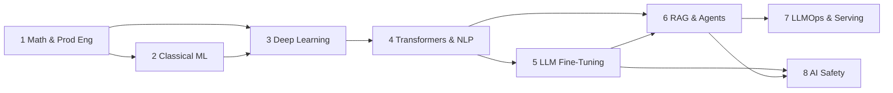

# The 60-Hour AI/LLM Engineering Syllabus

A source-backed, hands-on study path from mathematical foundations to production LLM systems.
Eight branches.
Sixty core hours.
Four milestone projects.
Every topic maps to a primary source, worked problems with full solutions, runnable code, and curated videos.

This site is the consolidated deliverable: Markdown sources for every branch live under `docs/`, and the site builds with MkDocs Material (`mkdocs.yml` at the repo root).

## How to use this syllabus

1. Read the branch overview (`index.md`) first — it lists the learning objectives, prerequisites, and an hour-by-hour schedule.
2. Study the teaching notes (`notes.md`) with the primary source open next to you. The notes summarize the source; they do not replace it.
3. Attempt every problem in `problems.md` on paper or in code **before** opening the solution blocks.
4. Pass the branch exit criteria (70% on problems, all coding exercises working) before moving on.
5. Build the milestone projects at their marked points. They turn knowledge into portfolio evidence.

Every hour is accounted for in the tables below.
If you skip a branch, note its prerequisites for later branches — the dependency arrows are real.

## Who this is for

You are a software engineer, data scientist, or researcher who wants production-grade LLM skills.

Assumed prerequisites:

- Fluent Python (functions, classes, packaging, virtual environments).
- Introductory linear algebra and calculus (vectors, matrices, derivatives). Branch 1 refreshes what you need.
- Basic NumPy and a first exposure to PyTorch or another tensor framework.
- Comfort with the command line.

If any prerequisite is shaky, spend a pre-week on the Branch 1 sources before starting the clock.

## The 60 hours at a glance

| # | Branch | Hours | Subtopics | Deliverable |
|---|--------|-------|-----------|-------------|
| 1 | [Mathematical Foundations & Production Engineering](branch-01-math-foundations/index.md) | 8 | 1.1 Vector calculus & linear algebra (3h) · 1.2 Probability, statistics & information theory (2h) · 1.3 High-performance Python & software engineering (3h) | Notes, 10 problems, profiling lab |
| 2 | [Classical Statistical & Machine Learning](branch-02-classical-ml/index.md) | 7 | 2.1 Supervised & unsupervised algorithms (4h) · 2.2 Optimization, validation & error diagnostics (3h) | Notes, 12 problems, tabular pipeline |
| 3 | [Deep Learning Foundations & Representation Learning](branch-03-deep-learning/index.md) | 8 | 3.1 Neural network fundamentals & autograd (3h) · 3.2 Optimization dynamics & training stability (2.5h) · 3.3 Computer vision & multimodal baselines (2.5h) | Notes, 10 problems, MLP + ViT labs |
| 4 | [Transformers & Modern NLP](branch-04-transformers-nlp/index.md) | 9 | 4.1 Tokenization & linguistic representation (2h) · 4.2 Transformer architecture deep dive (7h) | Notes, 12 problems, attention implementation |
| 5 | [LLM Engineering & Fine-Tuning](branch-05-llm-fine-tuning/index.md) | 9 | 5.1 Pre-training dynamics & architecture variants (2h) · 5.2 SFT & PEFT (3.5h) · 5.3 Alignment & preference optimization (3.5h) | Notes, 11 problems, LoRA + DPO labs |
| 6 | [RAG & Agentic Workflows](branch-06-rag-agents/index.md) | 8 | 6.1 Dense retrieval, embeddings & vector stores (2.5h) · 6.2 Advanced RAG architectures (3h) · 6.3 Function calling, tool use & agentic loops (2.5h) | Notes, 12 problems, hybrid RAG lab |
| 7 | [LLMOps, High-Throughput Serving & Systems](branch-07-llmops-serving/index.md) | 7 | 7.1 Inference mechanics & memory bottlenecks (4h) · 7.2 Serving engines & production stacks (3h) | Notes, 12 problems, vLLM + streaming lab |
| 8 | [AI Safety, Red Teaming & Governance](branch-08-ai-safety/index.md) | 4 | 8.1 Security & prompt hardening (2h) · 8.2 Bias, interpretability & evaluation benchmarks (2h) | Notes, 10 problems, guardrail lab |
| — | **Core total** | **60** | | |

Branch hours are weighted toward production-critical depth: the transformer deep dive (4.2), fine-tuning (5.2, 5.3), and inference mechanics (7.1) carry the largest single blocks.

## Dependency map

- Branch 1 compounds into everything else; do not skip 1.1 and 1.3.
- Branch 4 is the keystone. Budget extra time for 4.2.
- Branches 5 and 6 can run in either order after 4, but 6.3 assumes the fine-tuning vocabulary from 5.2.
- Branch 8 reads best after you have attempted an agentic system (6.3) and a fine-tune (5.2).

## Suggested schedules

### Intensive: 4 weeks × 15 hours

| Week | Focus | Hours |
|------|-------|-------|
| 1 | Branch 1 (8h) + start Branch 2 (7h) | 15 |
| 2 | Finish Branch 2, Branch 3 (8h) | 15 |
| 3 | Branch 4 (9h) + Branch 5 start (6h) | 15 |
| 4 | Finish Branch 5 (3h), Branch 6 (8h), Branch 7 (4h) | 15 |
| — | Branch 7 remainder (3h) + Branch 8 (4h) continue into a 5th short week, or fold projects into weeks 4-6 | 7 |

### Part-time: 8 weeks × 7.5 hours

| Week | Focus | Hours |
|------|-------|-------|
| 1 | Branch 1 | 8 |
| 2-3 | Branch 2, Branch 3 | 15 |
| 3-4 | Branch 4 | 9 |
| 5 | Branch 5 | 9 |
| 6 | Branch 6 | 8 |
| 7 | Branch 7 | 7 |
| 8 | Branch 8 + review + Project 1 kickoff | 4 |

### Working professional: 12 weeks × 5 hours

| Week | Focus |
|------|-------|
| 1-2 | Branch 1 |
| 2-3 | Branch 2 |
| 4-5 | Branch 3 |
| 5-7 | Branch 4 |
| 7-9 | Branch 5 |
| 9-10 | Branch 6 |
| 10-11 | Branch 7 |
| 12 | Branch 8 + consolidation |

## Milestone projects

These four projects convert the syllabus into portfolio artifacts.
They are **extensions beyond the 60 core hours** (estimate 10-20 hours each).
Start each one at the marked point.

| # | Project | Key tech | What it proves | Start after |
|---|---------|----------|----------------|-------------|
| 1 | From-scratch mini-transformer | Python, pure PyTorch, NumPy | You understand self-attention tensor mechanics, RoPE, and autograd backpropagation | Branch 4 |
| 2 | Domain-specific PEFT fine-tuning | HF TRL, Unsloth, QLoRA, DPO | You can construct instruction datasets, tune LoRA adapters, align preferences, and quantize parameters | Branch 5 |
| 3 | Production hybrid RAG engine | Qdrant/Milvus, BGE reranker, Ragas, FastAPI | You can implement hybrid search (dense + BM25), cross-encoder reranking, and automated evaluation | Branch 6 |
| 4 | High-throughput agentic service | vLLM, LangGraph, Pydantic, Langfuse | You can host models with continuous batching, execute structured tool calls, and trace agentic workflows | Branch 7 |

Full specifications with acceptance criteria appear in each branch's notes and in the project appendix at the end of this page.

## Assessment and progression gates

| Gate | Where | Passing bar |
|------|-------|-------------|
| Concept check | Each branch `problems.md`, Part A | 70% correct on paper before revealing solutions |
| Implementation check | Each branch `problems.md`, Part B | Reference behavior reproduced; tests pass if provided |
| Exit criteria | Each branch `index.md`, "Exit criteria" | Self-declared checklist all true |
| Milestone projects | Project appendix | Acceptance criteria listed per project |

Do not grade yourself on the solution code you just read — recompute on a blank page a day later.

## Project appendix

### Project 1 — From-scratch mini-transformer

Deliverable: a single repository that trains a character-level or BPE-level decoder-only transformer on a small corpus (TinyShakespeare or equivalent), with no `nn.Transformer` shortcuts.

Acceptance criteria:

- Multi-head self-attention implemented from raw `torch.Tensor` ops; shapes asserted in comments.
- RoPE (or learned positional embeddings) implemented and ablated against no-positional baseline.
- Training loop with AdamW, cosine schedule, gradient clipping, and mixed precision.
- Loss curve and sample generations in the README; one paragraph of analysis.
- A 5-minute walkthrough video or a written explanation of the attention math.

### Project 2 — Domain-specific PEFT fine-tuning

Deliverable: a LoRA/QLoRA fine-tune of an open instruct model (e.g., Llama 3.1 8B or Mistral 7B class) on a domain dataset you construct, followed by a preference-alignment pass.

Acceptance criteria:

- Dataset card: source, license, dedup method, train/val split, sample counts.
- SFT run with loss masking on prompts only; chat template applied consistently.
- DPO (or ORPO/KTO) run against a preference set; before/after win-rate on 50 held-out prompts scored by a judge model.
- Quantization comparison: base vs QLoRA memory and tokens/sec on your hardware.
- Adapter published or archived with reproducible command lines.

### Project 3 — Production hybrid RAG engine

Deliverable: a FastAPI service over a document corpus with hybrid retrieval, reranking, and automated evaluation.

Acceptance criteria:

- Ingestion pipeline: chunking strategy, embeddings, vector store (Qdrant or Milvus), metadata filtering.
- Hybrid search: BM25 + dense with reciprocal rank fusion, configurable weights.
- Cross-encoder reranking with a measured latency/quality tradeoff.
- Ragas (or equivalent) report: faithfulness, answer relevancy, context precision/recall on 100 question-answer pairs.
- Endpoint contract documented in OpenAPI; streaming answers.

### Project 4 — High-throughput agentic service

Deliverable: a vLLM-hosted model behind an agent service that executes tool calls and emits traces.

Acceptance criteria:

- vLLM deployment with continuous batching; benchmark report with TTFT, inter-token latency, and throughput at 3 concurrency levels.
- LangGraph agent with at least two tools, checkpointed state, and a human-in-the-loop approval step.
- Structured outputs validated with Pydantic; malformed tool calls retried with a bounded loop.
- Langfuse (or Phoenix) traces for 20 representative runs, plus a cost/latency dashboard screenshot.
- Written incident analysis: one observed failure mode and the guardrail that catches it.

## Sources, licenses, and freshness

- Primary sources are cited inline in every branch under "Key sources", with a verification date.
- Preferred sources are free to access: open textbooks, arXiv papers, official documentation, and university lecture playlists.
- Link checking: all URLs were verified live at authoring time (2026-10-16). Dead links get re-checked and corrected during the review loop.
- Respect licenses: books such as ISLR and Fluent Python are linked to their official free or paid locations; this site does not redistribute them.

## Review process

Each branch passed an independent review loop against the written checklist in `ACCEPTANCE.md` (repo root) before publication.
The review used a different model family (GLM-5.3 and GPT-6.1) as the reviewer than the one that drafted the content.
Reviewer verdicts drive a fix-and-recheck cycle; a branch ships only after it reaches PASS status.

Continue to [Branch 1 — Mathematical Foundations & Production Engineering](branch-01-math-foundations/index.md).
